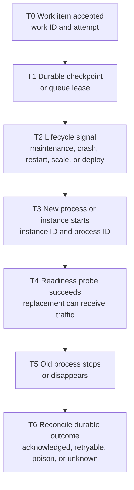

# Process Lifecycle and In-Flight Work

App Service can start, replace, recycle, or remove application processes for maintenance, recovery, configuration, scaling, and deployment. Replacement readiness protects routing, but it does **not** prove that an old process finished a request, that a runtime invocation succeeded, or that business work was durably committed.

## Main Content

### Keep three success claims separate

| Claim | What proves it | What it does not prove |
|---|---|---|
| Replacement is ready | A timestamped readiness probe succeeds on the new process or instance. | The old process completed its work. |
| Runtime invocation succeeded | The request or worker invocation has a terminal success record with its correlation and work-item ID. | The intended business state is durable unless the commit is independently verified. |
| Business work committed | A durable checkpoint, idempotency record, queue acknowledgement, or target-system read confirms the intended state. | That every earlier volatile step or log survived. |

An HTTP success recorded before termination can still precede a failed downstream commit. Conversely, a client disconnect does not prove that the server failed to commit. Reconcile by work-item ID against the durable system of record.

### Lifecycle paths are not interchangeable

| Lifecycle path | Confirmed platform behavior | Evidence that separates it | Work-loss statement |
|---|---|---|---|
| Maintenance: File Server role change | App Service performs a simultaneous overlapped process restart on active instances. The new process starts first; after it responds, existing requests have 30 seconds by default in the old process. | New and old process-start timestamps on the same instance identity, probe transition, and any Service Health or maintenance context available to the operator. | The overlap and drain window do not guarantee completion before the old process stops. |
| Maintenance: Worker role change or ASE v3 upgrade | App Service adds or updates capacity, starts the app, routes new requests to the replacement, and later removes the old worker. ASE v3 adds extra instances to retain capacity during upgrade. | Instance identity changes, startup and readiness timestamps, and ASE upgrade or Service Health records. | Replacement readiness does not preserve in-memory state from the removed worker. |
| App crash or out-of-memory termination | The app process exits unexpectedly; the cause must be established from runtime, crash, memory, and platform evidence. | Exit or crash record, memory trend or dump, abrupt log boundary, then a later process-start record. | A nearby restart alone does not prove crash, OOM, maintenance, or which work item was lost. |
| Configured restart | A restart action or configuration change can start a new process lifecycle. | Azure Activity Log operation or configuration timestamp aligned with process stop/start and probe evidence. | A controlled restart tests application recovery only; it does **not** reproduce an ASE maintenance mechanism. |
| Scale-out or scale-in | Scale-out introduces another instance; scale-in removes capacity. Do not infer a guaranteed shutdown signal or drain duration without environment-specific evidence. | Autoscale or Activity Log record, instance-set snapshots, instance identity, and per-instance probes. | Work held only in memory on a removed instance is not durable. |
| Deployment or slot swap | Deployments and configuration application can restart workers. During a swap, former production workers are recycled after moving to staging, and Microsoft Learn warns that long-running operations there are abandoned. | Deployment ID and timestamps, slot-swap Activity Log, artifact version, process identity, and readiness probes. | Seamless traffic routing during swap is not a guarantee that background work in a recycled process completes. |

Do not label a restart as maintenance merely because its time is near a suspected maintenance window. First confirm the process or instance transition; then use maintenance, management-plane, deployment, scale, and application evidence to classify the initiating path. If that evidence is absent, record the initiator as **unknown**, not maintenance.

### Build a timestamped identity and probe timeline

Use UTC with enough precision to order events. Record both process identity and `WEBSITE_ROLE_INSTANCE_ID` where the runtime exposes it; an unchanged instance ID can still contain an old and a new process during overlapped recycle.

<!-- diagram-id: process-lifecycle-evidence-timeline -->

A useful incident timeline contains rows like these; replace the example times with observed timestamps and never infer missing rows:

| UTC time | Identity and probe event | Correlated work evidence | Interpretation |
|---|---|---|---|
| `12:00:00.000` | Instance `A`, process `101` accepts work; readiness is healthy. | Work `W-42`, attempt `1`, acknowledgement absent. | Work started; durable completion is not proven. |
| `12:00:03.200` | Lifecycle initiator record appears. | Checkpoint `step-2` is committed. | Classify the initiator only from its own evidence source. |
| `12:00:05.100` | Instance `A` process `202`, or replacement instance `B`, logs startup. | No new acknowledgement yet. | A second identity distinguishes overlap or replacement from uninterrupted execution. |
| `12:00:07.400` | Replacement readiness probe succeeds. | Work `W-42` remains unacknowledged. | Routing readiness is confirmed; old-work outcome remains unknown. |
| `12:00:10.800` | Old process stop or last heartbeat. | Queue visibility or retry state changes. | Correlate, but do not claim causation without a terminal work record. |
| `12:00:12.300` | Replacement remains healthy. | Attempt `2` reads checkpoint `step-2`, commits result, and acknowledges `W-42`. | Durable completion is confirmed; duplicate-safe replay can be assessed. |

### Collect evidence in four linked layers

1. **Runtime start and stop**
    - Emit UTC startup, shutdown-handler entry, shutdown-handler exit, runtime version, artifact version, process ID, and a random per-process boot ID.
    - Treat a missing stop record as ambiguous: abrupt termination, logging failure, and retention gaps remain competing explanations.
2. **Process and instance identity**
    - Add the boot ID, process ID, and available App Service instance identity to every request, probe, and work-item log.
    - Snapshot the active instance set around scale or maintenance investigation. Do not treat `WEBSITE_ROLE_INSTANCE_ID` as a process identifier.
3. **Request and dependency correlation**
    - Preserve request ID, trace ID, route, start/end timestamps, response status, dependency attempt, dependency result, and deployment version.
    - Keep client, frontend, application, and dependency clocks in UTC and note clock uncertainty.
4. **Work-item acknowledgement and checkpoint**
    - Record a stable work ID, attempt number, dequeue or lease metadata, checkpoint version, side-effect idempotency key, acknowledgement time, and poison/dead-letter disposition.
    - Reconcile accepted items against committed results and pending/retry/dead-letter stores after the lifecycle event.

These layers let an investigator say, for example, “a replacement became ready and the old process disappeared; work `W-42` had no acknowledgement and later retried from checkpoint `step-2`.” They do not justify “maintenance lost the work” unless the initiator and causal mechanism are also proven.

### Design in-flight work for interruption

- Make work items small enough to finish inside the application's normal bounded execution budget; no App Service lifecycle mechanism promises unlimited execution time.
- Assign a stable idempotency key and make every externally visible side effect safe to repeat. Use uniqueness constraints, compare-and-set, upsert, or an inbox/outbox record instead of a check followed by an unprotected write.
- Commit durable checkpoints at business-safe boundaries. A file under `/home` can persist across many App Service restarts, but shared-file persistence is not a transactional queue, lease, or exactly-once guarantee; use a database, object store, or messaging service appropriate to the consistency requirement.
- Acknowledge or delete a queue item only after the durable business commit succeeds. Renew visibility or locks while processing when the selected service supports it.
- Reconcile accepted IDs against durable completion records. Alert on aged invisible/locked items, repeated delivery, checkpoint stalls, and poison or dead-letter growth.

Queue semantics are service-specific; “use a queue” is not a complete resilience design:

| Service pattern | Visibility, retry, and terminal handling caveat |
|---|---|
| App-managed Azure Queue Storage consumer | The application owns receive visibility, lease extension, delete-after-commit, retry count policy, and poison-queue convention. Queue Storage itself does not create a Service Bus-style dead-letter subqueue. |
| Azure Functions Queue Storage trigger | The Functions host uses Queue Storage visibility. By default it attempts a message up to five times including the first attempt, then writes it to `<queue>-poison`; failed execution uses the configured `visibilityTimeout`, while a host crash leaves the service-defined 10-minute invisibility. These are Functions binding semantics, not generic App Service guarantees. |
| Azure Service Bus consumer | Lock duration, renewal, delivery count, duplicate detection, sessions, and dead-letter behavior depend on the entity and client configuration. Verify the selected tier and current Service Bus limits before setting a maximum work-item duration. |

### Use shutdown as a bounded optimization, not the durability boundary

Implement the runtime and hosting model's supported shutdown callback: stop taking new background items, mark readiness unhealthy only when that behavior matches the routing design, allow already-started short work to finish, flush bounded telemetry, and close dependencies. Keep every step time-bounded and safe if the callback never arrives or is cut short.

The documented maintenance sequence provides a 30-second default completion period for existing requests during the specific File Server overlapped-restart path. That number is not a universal shutdown allowance for crash, OOM, scale-in, deployment, Windows, Linux, containers, or ASE upgrades. `WEBSITES_CONTAINER_START_TIME_LIMIT`, `WEBSITE_WARMUP_PATH`, and `WEBSITE_WARMUP_STATUSES` govern startup and readiness; they do not extend old-process execution. This page therefore makes no generic promise that Linux receives `SIGTERM`, that Windows receives a particular notification, or that either OS receives an unlimited drain interval for every lifecycle path.

### Functions scheduling is a separate contract

For Functions-specific Timer Trigger, queue-trigger, hosting-plan, and long-running processing semantics, use the [Azure Functions Practical Guide](https://github.com/yeongseon/azure-functions-practical-guide) together with the Microsoft Learn trigger references. Do not project those trigger guarantees onto a background loop hosted directly in App Service.

`IsPastDue` (Python: `past_due`) means the current timer invocation is later than scheduled. It does **not** mean that Azure resumed an interrupted Python frame. After process loss, the prior interpreter stack, local variables, and in-memory progress are gone. A later invocation starts application code again; only application or framework state that was durably checkpointed can be recovered. The timer trigger also does not retry a failed invocation by default. If resumable orchestration is required, choose a durable workflow model and design explicit activity boundaries rather than treating a delayed timer as continuation.

### Controlled volatile-versus-durable experiment status

**Status: NOT_RUN.** No Azure resources were created and no volatile-versus-durable outcome is claimed for this page. The proposed Linux B1 controlled-restart experiment was intentionally not executed within this change because producing deployment, timestamp, sanitation, teardown, and review-ready provenance safely did not fit the allotted implementation window.

A future experiment may compare an in-memory queue with a durable checkpoint across `az webapp restart`, but it must remain labeled an application recovery test. A controlled restart does **not** reproduce File Server maintenance, Worker replacement, or an App Service Environment maintenance mechanism. Until an executed lab records its environment, timestamps, plan SKU at start and end, sanitized artifacts, sample size, and resource-group deletion proof, the outcome remains **NOT_RUN**.

### Diagnostic routing decision

No separate playbook is added for this concept. The reported symptom (“work is missing near a restart”) does not identify one failure mode: maintenance, crash/OOM, configured restart, scaling, deployment, queue redelivery, and an uncommitted side effect remain competing hypotheses. The timeline and evidence method above is the symptom-first diagnostic needed to separate them without duplicating a numbered playbook. The [playbook index](../troubleshooting/playbooks/index.md#process-lifecycle-and-missing-work) links directly to this diagnostic section.

## See Also

- [Request Lifecycle](./request-lifecycle.md)
- [Reliability Best Practices](../best-practices/reliability.md)
- [Troubleshooting Playbooks](../troubleshooting/playbooks/index.md)
- [Azure Functions Practical Guide](https://github.com/yeongseon/azure-functions-practical-guide)

## Sources

- [Routine maintenance, restarts, and downtime in App Service](https://learn.microsoft.com/en-us/azure/app-service/routine-maintenance-downtime)
- [Set upgrade preference for App Service Environment planned maintenance](https://learn.microsoft.com/en-us/azure/app-service/environment/how-to-upgrade-preference)
- [Set up staging environments in App Service](https://learn.microsoft.com/en-us/azure/app-service/deploy-staging-slots)
- [App Service environment variables and app settings reference](https://learn.microsoft.com/en-us/azure/app-service/reference-app-settings)
- [Azure Queue Storage trigger for Azure Functions](https://learn.microsoft.com/en-us/azure/azure-functions/functions-bindings-storage-queue-trigger)
- [Timer trigger for Azure Functions](https://learn.microsoft.com/en-us/azure/azure-functions/functions-bindings-timer)
- [Designing Azure Functions for identical input](https://learn.microsoft.com/en-us/azure/azure-functions/functions-idempotent)
