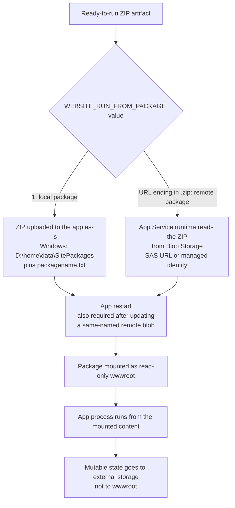

# Run From Package

Run From Package changes what "deployed" means on Azure App Service: instead of copying files into a writable `wwwroot`, App Service mounts the deployment ZIP itself as a read-only `wwwroot`. This page explains how the package is activated, what that implies for the file system, and which behaviors Microsoft Learn does not document. For the commands, see [ZIP Deploy and Run From Package](../operations/deployment/zip-deploy.md); for choosing a method, see [Deployment Options](deployment-options.md).

## Main Content

### Where Run From Package fits

With other file-based deployment methods, deployed files reside in `D:\home\site\wwwroot` on Windows or `/home/site/wwwroot` on Linux. Because the running app uses that same directory, deployment can fail on file lock conflicts, and the app can run with a partly updated file set.

Run From Package separates the two concerns. The ZIP is treated as the unit of deployment *and* the unit of execution, so there is no extraction step into `wwwroot`.

| Aspect | Standard ZIP Deploy | Run From Package |
|---|---|---|
| What lands on the app | Extracted files in `wwwroot` | The ZIP file itself |
| `wwwroot` at runtime | Writable | Read-only mount of the package |
| Build automation | Optional, enabled by `SCM_DO_BUILD_DURING_DEPLOYMENT=true` | Not applicable; the ZIP must already be ready to run |
| Deployment and runtime sharing a directory | Yes, so lock conflicts are possible | No, per Microsoft Learn lock conflicts between deployment and runtime are eliminated |
| Deploy to a production app | Yes | Yes, with a restart |

### Activation flow

The `WEBSITE_RUN_FROM_PACKAGE` value selects where the package comes from. Both branches end at the same read-only mount.

<!-- diagram-id: run-from-package-activation-flow -->

### Local package activation

Setting `WEBSITE_RUN_FROM_PACKAGE=1` makes the app run a ZIP package local to the app. When you deploy with `az webapp deploy`, App Service does not extract the ZIP. On Windows it stores the file as-is in `D:\home\data\SitePackages` and creates a `packagename.txt` in the same directory that names the package to load at runtime. The deploy command also restarts the app, and App Service then mounts the package as the read-only `wwwroot`.

If you upload a package some other way, such as FTP, you must create the `D:\home\data\SitePackages` directory and the `packagename.txt` file yourself.

!!! note "Windows-only path details"
    Microsoft Learn documents `SitePackages` and `packagename.txt` for Windows paths. It does not document an equivalent backing path for Linux. On Linux, rely only on the documented outcome: the package is mounted as the read-only `wwwroot`.

    In the [Missing wwwroot Content lab](../troubleshooting/lab-guides/missing-wwwroot-content.md), a Linux Node.js 20 code app showed `/home/data/SitePackages` with a `packagename.txt` and a read-only `fuse-zip` mount of `wwwroot`. Treat that as an observation from one run, not a documented guarantee. The same lab found that a deployment submitted immediately after enabling the setting did not produce a mount, so verify the mount instead of trusting the setting value.

### Remote package activation

Instead of `1`, you can set `WEBSITE_RUN_FROM_PACKAGE` to the URL of a ZIP file, such as a blob in Azure Blob Storage. The URL must end in `.zip`. Microsoft Learn recommends a private storage container, accessed either with a Shared Access Signature (SAS) or with a managed identity, so the App Service runtime can read the package securely.

| Access method | What you configure |
|---|---|
| SAS URL | Set `WEBSITE_RUN_FROM_PACKAGE` to the blob URL that includes a SAS token |
| System-assigned managed identity (default) | Keep the blob private, grant the app identity the `Storage Blob Data Reader` role scoped to the package blob, and set `WEBSITE_RUN_FROM_PACKAGE` to the plain blob URL |
| User-assigned managed identity | Same as above, plus set `WEBSITE_RUN_FROM_PACKAGE_BLOB_MI_RESOURCE_ID` to the identity's resource ID; the value `SystemAssigned` is the same as omitting the setting |

Two documented behaviors matter operationally:

- If you publish an updated package with the same name to Blob Storage, you must restart the app for the updated package to be loaded.
- An existing App Service resource that runs a local ZIP package cannot be migrated to a remote ZIP package. Create a new App Service resource configured to run from an external URL.

For cold-start performance, Learn advises using the local ZIP option (`WEBSITE_RUN_FROM_PACKAGE=1`). Reachability of the storage account follows the layers described in [App Service to Azure Storage connectivity](storage-connectivity.md).

### Build and runtime compatibility

The mounted package is what runs, so it has to be complete before it is uploaded.

- Run the build tasks (for example `npm`, `bower`, `gulp`, `composer`, `pip`, or `dotnet publish`) before creating the ZIP, and include everything the app needs to run.
- Do not include a root directory in the ZIP. Include only the files and directories inside the project root; a GitHub "Download ZIP" archive adds a nested top-level directory and does not work as-is.
- Build-on-deploy is a different path. `SCM_DO_BUILD_DURING_DEPLOYMENT=true` enables build automation for standard ZIP deploy. Learn does not describe it as a step that runs after a package is mounted, so do not combine a source-tree ZIP with Run From Package.

| Runtime | Documented status |
|---|---|
| Python apps | Not supported. Deploy a ZIP with build automation enabled so Azure creates the virtual environment and installs requirements |
| Java apps on Azure App Service | Not supported. Built-in Java runtimes (Java SE, Tomcat, JBoss EAP) require write access to the app directory at startup, while Run From Package mounts content read-only |
| Other code runtimes | Learn publishes no exhaustive support list, so verify the runtime's current requirements instead of inferring one from a single OS or language |

### Runtime file-system contract

Because `wwwroot` is read-only, an app that tries to write there receives an error. Treat the deployment directory as immutable content and move mutable state elsewhere.

- Store uploads, generated files, caches, and session state in Azure Storage, a database, or another external service.
- For WebJobs, either include them in the same ZIP under `app_data\jobs\...`, or deploy them separately to `\site\jobs\...`, which is not read-only. WebJobs under both `\site\wwwroot\app_data\jobs\...` and `\site\jobs\...` run.
- Operations that create files under `\site\wwwroot`, such as creating a `disable.job`, fail while `wwwroot` is read-only.

### Scale-out and deployment slots

Microsoft Learn documents the package-level guarantee: the app runs only fully deployed content, and deployment does not conflict with files in use. It does not document how every instance of a scaled-out app switches to a new package, or that the switch is simultaneous.

For slots, the documented behavior comes from the general slot swap process. During a swap, App Service warms up the source slot's instances before it switches routing rules, and settings marked as slot-specific do not move with the app. `WEBSITE_RUN_FROM_PACKAGE` is an ordinary app setting, so decide deliberately whether it should follow the content in a swap or stay with its slot, especially when its value is a slot-specific remote URL.

!!! warning "Direct-to-production deployment restarts the app"
    Deploying to a production app with Run From Package restarts the app. Use [deployment slots](../operations/deployment/slots-and-swap.md) with warm-up when you need a seamless release.

### Limits and failure modes

| Limit or failure | What Microsoft Learn documents |
|---|---|
| Package format | ZIP only; TAR and GZIP are not supported |
| Package size | At most 1 GB (standard ZIP Deploy has a separate, larger limit documented in the ZIP deploy article) |
| Local cache | Not compatible with Run From Package |
| Write to `wwwroot` | The app receives an error |
| Wrong package layout | A ZIP with a nested root directory does not work; include only the contents of the project root |
| Remote package not picked up | Updating a same-named blob requires an app restart. Access is through a SAS URL or an identity with the `Storage Blob Data Reader` role; Learn does not enumerate other remote-load failure causes |

### What is not documented

These are commonly assumed but not stated by Microsoft Learn. Do not present them as platform guarantees.

| Assumption | Status |
|---|---|
| Every scaled-out instance activates a new package at the same moment | Not documented |
| A slot swap moves `packagename.txt` or a package pointer in a specific way | Not documented; only the general swap and warm-up behavior is documented |
| Run From Package works with Oryx build-on-deploy after the mount | Not documented; the package must be ready to run |
| Run From Package makes every app start faster | Not documented; Learn says it *may* reduce cold-start times, particularly for JavaScript functions with large npm package trees |
| A Linux-equivalent of the Windows `SitePackages` path | Not documented by Learn; observed once in a lab, see the note under local package activation |
| Linux support is limited to Node.js and .NET | Not documented; only Python and Java apps are explicitly excluded |

### Selection summary

| Situation | Choice |
|---|---|
| Fully built ZIP, supported runtime, you want a read-only, fully deployed package | Run From Package with a local package (`WEBSITE_RUN_FROM_PACKAGE=1`) |
| Fully built ZIP that must be fetched from a central store | Run From Package with a remote package and managed identity or SAS |
| Source tree that needs dependency restore or build on the platform | Standard ZIP Deploy with build automation |
| Python app | Standard ZIP Deploy with build automation |
| Java app | Java-specific deployment (WAR, JAR, or EAR), not Run From Package |

## See Also

- [Deployment Options](deployment-options.md)
- [Deployment Scenarios](deployment-scenarios.md)
- [Kudu Overview](kudu-overview.md)
- [App Service to Azure Storage connectivity](storage-connectivity.md)
- [ZIP Deploy and Run From Package (operations)](../operations/deployment/zip-deploy.md)
- [Deployment Slots and Swap (operations)](../operations/deployment/slots-and-swap.md)
- [Deployment failures playbook](../troubleshooting/playbooks/deployment-failures.md)
- [Lab: Missing wwwroot Content Timeline and Run From Package](../troubleshooting/lab-guides/missing-wwwroot-content.md)

## Sources

- [Run your app from a ZIP package (Microsoft Learn)](https://learn.microsoft.com/en-us/azure/app-service/deploy-run-package)
- [Deploy files to App Service (Microsoft Learn)](https://learn.microsoft.com/en-us/azure/app-service/deploy-zip)
- [Set up staging environments in Azure App Service (Microsoft Learn)](https://learn.microsoft.com/en-us/azure/app-service/deploy-staging-slots)
