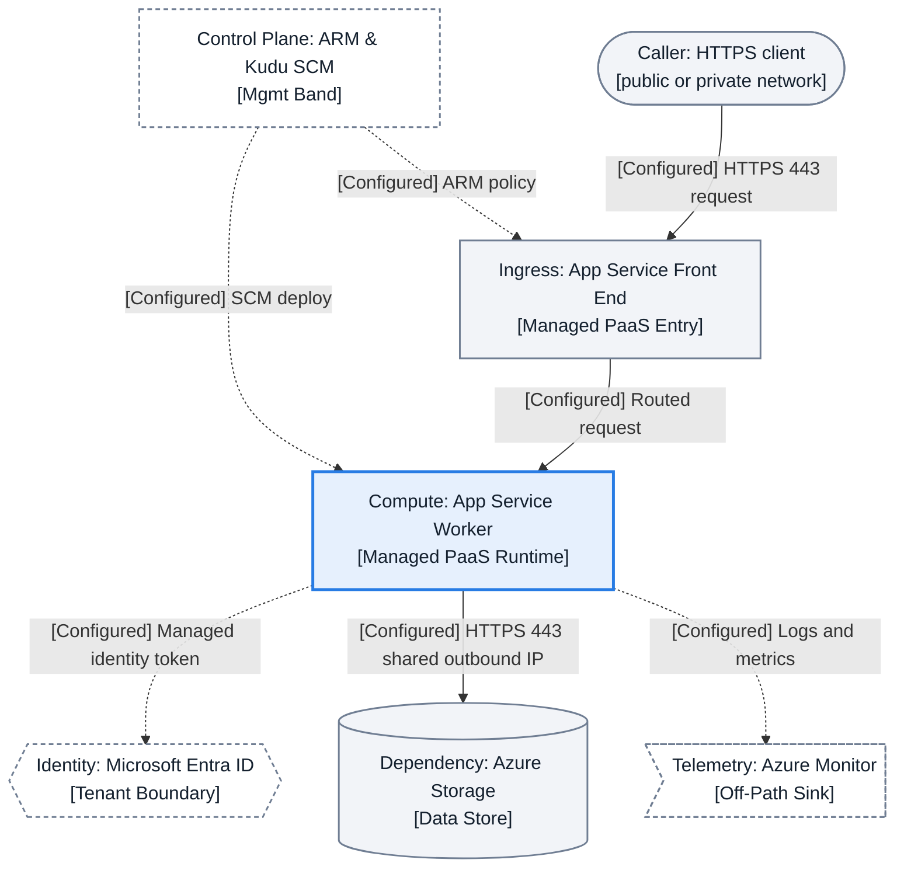
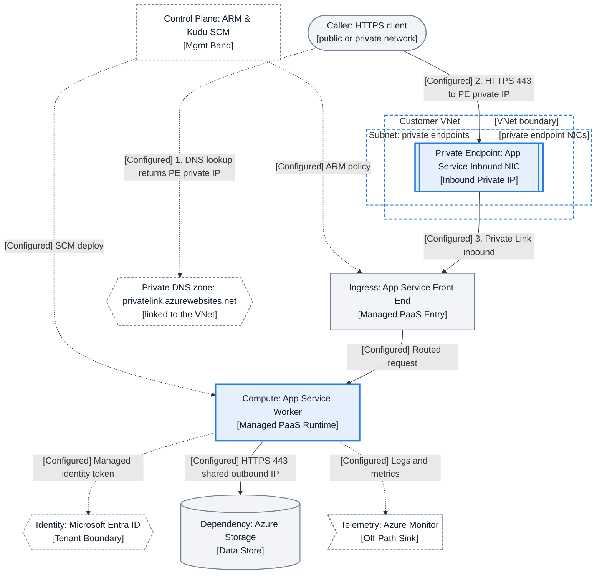
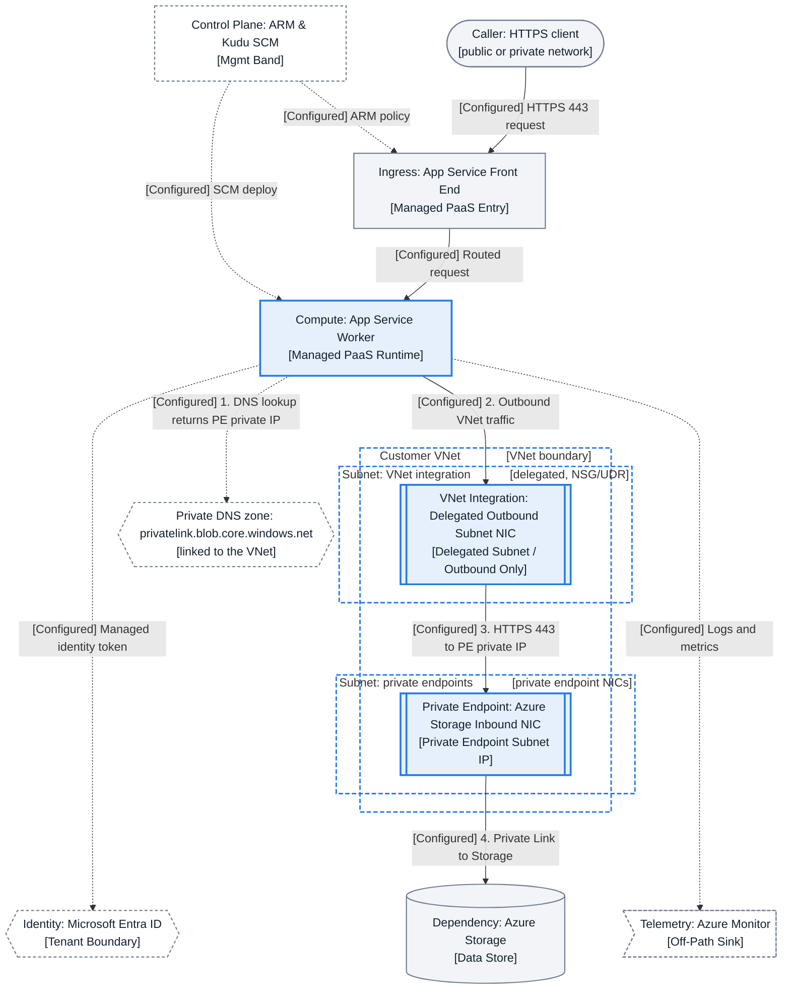
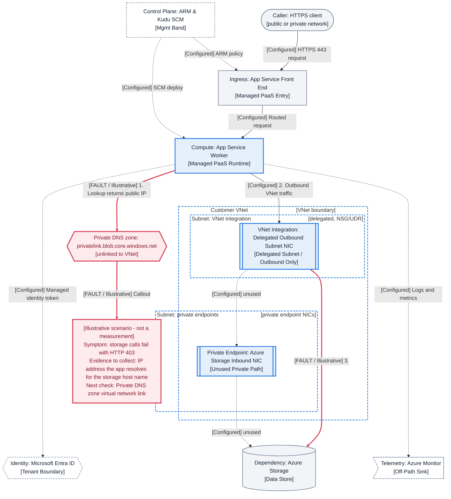
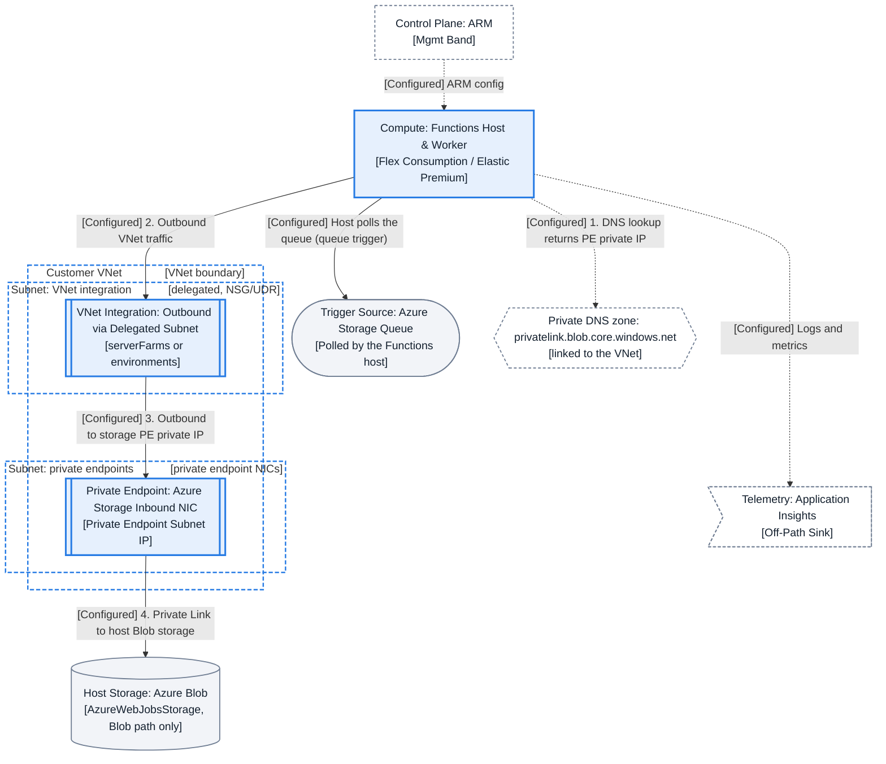
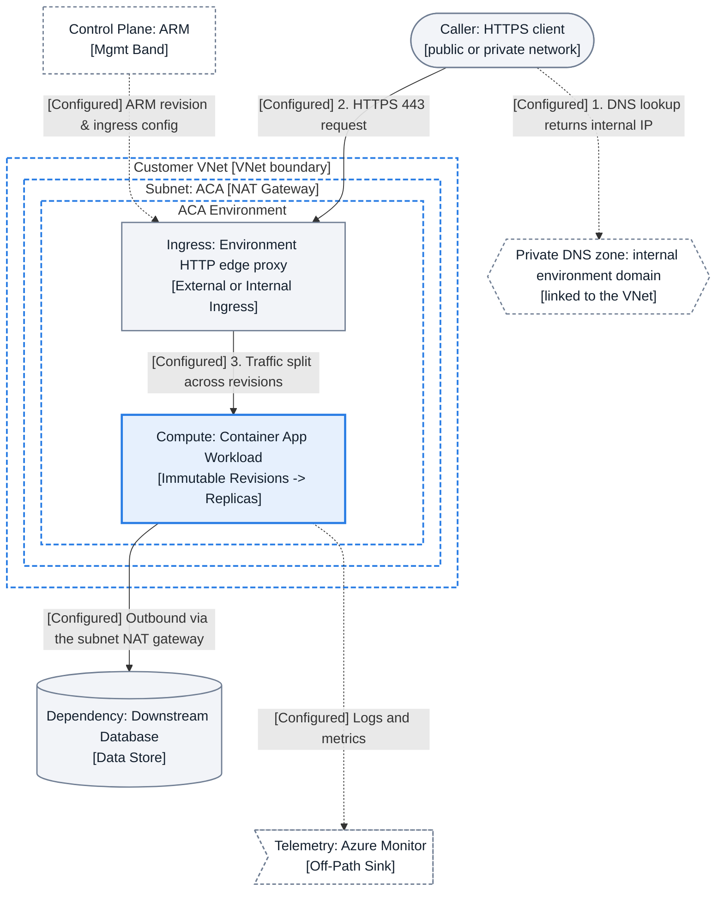

# Azure Topology Visual Grammar (v1)

## 1. Status and Scope

- **Version and state:** `grammar v1` — **Proposed** shared visual and semantic topology contract across the practical guide series.
- **Contract role:** Tool-neutral visual and semantic specification consumed by the App Service composition prototype ([#283](https://github.com/yeongseon/azure-app-service-practical-guide/issues/283)) and aligned with sibling topology work in Azure Functions ([#211](https://github.com/yeongseon/azure-functions-practical-guide/issues/211)) and Azure Container Apps ([#401](https://github.com/yeongseon/azure-container-apps-practical-guide/issues/401)). Sibling issues are referenced as links only; this page makes no claim about the implementation or verification state of other repositories.
- **What this contract is NOT:** It does not introduce a rendering engine, a site-wide diagram migration, a new diagram-as-code framework, or a pixel-grid mandate. Existing inline Mermaid diagrams remain governed by the [Diagram Inventory](diagram-inventory.md) and [Composition ADR](adr-diagram-composition.md).

## 2. Reading Order and Layout Regions

1. **Primary Request and Data Spine:** Follows the logical reading order **caller/external source -> entry/ingress -> hosted compute/runtime -> downstream dependencies**. Arrow direction always follows the connection initiator whereas reading order follows logical flow, so the two may differ for pull-based polling triggers.
2. **Management and Control Plane Band:** Placed in a separate upper band (`management.azure.com` / Azure Resource Manager and Kudu/SCM deployment endpoints) so administrative operations never masquerade as data-plane traffic.
3. **Observability Band:** Placed off the request path for Azure Monitor, Log Analytics, and Application Insights sinks.
4. **Failure and Evidence Overlay:** Anchored directly to the affected node or edge, pairing the symptom with the evidence to collect and next diagnostic check.
5. **Default vs explicit physical orientation:** While conceptual architecture boards often read left-to-right, `DOCUMENTATION_CONTRACT.md` (§Diagram Orientation Rule) mandates top-down (`flowchart TD`) for sequential flows with 5+ nodes and for all layered architectures to prevent horizontal overflow. In `flowchart TD` realizations, the logical reading order maps top-to-bottom: **Upper band** (`control_plane`, `client`) -> **Entry band** (`ingress`) -> **Compute band** (`app_runtime`) -> **Downstream and off-path band** (`identity`, `storage_db`, `telemetry`).

## 3. Resource and Responsibility Boundaries

| Boundary Type | Azure Scope / Examples | Containment and Placement Rules |
|---|---|---|
| **Administrative** | Subscription, Resource Group | Scopes RBAC, policy, and lifecycle operations via `management.azure.com` (Azure public cloud; [Control plane and data plane](https://learn.microsoft.com/en-us/azure/azure-resource-manager/management/control-plane-and-data-plane)). Does not isolate network traffic. |
| **Network** | Virtual Network (`vnet`), Subnet (`subnet`) | Nests `Customer VNet ⊃ Subnet ⊃ NIC` only for factual containment; never put CIDR sizes (`/27`, `/28`, `/23`) in a container title. Subnet policy (`[NSG/UDR apply]`) is a tag on the subnet header; a UDR is routing policy, never a node. A NAT Gateway is an outbound SNAT service associated with subnets that needs no route table entry and is not a UDR next hop type, so it is drawn as a subnet tag (`[NAT Gateway]`), not as a hop ([NAT Gateway resource](https://learn.microsoft.com/en-us/azure/nat-gateway/nat-gateway-resource), [NAT Gateway overview](https://learn.microsoft.com/en-us/azure/nat-gateway/nat-overview)). Only a firewall or network virtual appliance reached through a UDR `Virtual appliance` next hop is a routed hop, drawn in its own subnet ([User-defined routes](https://learn.microsoft.com/en-us/azure/virtual-network/virtual-networks-udr-overview)). |
| **Managed Platform** | App Service scale unit, Functions host, Container Apps environment | In multitenant App Service, all roles exist in a multitenant network outside customer containers; App Service Environment (ASE) is the single-tenant option deployed in your VNet ([App Service networking features](https://learn.microsoft.com/en-us/azure/app-service/networking-features)). |
| **Customer Application** | Web app code, slot, Function code, Container App revision | Workload artifact running on the managed compute boundary; inherits network paths from its hosting plan or environment. |

- **PaaS resource vs Private Endpoint (`private-endpoint`) vs VNet integration (`vnet-integration`):** A Private Endpoint is a network interface in a customer subnet for **inbound** calls to a PaaS resource; never draw the App Service inside the Private Endpoint subnet ([Use Private Endpoints for App Service apps](https://learn.microsoft.com/en-us/azure/app-service/overview-private-endpoint)). Regional VNet integration is **outbound-only**, grants no inbound private access, and requires a dedicated subnet ([Integrate your app with an Azure virtual network](https://learn.microsoft.com/en-us/azure/app-service/overview-vnet-integration)); the integration feature cannot use the same subnet as the Private Endpoint ([Use Private Endpoints for App Service apps](https://learn.microsoft.com/en-us/azure/app-service/overview-private-endpoint)); the integration subnet is delegated to `Microsoft.Web/serverFarms` for App Service (Dedicated) and Elastic Premium plans ([Azure Functions networking options](https://learn.microsoft.com/en-us/azure/azure-functions/functions-networking-options)).
- **Private DNS zone placement (grammar drawing convention):** An Azure Private DNS zone is linked to virtual networks via virtual network links ([Azure Private DNS Zone Overview](https://learn.microsoft.com/en-us/azure/dns/private-dns-privatednszone)). Derived from this linking model, this grammar draws each Private DNS zone as its own node **outside** every VNet and subnet container (`[linked to the VNet]`).
- **Main site vs SCM access boundary:** Access restrictions run in the App Service front-end roles upstream of the workers; the main site (`ipSecurityRestrictions`) and SCM site (`scmIpSecurityRestrictions`) can have separate rule sets or the SCM site can reuse main-site rules ([App Service access restrictions](https://learn.microsoft.com/en-us/azure/app-service/app-service-ip-restrictions)). For a Private Endpoint, the access restriction rules of your app aren't evaluated for traffic through the private endpoint, and DNS zone `privatelink.azurewebsites.net` holds records for `<app>` and `<app>.scm` ([Use Private Endpoints for App Service apps](https://learn.microsoft.com/en-us/azure/app-service/overview-private-endpoint)).
- **Container Apps boundary discipline:** Distinguish documented customer-visible layers — Container Apps environment deployed into an environment subnet, environment HTTP proxy ingress, container app, and immutable `revisions` running `replicas` — from undocumented cluster internals ([Compute and billing structures](https://learn.microsoft.com/en-us/azure/container-apps/structure), [Revisions in Azure Container Apps](https://learn.microsoft.com/en-us/azure/container-apps/revisions)).

## 4. Component Vocabulary

| Canonical ID | Mermaid ID | Boundary Role | Mermaid Shape & Container Convention | Canonical Label Pattern |
|---|---|---|---|---|
| `client` | `client` | External / Private Caller | Stadium `(["..."])` | `Caller: HTTPS client [public or private network]` |
| `dns` | `dns` / `dns_*` | External Name Resolution | Hexagon `{{"..."}}` outside VNet | `Private DNS zone: <zone> [linked to the VNet]` |
| `vnet` | `vnet_*` | Outer Network Container | `subgraph vnet_*["Customer VNet"]` | `Customer VNet` |
| `subnet` | `subnet_*` | Nested Subnet Container | `subgraph subnet_*["Subnet: ..."]` inside VNet | `Subnet: <role> [delegated / NSG/UDR apply]` |
| `nsg-udr` | *(subnet tag)* | Subnet Policy Marker | Tag `[NSG/UDR apply]` in subnet title; never a node | `Subnet: <role> [NSG/UDR apply]` |
| `ingress` | `ingress` | Managed Entry | Rectangle `["..."]` | `Ingress: <front end or proxy> [entry]` |
| `private-endpoint` | `private_endpoint` / `pe_*` | Subnet NIC (Inbound) | Subroutine `[["..."]]` inside PE subnet | `Private Endpoint: <target> NIC [private IP]` |
| `vnet-integration` | `vnet_integration` | Delegated Subnet NIC (Outbound) | Subroutine `[["..."]]` inside delegated subnet | `VNet Integration: delegated NIC [outbound]` |
| `nat-gateway` | *(subnet tag)* | Subnet-Associated Outbound SNAT | Tag `[NAT Gateway]` in subnet title; never a node or a UDR target | `Subnet: <role> [NAT Gateway]` |
| `firewall-nva` | `firewall_nva` | Routed Egress Hop (UDR `Virtual appliance` next hop) | Parallelogram `[/"..."/]` inside its own subnet | `Firewall/NVA: <name> [UDR next hop]` |
| `app-runtime` | `app_runtime` | Managed Compute | Rectangle `["..."]` | `Compute: <worker or app> [managed runtime]` |
| `identity` | `identity` | Tenant Trust Boundary | Hexagon `{{"..."}}` | `Identity: Microsoft Entra ID [token]` |
| `key-vault` | `key_vault` | Secret Store Dependency | Cylinder `[("...")]` | `Secrets: Azure Key Vault [vault]` |
| `storage-db` | `storage_db` | Data Store Dependency | Cylinder `[("...")]` | `Dependency: Azure Storage [data store]` |
| `telemetry` | `telemetry` | Off-Path Observability | Asymmetric `>"..."]` | `Telemetry: Azure Monitor [off-path sink]` |
| `control-plane` | `control_plane` | Upper Management Band | Rectangle `["..."]` | `Control Plane: ARM & Kudu SCM [mgmt band]` |

**Icon and naming rules:** Generic concepts (`client`, generic `ingress`, generic `telemetry`) use geometric shapes, never product logos. Where a tool supports official Azure icons, Microsoft permits use in architectural diagrams, training materials, or documentation: "Don't crop, flip, or rotate icons", "Don't distort or change icon shape in any way", and "Use the icons as they would appear within Azure"; adding the product name near the icon is recommended ([Azure Architecture Icons](https://learn.microsoft.com/en-us/azure/architecture/icons/)). This grammar adds two requirements of its own, which are not Microsoft rules: one icon scale for the same service across guides, and no recoloring of product icons. Because Mermaid `10.9.1` flowcharts do not bundle Azure icon packs, fixtures here use geometric shapes with bracketed role tags.

## 5. Edge and Legend Contract

Every semantic relationship uses a single-headed directional arrow (`-->`, `-.->`, or `==>`) pointing from the initiating component to the target. Arrow direction = connection initiator; reading order = logical flow (for pull-based polling triggers, the runtime initiates the poll toward the event source). **Unconstrained bidirectional arrows (`<-->`) and false layout-steering semantic edges are forbidden.** Model a DNS lookup as **one** arrow from the querying component to the DNS node with the resolution result in its label.

| Claim Prefix | Allowed Scope and Meaning |
|---|---|
| `[Configured]` | Documented or intended architectural flow, configuration, or telemetry sink (`Logs and metrics`). |
| `[Illustrative]` | Teaching placeholder for a symptom or diagnostic check in a reference fixture where no retained run artifact exists. |
| `[Inferred]` | Competing diagnostic explanation or hypothesis derived from multiple observations. |
| `[Observed]` | **RESERVED** for diagrams backed by a named retained lab/troubleshooting artifact. **No fixture on this page may use `[Observed]`.** |

| Edge Purpose | Mermaid Syntax | Line Pattern & Weight | Allowed Claim Prefix | Semantic Rule |
|---|---|---|---|---|
| `request/data` | `A -->\|"[Configured] HTTPS 443"\| B` | Solid (`2px`), single arrowhead | `[Configured]` / `[Observed]` | Synchronous data transport from caller/initiator to target. |
| `event/message` | `A -->\|"[Configured] Poll trigger"\| B` | Solid (`2px`), single arrowhead | `[Configured]` / `[Observed]` | Push delivery or pull-based polling (arrow points from poller to source). |
| `dns-lookup` | `A -.->\|"[Configured] DNS lookup returns PE IP"\| dns` | Dotted (`2px`), single arrowhead | `[Configured]` / `[Illustrative]` / `[Observed]` | Single arrow from querying component to DNS zone stating the returned address type. |
| `management/control` | `control_plane -.->\|"[Configured] ARM policy"\| B` | Dotted (`2px`) from upper band | `[Configured]` | `management.azure.com` or Kudu/SCM deployment and configuration operations. |
| `auth/token` | `A -.->\|"[Configured] Managed identity token"\| identity` | Dotted (`2px`) | `[Configured]` | Microsoft Entra ID token acquisition or RBAC check. |
| `observation` | `A -.->\|"[Configured] Logs and metrics"\| telemetry` | Dotted (`1.5px`) | `[Configured]` / `[Observed]` | Off-path diagnostic log and metric emission to Azure Monitor / Application Insights. |
| `fault/evidence` | `A ==>\|"[FAULT / Illustrative] ..."\| B` | Thick (`3px`), red (`#da495d`) | `[FAULT / Illustrative]` / `[FAULT / Inferred]` / `[FAULT / Observed]` | Broken path or anchored diagnostic callout. |

## 6. Visual System

This guide defines its own self-contained role palette; no other design system is a source or a dependency. The values were chosen by this guide's criteria: text inside a node reaches at least `7:1` against its fill, and every stroke reaches at least `3:1` against both site surfaces (`default` `#ffffff` and `slate` `#1e2129`), because a static Mermaid `classDef` cannot change with the theme. The Mermaid fixtures therefore use **only the Table 6.1 values**: opaque node fills with explicit text colors keep the same intra-node contrast on both surfaces, and `netBox` containers use `fill:transparent` with a `#287ce4` dashed stroke so their titles inherit the page theme. **Table 6.2 records dark target values** for realizations that can theme (not used by the static fixtures). Every Mermaid diagram includes `accTitle` and `accDescr`, never encodes meaning by color alone, and keeps labels short (about six words per line, with ` ` between the name and its role tag; diagnostic callouts use one line each for Symptom, Evidence to collect, and Next check).

| Role (`classDef`) | Semantic Use | Fill / Text / Stroke (Used in Mermaid) | Text Contrast | Stroke Contrast on `#ffffff` / `#1e2129` | Non-Color Redundancy |
|---|---|---|---|---|---|
| `baseNeutral` | Standard nodes (`client`, `ingress`, `storage_db`) | `#f2f4f8` / `#14202e` / `#707e93` (`1.5px`) | `14.95:1` | `4.12:1` / `3.90:1` | Standard border + bracketed role tag |
| `focusActive` | Active compute / subnet NIC (`app_runtime`, `private_endpoint`, `vnet_integration`) | `#e6f0fd` / `#14202e` / `#287ce4` (`2.5px`) | `14.30:1` | `4.12:1` / `3.90:1` | Thick `2.5px` stroke + shape (`[[...]]` / `[...]`) + tag |
| `bandMuted` | Control plane, DNS, identity, telemetry | `#ffffff` / `#14202e` / `#707e93` (`1.5px` dashed) | `16.46:1` | `4.12:1` / `3.90:1` | Dashed border (`4 3`) + upper/off-path placement |
| `stateHealthy` | Healthy path or recovery check (no fixture uses it) | `#e5f5ee` / `#0b4a35` / `#198d67` (`2px`) | `9.11:1` | `4.16:1` / `3.87:1` | `[HEALTHY]` or `[Recovery]` label prefix |
| `stateWarn` | Caveat marker (no fixture uses it) | `#fff3e0` / `#5c3200` / `#ba690c` (`2px`) | `10.02:1` | `4.11:1` / `3.92:1` | `[WARN]` label prefix |
| `stateFault` | Fault boundary or callout (`dns_out` and `fault_note` in the overlay) | `#fdebee` / `#86172a` / `#da495d` (`3px`) | `8.43:1` | `4.12:1` / `3.90:1` | Thick `3px` stroke + thick `==>` link + `[FAULT]` prefix |

| Role | Dark Target Fill / Text / Stroke (Contract Target Only; Not Used in Mermaid) | Contrast (stroke against the slate surface `#1e2129`) |
|---|---|---|
| `baseNeutral` / `focusActive` / `bandMuted` | `#2b313d` / `#eef1f6` / `#9aa6b8` (text `11.52:1`, stroke `6.53:1`) · `#16325c` / `#eef4ff` / `#6ea8fe` (`11.56:1`, `6.66:1`) · `#1e2129` / `#c9d1dd` / `#9aa6b8` (`10.46:1`, `6.53:1`) | text `>= 10.46:1`, stroke `>= 6.53:1` |
| `stateHealthy` / `stateWarn` / `stateFault` | `#0f3a2b` / `#d5f5e6` / `#4cc79a` (`10.86:1`, `7.62:1`) · `#43290b` / `#ffe7c2` / `#e0a050` (`11.19:1`, `7.14:1`) · `#4a1520` / `#ffdce2` / `#ff7b8c` (`11.69:1`, `6.49:1`) | text `>= 10.86:1`, stroke `>= 6.49:1` |

## 7. Progressive Views

- **Four progressive views:** (1) **Baseline (`baseline`)**, (2) **Network Ingress Extension (`network-ingress`)**, (3) **Private Dependency Egress Extension (`private-dependency-egress`)**, and (4) **Fault and Evidence Overlay (`fault-evidence-overlay`)**.
- **What was observed while authoring (not retained):** When the four App Service fixtures were rendered with `mermaid@10.9.1` (Dagre) in headless Chrome, the 7 base nodes kept their intended tiers (`control_plane` and `client` on the top tier, then `ingress`, `app_runtime`, and `identity` / `storage_db` / `telemetry` on the bottom tier) and their left-to-right sibling order. Those renders and measurements are not retained as repository artifacts, so this is an authoring observation and not an `Observed` Golden claim.
- **Techniques required:** Holding those tiers in Dagre required identical base-node IDs, labels, and declaration order **plus** Mermaid link-length dash tuning (`-..->`, `-...->`) on the off-path edges of the extensions; an invisible anchor (`~~~`) was needed only in the Functions adapter.
- **Known limit:** Absolute positions still moved noticeably between the variants as subgraphs and hops enlarged the canvas. Dagre provides no layout-stability guarantee; [#283](https://github.com/yeongseon/azure-app-service-practical-guide/issues/283) and [#289](https://github.com/yeongseon/azure-app-service-practical-guide/issues/289) must retain a reproducible measurement before any stability claim is relied on.

## 8. Reference Fixtures (App Service)

### 8.1 Baseline: Multitenant App Service Default Topology

<!-- diagram-id: topology-grammar-v1-appservice-baseline -->

- **Legend & Takeaway:** Solid (`-->`) = HTTPS 443 request/data path; dotted (`-.->`) = control plane (`ARM policy`, `SCM deploy`), identity token, and `[Configured] Logs and metrics`. In multitenant App Service, front-end and worker roles run in an Azure-managed multitenant network outside any customer VNet.

### 8.2 Extension A: Network Ingress via Private Endpoint

<!-- diagram-id: topology-grammar-v1-appservice-ingress-pe -->

- **Legend & Takeaway:** Direct `client -> ingress` public edge is replaced by `client -> private_endpoint -> ingress` inside `Customer VNet ⊃ Subnet: private endpoints`, and `client -.-> dns` queries `privatelink.azurewebsites.net` (drawn outside the VNet) and returns the PE private IP. A Private Endpoint places only an inbound NIC in the customer subnet; the App Service remains in the multitenant network, and the app's access restriction rules aren't evaluated for traffic through the private endpoint.

### 8.3 Extension B: Private Dependency Egress via Regional VNet Integration

<!-- diagram-id: topology-grammar-v1-appservice-egress-vnet -->

- **Legend & Takeaway:** `Subnet: VNet integration [NSG/UDR]` and `Subnet: private endpoints` are separate nested subnets inside `Customer VNet`; `[NSG/UDR]` marks subnet policy without inserting a false hop in the request chain, while `dns_out` is linked to the VNet outside both containers.

### 8.4 Overlay: DNS and Egress Fault Evidence Overlay

<!-- diagram-id: topology-grammar-v1-appservice-fault-overlay -->

- **Legend & Takeaway:** Thick red (`==>`) `[FAULT / Illustrative]` arrow originates from `vnet_integration` to public Storage (`HTTP 403`) while `pe_storage` stays dashed `unused`; the anchored `[Illustrative scenario - not a measurement]` callout states `Symptom -> Evidence to collect -> Next check` while preserving base-node rank and sibling order. The illustration assumes public resolution (no other private DNS override), application routing of outbound internet traffic into the VNet (if only private traffic is routed and the integration subnet has no service endpoint for Storage, a call to a public Storage address is not sent into the VNet and never passes `vnet_integration`; [Integrate your app with an Azure virtual network](https://learn.microsoft.com/en-us/azure/app-service/overview-vnet-integration)), and a Storage network rule that rejects the public path; the red arrow to the unlinked zone stands for failed private-zone resolution, not for a lookup that the zone answers.

## 9. Service Adapters

| Dimension | Common Contract | Azure App Service ([#283](https://github.com/yeongseon/azure-app-service-practical-guide/issues/283)) | Azure Functions ([#211](https://github.com/yeongseon/azure-functions-practical-guide/issues/211)) | Azure Container Apps ([#401](https://github.com/yeongseon/azure-container-apps-practical-guide/issues/401)) |
|---|---|---|---|---|
| **Inbound & DNS** | Private DNS zone drawn outside VNet; PE is inbound-only inside a PE subnet | Front-end access restrictions (`ipSecurityRestrictions` / `scmIpSecurityRestrictions`, or SCM reuses main rules); rules aren't evaluated for PE traffic | IP restrictions work with all function-hosting options; inbound PE on Flex Consumption, Elastic Premium, Dedicated (not Consumption) | External/internal ingress; workload profiles support environment PE when public network access is `Disabled` |
| **Compute & VNet** | `Customer VNet ⊃ Subnet ⊃ NIC / env`; no CIDR sizes in titles | Multitenant roles outside VNet; outbound VNet integration (`/28` existing subnet min, `/27` portal); ASE is single-tenant in VNet | Outbound VNet integration on Flex Consumption (`Microsoft.App/environments`, `/27` min; `/26` recommended for multiple apps), Elastic Premium (`Microsoft.Web/serverFarms`, `/28` min; portal `/24` Win, `/26` Linux), Dedicated (`/28` min) | Environment deployed into subnet: Workload profiles (`v2` default, `/27` min, UDR & NAT Gateway support); Consumption-only (`v1` legacy, `/23` min) |
| **Runtime & storage** | Arrow direction = initiator; reading order = logical flow | Optional downstream storage/SQL dependencies; Kudu/SCM deployment endpoint | Requires `AzureWebJobsStorage`; the host polls Storage queue triggers; Flex Consumption supports VNet triggers natively; Elastic Premium uses `functionsRuntimeScaleMonitoringEnabled`; content share uses `vnetContentShareEnabled` / `WEBSITE_CONTENTOVERVNET` | Traffic splitting routes across immutable `revisions` (multiple-revision mode), which run `replicas` |

### 9.1 Azure Functions Adapter Example

<!-- diagram-id: topology-grammar-v1-adapter-functions -->

**Takeaway:** For the Storage queue trigger, the Functions host initiates the poll (`app_runtime -> client`), so arrow direction (initiator) differs from reading order. The fixture is a Blob-only slice of host-storage connectivity: the outbound call traverses the delegated VNet integration subnet to one Private Endpoint in the Private Endpoint subnet. The integration node is drawn plan-neutral, as a deliberate exception to the canonical `delegated NIC` label: Learn documents that App Service mounts virtual interfaces on its workers in the delegated subnet, whereas a Flex Consumption plan routes outbound traffic through shared gateways dedicated to the subnet ([Integrate your app with an Azure virtual network](https://learn.microsoft.com/en-us/azure/app-service/overview-vnet-integration), [Azure Functions networking options](https://learn.microsoft.com/en-us/azure/azure-functions/functions-networking-options)). A secured `AzureWebJobsStorage` account can need more than that endpoint and zone: Learn's secured-storage guide creates private endpoints for the `file`, `blob` and `table` subresources (and `queue` for Durable Functions), and each subresource has its own Private DNS zone ([Secured storage with Azure Functions](https://learn.microsoft.com/en-us/azure/azure-functions/configure-networking-how-to), [Private endpoint private DNS zone values](https://learn.microsoft.com/en-us/azure/private-link/private-endpoint-dns)). Those other endpoints and zones are not drawn; the queue-trigger connection is the separate arrow to the trigger source.

### 9.2 Azure Container Apps Adapter Example

<!-- diagram-id: topology-grammar-v1-adapter-container-apps -->

**Takeaway:** A custom-VNet Container Apps environment is deployed inside a dedicated VNet subnet (`Customer VNet ⊃ Subnet ⊃ Container Apps Environment`), where environment ingress splits traffic across immutable revisions that run replicas. The illustration assumes a network-connected caller, an internal environment and a public endpoint for the downstream database, because a NAT gateway serves outbound internet traffic.

## 10. Exceptions and Limits

- **Non-topology diagrams remain typed:** Decision trees, `sequenceDiagram`, `stateDiagram-v2`, and `timeline` diagrams are not forced into network topology boxes.
- **Orientation reconciliation (`LR` vs `TD`):** Although the logical reading order (`caller -> ingress -> runtime -> dependencies`) is described left-to-right, `DOCUMENTATION_CONTRACT.md` (§Diagram Orientation Rule) requires `flowchart TD` for sequential flows with 5+ nodes and for layered architectures. All multi-node fixtures here realize that reading order top-to-bottom (`flowchart TD`).
- **Mermaid `10.9.1`, layout anchors, and Dagre stability limits:** This site uses `mermaid@10.9.1` (no Mermaid 11.x syntax or ELK). Holding the base-node tiers across the App Service variants needed link-length dash tuning (`-..->`, `-...->`); layout anchors must always be invisible links (`A ~~~ B`), never false semantic edges. Absolute positions still shift when subgraphs or hops are added, and Dagre gives no layout-stability guarantee; the authoring-time observation is not a retained artifact (see Section 7), so [#283](https://github.com/yeongseon/azure-app-service-practical-guide/issues/283) and [#289](https://github.com/yeongseon/azure-app-service-practical-guide/issues/289) own a reproducible measurement.
- **Title padding workaround:** Subgraph titles in these fixtures are padded with `&nbsp;` so that entry arrows pass between the two title parts instead of through the text. This is a Mermaid `10.9.1` rendering workaround, not part of the contract; the contract rule is that an edge must not cross container title text.

## 11. Source and Accuracy

- **Claim-level separation:** Keep `Documented` platform behavior, `Observed` retained-artifact measurements, `Inferred` hypotheses, and `Illustrative` fixture scenarios distinct. Never use `[Observed]` in a synthetic fixture.
- **Documented Microsoft Learn platform constraints (read from the cited pages while authoring; not a live Azure verification):**
    - In the Azure public cloud, control-plane requests go to `https://management.azure.com`, whereas data-plane requests go to an endpoint specific to the resource instance ([Control plane and data plane operations](https://learn.microsoft.com/en-us/azure/azure-resource-manager/management/control-plane-and-data-plane)).
    - In multitenant App Service, all roles exist in a multitenant network; App Service Environment (ASE) is the single-tenant deployment in your virtual network ([App Service networking features](https://learn.microsoft.com/en-us/azure/app-service/networking-features)).
    - Access restrictions run on App Service front-end roles upstream of workers; the main site (`ipSecurityRestrictions`) and SCM site (`scmIpSecurityRestrictions`) can have separate rule sets or the SCM site can reuse main-site rules ([App Service access restrictions](https://learn.microsoft.com/en-us/azure/app-service/app-service-ip-restrictions)).
    - For Private Endpoints (`privatelink.azurewebsites.net` for `<app>` and `<app>.scm`), inbound access restriction rules of your app aren't evaluated for traffic through the private endpoint, and the VNet integration feature cannot use the same subnet as the private endpoint ([Use Private Endpoints for App Service apps](https://learn.microsoft.com/en-us/azure/app-service/overview-private-endpoint)). Private DNS zones are linked to virtual networks via virtual network links ([Azure Private DNS Zone Overview](https://learn.microsoft.com/en-us/azure/dns/private-dns-privatednszone)); the zone for the Blob Storage `blob` sub-resource is `privatelink.blob.core.windows.net` ([Private endpoint private DNS zone values](https://learn.microsoft.com/en-us/azure/private-link/private-endpoint-dns)).
    - Regional VNet integration is outbound-only, requires a dedicated subnet (`/28` minimum when selecting an existing subnet; `/27` in the portal), and supports content-share routing via `vnetContentShareEnabled` / **Content storage** / `WEBSITE_CONTENTOVERVNET` ([Integrate your app with an Azure virtual network](https://learn.microsoft.com/en-us/azure/app-service/overview-vnet-integration)).
    - Azure Functions requires `AzureWebJobsStorage` and supports content-share routing ([Secured storage with Azure Functions](https://learn.microsoft.com/en-us/azure/azure-functions/configure-networking-how-to), [Storage considerations for Azure Functions](https://learn.microsoft.com/en-us/azure/azure-functions/storage-considerations)). The Storage queue trigger polls the queue with a random exponential back-off ([Azure Queue storage trigger for Azure Functions](https://learn.microsoft.com/en-us/azure/azure-functions/functions-bindings-storage-queue-trigger)). Functions subnet delegations and minimums are `Microsoft.App/environments` on Flex Consumption (`/27` min; `/26` recommended for multiple apps, native VNet triggers) and `Microsoft.Web/serverFarms` on Elastic Premium (`/28` min; portal `/24` Windows, `/26` Linux; `functionsRuntimeScaleMonitoringEnabled` for VNet triggers) and Dedicated (`/28` min) ([Azure Functions networking options](https://learn.microsoft.com/en-us/azure/azure-functions/functions-networking-options)).
    - Azure Container Apps environments deploy into a subnet (`Workload profiles` `v2` default `/27` min with UDR, NAT Gateway, and environment PE when public network access is `Disabled`; legacy `Consumption-only` `v1` `/23` min), a NAT gateway configured on the environment subnet gives outbound traffic a static public IP in a workload profiles environment ([Integrate a virtual network with Container Apps](https://learn.microsoft.com/en-us/azure/container-apps/custom-virtual-networks)), and traffic splitting routes across immutable `revisions` that run `replicas` ([Networking in Azure Container Apps](https://learn.microsoft.com/en-us/azure/container-apps/networking), [Compute and billing structures](https://learn.microsoft.com/en-us/azure/container-apps/structure), [Revisions in Azure Container Apps](https://learn.microsoft.com/en-us/azure/container-apps/revisions)).
- **Deterministic source metadata:** Every Mermaid fence is preceded by a unique `diagram-id` HTML comment, registered under `content_sources.diagrams[]` in YAML frontmatter, and stored as plain text in Git.

## See Also

- [ADR: Diagram Composition and Shared Topology Strategy](adr-diagram-composition.md)
- [Diagram Inventory and Migration Manifest](diagram-inventory.md)
- [Golden Evidence Model](golden-evidence-model.md)
- [App Service Networking](../platform/networking.md)
- [Shared Prototype #283](https://github.com/yeongseon/azure-app-service-practical-guide/issues/283)

## Sources

- [Create architecture design diagrams — Azure Well-Architected Framework](https://learn.microsoft.com/en-us/azure/well-architected/architect-role/design-diagrams)
- [Azure Architecture Center — Official Azure icons and guidelines](https://learn.microsoft.com/en-us/azure/architecture/icons/)
- [Control plane and data plane operations — Azure Resource Manager](https://learn.microsoft.com/en-us/azure/azure-resource-manager/management/control-plane-and-data-plane)
- [Networking features in Azure App Service](https://learn.microsoft.com/en-us/azure/app-service/networking-features)
- [Integrate your app with an Azure virtual network](https://learn.microsoft.com/en-us/azure/app-service/overview-vnet-integration)
- [Use Private Endpoints for Azure App Service apps](https://learn.microsoft.com/en-us/azure/app-service/overview-private-endpoint)
- [Set up Azure App Service access restrictions](https://learn.microsoft.com/en-us/azure/app-service/app-service-ip-restrictions)
- [Azure Private DNS Zone Overview](https://learn.microsoft.com/en-us/azure/dns/private-dns-privatednszone)
- [Azure Private Endpoint private DNS zone values](https://learn.microsoft.com/en-us/azure/private-link/private-endpoint-dns)
- [Azure Functions networking options](https://learn.microsoft.com/en-us/azure/azure-functions/functions-networking-options)
- [How to use a secured storage account with Azure Functions](https://learn.microsoft.com/en-us/azure/azure-functions/configure-networking-how-to)
- [Storage considerations for Azure Functions](https://learn.microsoft.com/en-us/azure/azure-functions/storage-considerations)
- [Azure Queue storage trigger for Azure Functions](https://learn.microsoft.com/en-us/azure/azure-functions/functions-bindings-storage-queue-trigger)
- [Networking in an Azure Container Apps environment](https://learn.microsoft.com/en-us/azure/container-apps/networking)
- [Compute and billing structures in Azure Container Apps](https://learn.microsoft.com/en-us/azure/container-apps/structure)
- [Update and deploy changes (Revisions) in Azure Container Apps](https://learn.microsoft.com/en-us/azure/container-apps/revisions)
- [Integrate a virtual network with Azure Container Apps](https://learn.microsoft.com/en-us/azure/container-apps/custom-virtual-networks)
- [Azure NAT Gateway resource](https://learn.microsoft.com/en-us/azure/nat-gateway/nat-gateway-resource)
- [What is Azure NAT Gateway?](https://learn.microsoft.com/en-us/azure/nat-gateway/nat-overview)
- [Virtual network traffic routing (user-defined routes)](https://learn.microsoft.com/en-us/azure/virtual-network/virtual-networks-udr-overview)
