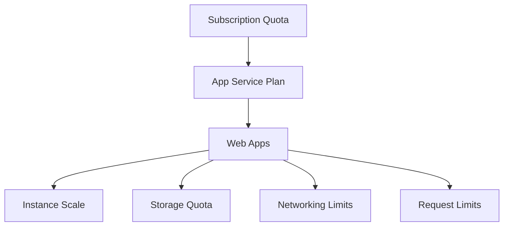

---
content_sources:
  diagrams:
    - id: reference-platform-limits-diagram-1
      type: graph
      source: self-generated
      justification: Self-generated reference diagram synthesized from official Azure App Service documentation for this guide.
      based_on:
        - https://learn.microsoft.com/en-us/azure/app-service/overview
        - https://learn.microsoft.com/en-us/azure/app-service/troubleshoot-diagnostic-logs
---
# Platform Limits & Quotas

Quick reference for common Azure App Service platform limits and quota-related behaviors.

## Overview

<!-- diagram-id: reference-platform-limits-diagram-1 -->

## How to Read This Page

Each figure carries one of three classes, because they do not carry the same authority.

- **[Documented]**: stated by Microsoft Learn for App Service, with the source in the row. Still source-reviewed only (see the review note at the end), not tested against Azure by this guide.
- **[Application or framework]**: set by your runtime, web server or framework, not by an App Service platform limit. This page publishes no number for these; see [Values this guide does not publish](#values-this-guide-does-not-publish).
- **[Measured]**: a value observed in a lab. Lab measurements live with their lab and evidence, never in this table.

## Request Limits

| Limit | Value | Class | Notes | Source |
| :--- | :--- | :--- | :--- | :--- |
| **Frontend HTTP timeout** | **230 seconds** on Windows apps; approximately **240 seconds** on Linux apps | [Documented] | App Service returns a timeout to the client when the application does not respond within this window. Use background processing (for example WebJobs) for longer work. | [Web request times out in App Service](https://learn.microsoft.com/en-us/troubleshoot/azure/app-service/web-request-times-out-app-service) |

## Values this guide does not publish

The sources reviewed for this page do not document an App Service-wide value for the first three, so a number here would be an invention. They are [Application or framework] concerns and depend on the runtime, web server and request path.

- **Maximum request body size.** Request-body limits vary by runtime and web server (for example IIS request filtering on Windows); see [Request Limits `requestLimits` (IIS)](https://learn.microsoft.com/en-us/iis/configuration/system.webserver/security/requestfiltering/requestlimits/) for the IIS behavior.
- **Maximum URL length.** URL limits vary by stack and by front-end and server behavior; the same IIS reference covers the Windows web server.
- **Maximum number of app settings.** No hard App Service limit is documented; environment-block and runtime constraints can be stack-specific. See [Configure an App Service app](https://learn.microsoft.com/en-us/azure/app-service/configure-common).
- **Filesystem log retention.** This one is an App Service logging setting, not an application or framework concern: you choose the number of days, so there is no platform default to publish (see [Diagnostics and Retention](#diagnostics-and-retention)).

Earlier revisions of this page showed 128 MB, 8192 characters, 10,000 settings and 30-90 days as "typical" values. They were removed because no primary source supports them as App Service limits.

## Scale and Plan Limits

| Tier | Max instances | Staging slots per app | Always On | Class | Source |
| :--- | :--- | :--- | :--- | :--- | :--- |
| **Free (F1)** | 1 (shared) | 0 | No | [Documented] | [Azure App Service limits](https://learn.microsoft.com/en-us/azure/azure-resource-manager/management/azure-subscription-service-limits#app-service-limits) |
| **Basic (B1)** | 3 (dedicated) | 0 | Yes | [Documented] | [Azure App Service limits](https://learn.microsoft.com/en-us/azure/azure-resource-manager/management/azure-subscription-service-limits#app-service-limits) |
| **Standard (S1)** | 10 (dedicated) | 5 | Yes | [Documented] | [Azure App Service limits](https://learn.microsoft.com/en-us/azure/azure-resource-manager/management/azure-subscription-service-limits#app-service-limits) |
| **Premium v2, v3 and v4** | 30 (dedicated; 20 for Premium v1) | 20 | Yes | [Documented] | [Azure App Service limits](https://learn.microsoft.com/en-us/azure/azure-resource-manager/management/azure-subscription-service-limits#app-service-limits) |

**Always On.** The Microsoft Learn limits table marks Always On as supported on Basic, Standard, Premium, and Isolated plans, and not on Free or Shared. Basic therefore supports Always On even though it does not support deployment slots; the two columns above are independent capabilities. **[Documented]** from the source linked in each row, reviewed 2026-10-24. **[Not Proven]** by a run on each SKU: this page's values are source-reviewed and were not exercised against Azure.

!!! note "Regional and SKU variation"
    The values above are the maxima Microsoft Learn documents per tier. The effective limit for your subscription can be lower because of region, subscription quota and SKU generation. Validate current values in Microsoft Learn and in your subscription quotas.

## Storage and File System

| Area | Behavior | Notes |
| :--- | :--- | :--- |
| **`/home`** | Persistent | Survives restarts and redeployments |
| **`/tmp`** | Ephemeral | Reclaimed across restarts/reimages |
| **Logs (`/home/LogFiles`)** | Persistent and quota-counted | Large log volume can consume storage quota |

## Deployment and Configuration Limits

| Limit | Value | Class | Notes | Source |
| :--- | :--- | :--- | :--- | :--- |
| **ZIP deploy package size** | **2,048 MB** | [Documented] | Package size limit for ZIP deploy. | [Deploy files to Azure App Service](https://learn.microsoft.com/en-us/azure/app-service/deploy-zip) |
| **Slot settings scope** | Per-slot | [Documented] | A setting marked as a deployment slot setting stays with its slot during a swap. Mark sensitive values accordingly. | [Configure an App Service app](https://learn.microsoft.com/en-us/azure/app-service/configure-common#configure-app-settings) |

The number of app settings is not listed here; see [Values this guide does not publish](#values-this-guide-does-not-publish).

## Networking and Connections

| Limit/Behavior | Value / Pattern | Class | Notes | Source |
| :--- | :--- | :--- | :--- | :--- |
| **SNAT ports per instance (multitenant App Service, platform public outbound)** | **128 preallocated** | [Documented] | Each instance starts with 128 preallocated SNAT ports; more can be allocated dynamically or freed by connection reuse. The limit applies to connections to the same address and port combination. It does not describe App Service Environments, which allocate differently, nor traffic that avoids platform SNAT (a NAT gateway provides its own port pool; services reached over private endpoints or service endpoints are not subject to the restriction). See the source for those exceptions. | [Troubleshoot intermittent outbound connection errors](https://learn.microsoft.com/en-us/azure/app-service/troubleshoot-intermittent-outbound-connection-errors) |
| **Outbound IPs** | Multiple, can change | [Documented] | Use `possibleOutboundIpAddresses` for allowlists on plans that return it. Premium v4 returns empty strings for `outboundIpAddresses` and `possibleOutboundIpAddresses`; use a solution such as Azure NAT Gateway when you need a predictable outbound address. | [Inbound and outbound IP addresses in Azure App Service](https://learn.microsoft.com/en-us/azure/app-service/overview-inbound-outbound-ips) |
| **WebSocket and long-lived connections** | Tier-dependent | [Documented] | Per-instance WebSocket limits differ by tier and by Windows or Linux; see the WebSockets rows of the limits table. | [Azure App Service limits](https://learn.microsoft.com/en-us/azure/azure-resource-manager/management/azure-subscription-service-limits#app-service-limits) |

## Diagnostics and Retention

| Area | Value | Class | Notes | Source |
| :--- | :--- | :--- | :--- | :--- |
| **Application logging (Filesystem), Windows apps** | Turns itself off after **12 hours** | [Documented] | Documented for the Windows application-logging setting and intended for temporary debugging. The long-term option, Application logging (Blob), needs a blob storage container; the article supports it without code changes for .NET only. | [Enable diagnostic logging for apps in Azure App Service](https://learn.microsoft.com/en-us/azure/app-service/troubleshoot-diagnostic-logs) |
| **Filesystem log retention** | Configurable (days) | [Documented] | The portal exposes a Retention Period (Days) setting for web server logging on Windows apps and for application logging on Linux and container apps (the latter also has a Quota (MB) setting). No platform default range is documented, so none is shown here. | [Enable diagnostic logging for apps in Azure App Service](https://learn.microsoft.com/en-us/azure/app-service/troubleshoot-diagnostic-logs) |
| **Live log streaming inactivity timeout, Windows apps** | **1800 seconds** default | [Documented] | The `SCM_LOGSTREAM_TIMEOUT` app setting is the inactivity timeout, in seconds, before log streaming stops. | [Environment variables and app settings reference](https://learn.microsoft.com/en-us/azure/app-service/reference-app-settings) |
| **Application Insights retention** | Configurable | [Documented] | Affects cost and forensic depth. | [Manage usage and costs for Application Insights](https://learn.microsoft.com/en-us/azure/azure-monitor/app/pricing) |

## Limit-Driven Symptoms

- Intermittent outbound failures under load (possible SNAT pressure)
- Sudden 5xx spikes with no code change (plan/resource saturation)
- Failed uploads or deployments due to artifact size
- Missing files due to writing into ephemeral paths
- Slow or dropped long-running HTTP requests over frontend timeout

## Run It in the Portal

#### Portal view: Scale up (App Service plan) blade

[[[ shot("platform--scaling--02-scale-up") ]]]

The `Scale up (App Service plan)` blade is where you compare the plan SKUs that drive most of the limits in the Scale and Plan Limits table above. This capture shows the `Hardware view` table grouped into `Dev/Test`, `Production`, and `Legacy`, with the selected `Premium v3 P0V3` row exposing the per-plan fields that matter operationally: `vCPU`, `Memory (GB)`, `Remote Storage (GB)`, `Scale (instance)`, and SLA. Because the blade is scoped to the App Service plan rather than the individual web app, it is the right place to confirm whether plan tier and per-instance capacity are part of a saturation or quota problem. Use this view to verify the current plan family and worker size before concluding that a symptom is application-only.

## Review Status

**[Documented]** figures were checked against the Microsoft Learn sources in each row on 2026-10-24. That is a source review: this guide did not run these limits against Azure, and a lab measurement would be a separate **[Measured]** claim recorded with its own evidence. **[Not Proven]**: any figure not listed here.

## See Also

- [CLI Cheatsheet](cli-cheatsheet.md)
- [KQL Queries](kql-queries.md)

## Sources

- [Azure App Service Limits (Microsoft Learn)](https://learn.microsoft.com/en-us/azure/azure-resource-manager/management/azure-subscription-service-limits#app-service-limits)
- [App Service Plan Overview (Microsoft Learn)](https://learn.microsoft.com/en-us/azure/app-service/overview-hosting-plans)
- [Best Practices for App Service (Microsoft Learn)](https://learn.microsoft.com/en-us/azure/app-service/app-service-best-practices)

## Language-Specific Details

Language/runtime behavior (for example, worker model, memory profile, and startup semantics) can change how these limits are experienced in practice.
See:

- [Azure App Service Node.js Guide — Reference](../language-guides/nodejs/index.md)
- [Azure App Service Python Guide — Reference](../language-guides/python/index.md)
