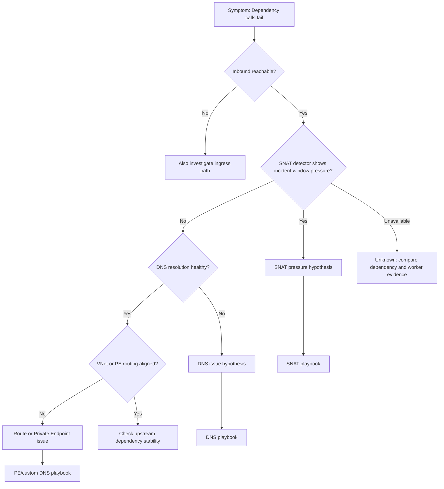

---
content_validation:
  status: verified
  last_reviewed: 2026-10-14
  reviewer: agent
  core_claims:
    - claim: "Azure App Service diagnostics includes networking diagnostics such as SNAT Port Exhaustion and TCP Connections."
      source: "https://learn.microsoft.com/en-us/azure/app-service/overview-diagnostics"
      verified: true
    - claim: "App Service can stream logs written to console output or files stored under /home/LogFiles for troubleshooting."
      source: "https://learn.microsoft.com/en-us/azure/app-service/troubleshoot-diagnostic-logs"
      verified: true
content_sources:
  diagrams:
    - id: troubleshooting-first-10-minutes-outbound-network-diagram-1
      type: graph
      source: self-generated
      justification: "Self-generated troubleshooting diagram synthesized from Microsoft Learn diagnostics and Azure App Service incident guidance for this guide."
      based_on:
        - https://learn.microsoft.com/en-us/azure/app-service/troubleshoot-diagnostic-logs
        - https://learn.microsoft.com/en-us/azure/app-service/troubleshoot-http-502-http-503
---
# First 10 Minutes: Outbound / Network

## Quick Context
Use this checklist when Azure App Service Linux can serve some traffic but fails calling dependencies (timeouts, connection failures, DNS errors). In the first 10 minutes, determine whether the issue is SNAT pressure, DNS resolution, routing/Private Endpoint configuration, or upstream dependency instability.

<!-- diagram-id: troubleshooting-first-10-minutes-outbound-network-diagram-1 -->


## Step 1: Classify inbound vs outbound symptom first
Avoid losing time on ingress when the failure is dependency egress.

- Quick check:
    - Inbound issue: clients cannot reach your app endpoint.
    - Outbound issue: app endpoint is reachable, but dependency calls fail.
    - Validate with app logs or synthetic call path.
- Good signal: clear isolation to outbound-only failure.
- Bad signal: mixed signals (both inbound and outbound), requiring parallel checks.

## Step 2: Check SNAT Port Exhaustion detector
Treat SNAT pressure as one competing hypothesis for outbound failures under load.

- Portal path: **App Service -> Diagnose and solve problems -> Availability and Performance -> SNAT Port Exhaustion**
- Evidence against this hypothesis: detector pressure stays comfortably below limits on the affected instance during the incident.
- Evidence supporting this hypothesis: measured near/at exhaustion aligns with outbound failures on the same instance and window.
- `Unknown`: the detector has no port data or is unavailable; continue with dependency, DNS, client-cancellation, and worker-queueing checks rather than inferring SNAT from inbound `499`/`503` or timeout duration.

## Step 3: Check TCP Connections metric trend
High connection churn with poor reuse often precedes SNAT incidents.

- Portal path: **App Service -> Metrics -> TCP Connections**
- Azure CLI:

```bash
az monitor metrics list --resource "$APP_ID" --metric "TcpConnections" --interval PT1M --aggregation Average Maximum
```

| Command | Purpose |
|---------|---------|
| `az monitor metrics list --resource "$APP_ID" --metric "TcpConnections" --interval PT1M --aggregation Average Maximum` | Fetches TCP connection counts so you can correlate connection churn with outbound failures. |
| `--resource "$APP_ID"` | Scopes the metric query to this specific Azure resource. |
| `--metric "TcpConnections"` | Requests exactly these metrics from Azure Monitor for this check. |
| `--interval PT1M` | Samples the metrics at this time granularity. |
| `--aggregation Average Maximum` | Returns these aggregation(s) for each metric time bucket. |

Select `TCP Connections` and add both `Avg` and `Max` aggregations, then narrow the time range to the incident window; the default lookback is usually too wide for SNAT triage. Use `Apply splitting` by `Instance` so a single noisy worker isn't averaged away, since SNAT exhaustion is per-instance rather than per-plan.

## Step 4: Check VNet integration status (if used)
Misconfigured or unhealthy integration causes asymmetric dependency failures.

- Portal path: **App Service -> Networking -> VNet integration**
- Azure CLI:

```bash
az webapp vnet-integration list --resource-group "$RG" --name "$APP_NAME"
```

| Command | Purpose |
|---------|---------|
| `az webapp vnet-integration list --resource-group "$RG" --name "$APP_NAME"` | Lists the web app's VNet integration bindings so you can confirm whether the expected subnet integration exists. |
| `--resource-group "$RG" --name "$APP_NAME"` | Looks up the resource in this resource group. |
| `--name "$APP_NAME"` | Targets this web app. |

#### Portal view: Networking hub (inbound + outbound at a glance)

[[[ shot("operations--networking--01-networking-hub") ]]]

Purpose: Show the app's inbound and outbound network configuration on one page.

Look for: `Public network access` and `Private endpoints` under inbound traffic, and `Virtual network integration`, `Outbound DNS`, and the outbound address lists under outbound traffic.

Expected result: This capture shows the displayed configuration of a public app without VNet integration: the listed outbound addresses are the platform's potential outbound address pool (not a measured egress address for any connection), and the integration subnet settings show `N/A`.

The Networking hub shows the app's configured routing context; it does not decide the failure domain or prove a misconfiguration. Use its VNet integration, outbound DNS, address, and integration-subnet fields to form a route hypothesis. Then test DNS and connectivity from inside the app, compare per-target dependency telemetry in the incident window, inspect effective routes and attached NSG/NAT resources, and use policy or deployment evidence to confirm whether the observed configuration differs from the intended design.

- Good signal: expected subnet integration and healthy state.
- Bad signal: disconnected/misconfigured integration, wrong subnet, or route mismatch.

## Step 5: Validate DNS resolution from Kudu/SSH
Prove whether failures happen before connect (resolution) or after connect (network/dependency).

- Portal path: **App Service -> Development Tools -> SSH** (or Kudu SSH)
- Commands:

```bash
nslookup <dependency-fqdn>
nslookup <dependency-private-endpoint-fqdn>
```

- Good signal: consistent, expected DNS answer.
- Bad signal: NXDOMAIN, intermittent SERVFAIL, or wrong IP family/target.

## Step 6: Check Private Endpoint + DNS mapping (if applicable)
Private Endpoint without correct DNS zone linkage can silently route to wrong targets.

- Portal path:
    - **Dependency resource -> Networking -> Private endpoint connections**
    - **Private DNS zones -> Virtual network links**
- Good signal: approved Private Endpoint and correct private DNS zone links.
- Bad signal: pending/rejected endpoint, missing DNS link, or public IP resolution when private expected.

## Step 7: Check NAT Gateway attachment and health (if applicable)
If NAT Gateway is expected but not applied, outbound behavior may differ from design.

- Portal path: **VNet -> Subnets -> <integration subnet> -> NAT Gateway**
- Azure CLI:

```bash
az network vnet subnet show --resource-group "$RG" --vnet-name "$VNET_NAME" --name "$SUBNET_NAME"
```

| Command | Purpose |
|---------|---------|
| `az network vnet subnet show --resource-group "$RG" --vnet-name "$VNET_NAME" --name "$SUBNET_NAME"` | Shows the integration subnet resource so you can inspect route-table, service-endpoint, NAT, or NSG attachments that affect this path. |
| `--resource-group "$RG" --vnet-name "$VNET_NAME" --name "$SUBNET_NAME"` | Scopes the lookup to the resource group that owns the VNet. |
| `--vnet-name "$VNET_NAME" --name "$SUBNET_NAME"` | Targets this virtual network. |
| `--name "$SUBNET_NAME"` | Targets this specific subnet. |

- Good signal: correct NAT Gateway association and healthy outbound path.
- Bad signal: no NAT association when expected, or wrong subnet association.

## Step 8: Confirm timeout/error signatures in console logs
Use log signatures to separate DNS, connect, and upstream timeout patterns.

- KQL:

```kql
AppServiceConsoleLogs
| where TimeGenerated > ago(1h)
| where ResultDescription has_any ("timeout", "timed out", "ENOTFOUND", "Name or service not known", "connection refused", "ECONNRESET")
| project TimeGenerated, ResultDescription
| order by TimeGenerated desc
```

- Good signal: no concentrated outbound error pattern.
- Bad signal: repeated DNS or connect-timeout errors in incident window.

Console timeout errors identify the failing operation more precisely than inbound status alone, but still compare per-target dependency health and worker saturation. A repeated HTTP time boundary can result from client cancellation, queued work, or dependency timeout as well as SNAT pressure.

## Decision Points
After these checks, you should be able to:

- Narrow to 1-2 hypotheses:
    - **SNAT pressure**: incident-window detector data shows pressure alongside outbound errors.
    - **DNS issue**: in-app resolution tests fail or return an unexpected path.
    - **Route/Private Endpoint issue**: configured routing context, effective routes, and policy or deployment evidence disagree with the intended VNet, Private Endpoint, or DNS design.
    - **Dependency or worker pressure**: failures isolate to a target or queueing grows without measured SNAT pressure.
    - **Unknown**: required detector, dependency, route, policy, or application telemetry is unavailable.
- Choose the next playbook or action:
    - **SNAT pressure**: use the connection reuse/SNAT playbook.
    - **DNS issue**: use the DNS resolution playbook.
    - **Route/Private Endpoint issue**: use the Private Endpoint and custom DNS playbook.
    - **Dependency or worker pressure**: inspect same-window dependency telemetry and worker queueing.
    - **Unknown**: collect the missing evidence before selecting a causal playbook.

## Next Steps
- [SNAT or Application Issue?](../playbooks/outbound-network/snat-or-application-issue.md)
- [DNS Resolution (VNet-Integrated)](../playbooks/outbound-network/dns-resolution-vnet-integrated-app-service.md)
- [Private Endpoint / Custom DNS Confusion](../playbooks/outbound-network/private-endpoint-custom-dns-route-confusion.md)

## See Also

- [SNAT or Application Issue](../playbooks/outbound-network/snat-or-application-issue.md)
- [DNS Resolution (VNet-integrated App Service)](../playbooks/outbound-network/dns-resolution-vnet-integrated-app-service.md)

## Sources

- [Troubleshoot outbound connection errors in Azure App Service](https://learn.microsoft.com/en-us/azure/app-service/troubleshoot-intermittent-outbound-connection-errors)
- [Azure App Service networking features](https://learn.microsoft.com/en-us/azure/app-service/networking-features)
- [Azure App Service diagnostics overview](https://learn.microsoft.com/en-us/azure/app-service/overview-diagnostics)
