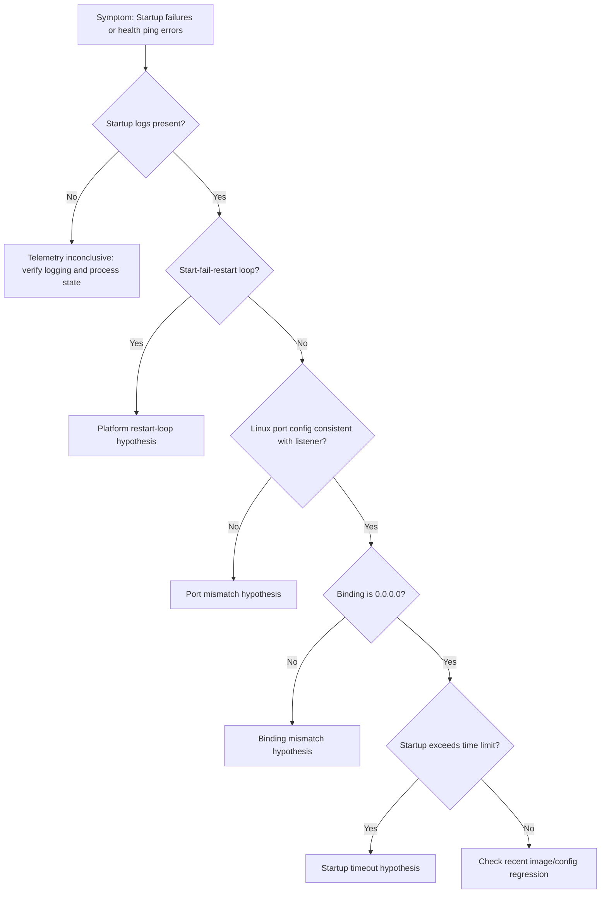
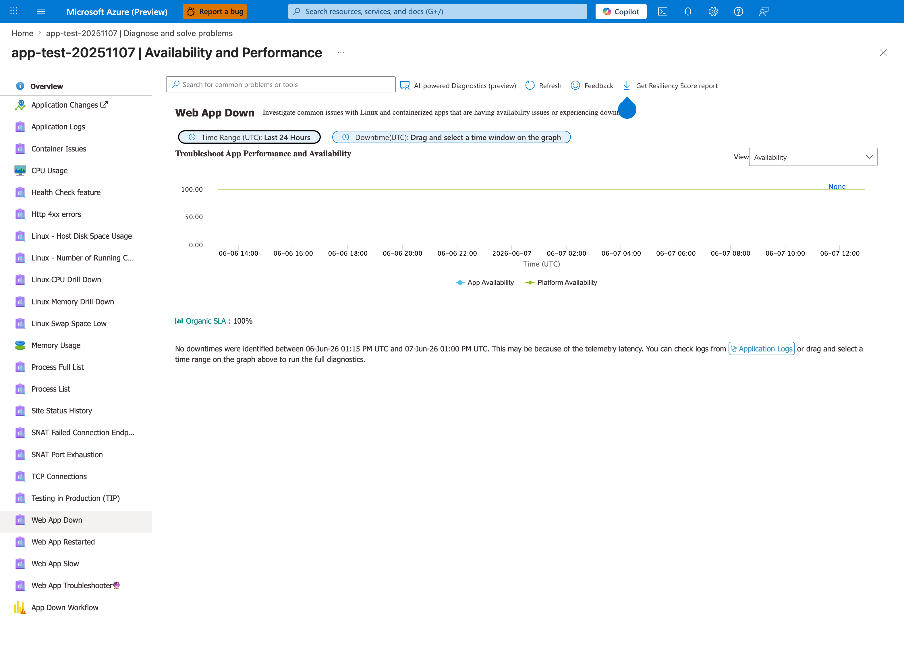

---
content_validation:
  status: verified
  last_reviewed: 2026-10-14
  reviewer: agent
  core_claims:
    - claim: "Health check pings a path that you choose on all instances of an App Service app at 1-minute intervals."
      source: "https://learn.microsoft.com/en-us/azure/app-service/monitor-instances-health-check"
      verified: true
    - claim: "If an instance doesn't return a 200-299 response after repeated failed health checks, App Service marks it unhealthy and removes it from the load balancer."
      source: "https://learn.microsoft.com/en-us/azure/app-service/monitor-instances-health-check"
      verified: true
content_sources:
  diagrams:
    - id: troubleshooting-first-10-minutes-startup-availability-diagram-1
      type: graph
      source: self-generated
      justification: "Self-generated troubleshooting diagram synthesized from Microsoft Learn diagnostics and Azure App Service incident guidance for this guide."
      based_on:
        - https://learn.microsoft.com/en-us/azure/app-service/troubleshoot-diagnostic-logs
        - https://learn.microsoft.com/en-us/azure/app-service/troubleshoot-http-502-http-503
---
# First 10 Minutes: Startup / Availability

## Quick Context
Use this checklist when an Azure App Service Linux app does not come up cleanly after deployment/restart, returns startup-related 5xx, or fails health pings. In the first 10 minutes, establish whether this is a startup crash, wrong port/binding, startup timeout, or recent image/config regression.

<!-- diagram-id: troubleshooting-first-10-minutes-startup-availability-diagram-1 -->


## Step 1: Check AppServiceConsoleLogs for startup output
First question: is the containerized app producing any startup logs at all?

#### Portal view: Web App Down detector confirms the availability symptom



Purpose: Show a healthy baseline of the Web App Down detector.

Look for: The availability chart, `Organic SLA`, and the downtime message below it.

Expected result: A healthy app shows flat 100 percent availability and no downtime; during an outage the chart dips and a downtime window can be selected.

Before running the KQL query below, check whether the `Web App Down` detector observed the symptom in the incident window. [Observed] A lower `App Availability` line with a healthy `Platform Availability` line scopes the detector's result; it makes application or container hypotheses useful next checks. [Not Proven] A healthy platform line does not exclude every platform contribution, downstream side effect, or problem outside the detector's scope. Select the incident window to review the correlated detector results, then compare them with platform events, HTTP logs, and per-instance process state. If the detector has no matching window or is unavailable, record `Unknown` rather than assigning a layer.

- KQL:

```kql
AppServiceConsoleLogs
| where TimeGenerated > ago(1h)
| project TimeGenerated, ResultDescription
| order by TimeGenerated desc
```

Log stream is the real-time complement to the historical query above. The `Runtime` radio can show application stdout/stderr, including Python tracebacks, Node.js `Error: listen EADDRINUSE`, and Java `BindException`; the `Platform` radio shows container lifecycle and health-probe messages. [Observed] A silent stream means only that this collection path returned no lines. [Not Proven] It does not prove that the process failed before logging initialized. Verify that the intended log type is enabled, the application writes to console or `/home/LogFiles`, the correct instance is selected, and the stream has not stalled. Also allow for collection delay and query-window mismatch. Then compare the platform-event query with SSH/process and listener checks. If logging configuration, stream health, or telemetry availability cannot be established, record `INCONCLUSIVE`.

## Step 2: Check platform events for container start/fail loop
Platform logs confirm if App Service can start and keep the container alive.
- KQL:

```kql
AppServicePlatformLogs
| where TimeGenerated > ago(6h)
| where OperationName has_any ("Container", "start", "Start", "fail", "Fail", "restart", "Restart")
| project TimeGenerated, OperationName, ContainerId
| order by TimeGenerated desc
```

- Good signal: normal start with no immediate fail/restart cycle.
- Bad signal: rapid start-fail-restart patterns.

## Step 3: Verify Linux port configuration against the actual listener
For Linux custom containers, startup reachability is more nuanced than a simple `WEBSITES_PORT` mismatch model. Check the actual listener together with both `WEBSITES_PORT` and the runtime-injected `PORT` value. See [Container HTTP Pings Lab](../lab-guides/container-http-pings.md) for experimental evidence on Linux port behavior.
- Portal path: **App Service -> Configuration -> Application settings -> WEBSITES_PORT**
- CLI:

```bash
az webapp config appsettings list --resource-group "$RG" --name "$APP_NAME"
```

| Command | Purpose |
|---------|---------|
| `az webapp config appsettings list --resource-group "$RG" --name "$APP_NAME"` | Lists the app settings currently applied to this web app so you can inspect runtime or deployment configuration. |
| `--resource-group "$RG" --name "$APP_NAME"` | Looks up the resource in this resource group. |
| `--name "$APP_NAME"` | Targets this web app. |

- Good signal: the app binds to `0.0.0.0` on the port App Service exposes through `PORT`, and any configured `WEBSITES_PORT` does not contradict that listener.
- Bad signal: logs show a different port or localhost-only binding than the effective Linux startup path can reach.

## Step 4: Verify binding address is 0.0.0.0 (not 127.0.0.1)
Binding to loopback prevents App Service front-end probe from reaching the process.
- Check startup logs for bind/listen line.
- Common bad pattern: `Listening on 127.0.0.1:<port>`.
- Good signal: `0.0.0.0:<port>` listener.
- Bad signal: loopback-only bind.

## Step 5: Check WEBSITES_CONTAINER_START_TIME_LIMIT
Large images, migrations, or cold startup overhead can exceed default timeout.
- Portal path: **App Service -> Configuration -> Application settings -> WEBSITES_CONTAINER_START_TIME_LIMIT**
- CLI:

```bash
az webapp config appsettings list --resource-group "$RG" --name "$APP_NAME" --query "[?name=='WEBSITES_CONTAINER_START_TIME_LIMIT']"
```

| Command | Purpose |
|---------|---------|
| `az webapp config appsettings list --resource-group "$RG" --name "$APP_NAME" --query "[?name=='WEBSITES_CONTAINER_START_TIME_LIMIT']"` | Lists only the `WEBSITES_CONTAINER_START_TIME_LIMIT` app setting so you can compare startup tolerance with observed startup time. |
| `--resource-group "$RG" --name "$APP_NAME" --query "[?name=='WEBSITES_CONTAINER_START_TIME_LIMIT']"` | Looks up the resource in this resource group. |
| `--name "$APP_NAME" --query "[?name=='WEBSITES_CONTAINER_START_TIME_LIMIT']"` | Targets this web app. |
| `--query "[?name=='WEBSITES_CONTAINER_START_TIME_LIMIT']"` | Filters the app-settings list to the `WEBSITES_CONTAINER_START_TIME_LIMIT` entry only. |

- Good signal: timeout value fits startup profile.
- Bad signal: container initialization consistently exceeds limit.

## Step 6: Check recent image/config changes
Confirm if failure started after deployment, base image update, or setting change.
- Portal path: **Deployment Center -> Logs** and **Configuration -> Last modified**
- CLI examples:

```bash
az webapp config container show --resource-group "$RG" --name "$APP_NAME"
az webapp deployment source show --resource-group "$RG" --name "$APP_NAME"
```

| Command | Purpose |
|---------|---------|
| `az webapp config container show --resource-group "$RG" --name "$APP_NAME"` | Shows the current container image configuration so you can verify image/tag/source details involved in startup behavior. |
| `--resource-group "$RG" --name "$APP_NAME"` | Looks up the resource in this resource group. |
| `--name "$APP_NAME"` | Targets this web app. |
| `az webapp deployment source show --resource-group "$RG" --name "$APP_NAME"` | Shows the configured deployment source so you can confirm how this app is being deployed. |
| `--resource-group "$RG" --name "$APP_NAME"` | Looks up the resource in this resource group. |
| `--name "$APP_NAME"` | Targets this web app. |

- Good signal: no risky change near first failure timestamp.
- Bad signal: issue starts immediately after image tag/config update.

## Step 7: SSH into container and verify process state
Direct process check quickly distinguishes crash-loop from healthy process with routing issue.
- Portal path: **App Service -> Development Tools -> SSH**
- Commands inside container:

```bash
ps -ef
ss -lntp
```

- Good signal: expected app process running and listening on configured port/address.
- Bad signal: no app process, repeated exits, or wrong listen socket.

## Step 8: Pull startup error signatures from console logs
Extract concrete crash reasons to choose the next deep-dive playbook.
- KQL:

```kql
AppServiceConsoleLogs
| where TimeGenerated > ago(1h)
| where ResultDescription has_any ("error", "exception", "failed", "traceback", "EADDRINUSE", "address already in use")
| project TimeGenerated, ResultDescription
| order by TimeGenerated desc
```

- Good signal: no repeated fatal startup signatures.
- Bad signal: repeatable stack traces or bind errors explaining startup failure.

## Decision Points
After these checks, you should be able to:
- Narrow to 1-2 hypotheses:
    - **Port/listener contract issue** -> verify `PORT`, `WEBSITES_PORT`, and actual bind behavior together
    - **Binding mismatch** -> bind to `0.0.0.0`
    - **Startup timeout** -> increase time limit and reduce startup work
    - **Crash on boot** -> investigate stack trace/runtime dependency error
    - **Unknown / unavailable telemetry** -> preserve `INCONCLUSIVE`, repair collection, and repeat the process/listener checks before attributing a cause
    - Select immediate corrective path before full deep dive.

## Next Steps
- [Container Didn't Respond to HTTP Pings](../playbooks/startup-availability/container-didnt-respond-to-http-pings.md)
- [Warm-up vs Health Check](../playbooks/startup-availability/warmup-vs-health-check.md)
- [Slot Swap Failed During Warm-up](../playbooks/startup-availability/slot-swap-failed-during-warmup.md)

## See Also

- [Container Didn't Respond to HTTP Pings](../playbooks/startup-availability/container-didnt-respond-to-http-pings.md)
- [Startup Errors](../kql/console/startup-errors.md)

## Sources

- [Configure a custom container for Azure App Service](https://learn.microsoft.com/en-us/azure/app-service/configure-custom-container)
- [Enable diagnostic logging for apps in Azure App Service](https://learn.microsoft.com/en-us/azure/app-service/troubleshoot-diagnostic-logs)
- [Azure App Service diagnostics overview](https://learn.microsoft.com/en-us/azure/app-service/overview-diagnostics)
