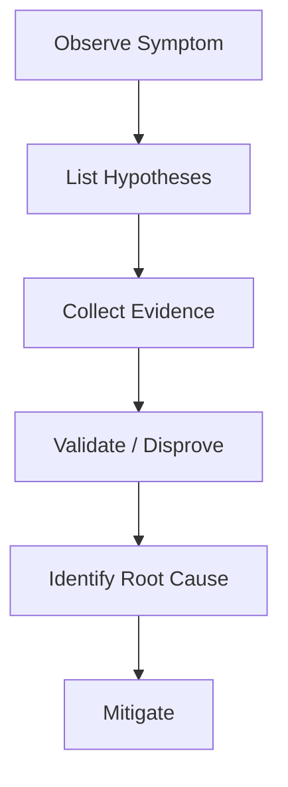
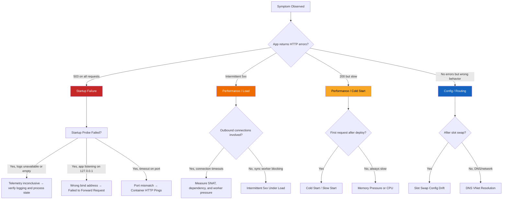
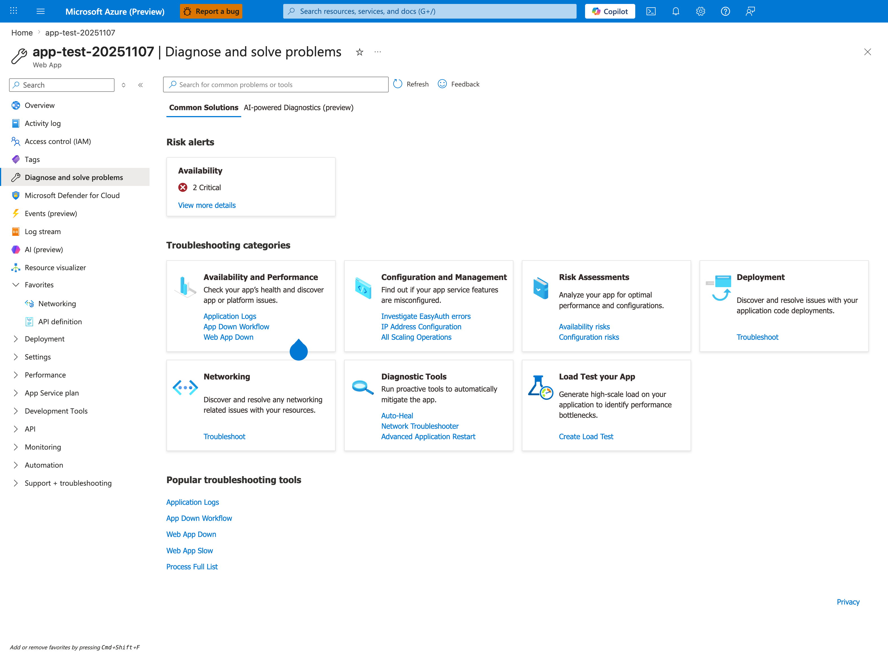

---
content_sources:
  diagrams:
    - id: troubleshooting-index-diagram-1
      type: graph
      source: self-generated
      justification: "Self-generated troubleshooting diagram synthesized from Microsoft Learn diagnostics and Azure App Service incident guidance for this guide."
      based_on:
        - https://learn.microsoft.com/en-us/azure/app-service/troubleshoot-diagnostic-logs
        - https://learn.microsoft.com/en-us/azure/app-service/troubleshoot-http-502-http-503
    - id: troubleshooting-index-diagram-2
      type: graph
      source: self-generated
      justification: "Self-generated troubleshooting diagram synthesized from Microsoft Learn diagnostics and Azure App Service incident guidance for this guide."
      based_on:
        - https://learn.microsoft.com/en-us/azure/app-service/troubleshoot-diagnostic-logs
        - https://learn.microsoft.com/en-us/azure/app-service/troubleshoot-http-502-http-503
---
# App Service Troubleshooting

A hypothesis-driven troubleshooting guide for Azure App Service workloads on Windows and Linux.

---

## What This Is

A practical field guide for troubleshooting real-world issues on Azure App Service across its supported hosting modes.

This is **not** a general Azure tutorial. It is designed to help engineers move from **symptom** to **validated interpretation** faster.

## How It Works

<!-- diagram-id: troubleshooting-index-diagram-1 -->

Every playbook follows this flow:

1. **Start from the symptom** — what the engineer actually observes
2. **List competing hypotheses** — multiple plausible causes
3. **Collect evidence** — metrics, logs, detectors, configuration
4. **Validate or disprove** each hypothesis with specific signals
5. **Identify the most likely root cause** pattern
6. **Apply mitigations** — immediate and long-term

## Start Here

| Your Situation | Go To |
|---|---|
| First incident, no idea where to start | [Architecture Overview](architecture-overview.md) |
| Need to identify the failure category | [Decision Tree](decision-tree.md) |
| Want 60-second symptom-to-playbook cards | [Quick Diagnosis Cards](quick-diagnosis-cards.md) |
| Want to understand what evidence to collect | [Evidence Map](evidence-map.md) |
| Need a mental framework for diagnosis | [Mental Model](mental-model.md) |
| Already know the symptom category | Jump to [Playbooks](#topics) below |
| Need KQL queries to investigate | [KQL Query Library](kql/index.md) |
| Want hands-on practice | [Labs](#hands-on-labs) below |

### Inbound Access and Slow-Request Symptom Routes

Choose the observed symptom rather than a presumed cause. These links lead to
investigation steps, evidence collection, competing hypotheses, mitigation and
prevention. They are not customer RCA records or new lab execution results;
check each destination's verification boundary before treating an example as evidence.

| Observed symptom | First discriminating check | Investigation |
|---|---|---|
| Browser cannot resolve the app or SCM name | Record the same client's target, resolver/proxy path and final DNS answer; keep separate attempts separate. | [SCM Client DNS and HTTP Failures](playbooks/scm-access-dns-and-http-failures.md) |
| Main app works, but Kudu or deployment fails | Test the actual operator/agent SCM path and its DNS, rule inheritance and authentication separately. | [SCM Client DNS and HTTP Failures](playbooks/scm-access-dns-and-http-failures.md) |
| Private endpoint is Approved, but the intended client cannot connect | Compare approval with actual client DNS, route and TCP/TLS observations. | [Private Endpoint and Access Restriction Decisions](playbooks/private-endpoint-access-restrictions.md) |
| HTTP 403 despite an Allow rule | Identify the response origin, actual ingress path and applicable app/main/SCM policy before assigning a cause. | [Private Endpoint and Access Restriction Decisions](playbooks/private-endpoint-access-restrictions.md) |
| Adding one Allow rule excludes other clients | Compare the effective unmatched action and ordered rules before/after the change. | [Private Endpoint and Access Restriction Decisions](playbooks/private-endpoint-access-restrictions.md) |
| Private-only cutover breaks operator access | Check the intended private operator/agent path and approved rollback criteria; do not broadly reopen SCM to test a theory. | [Private Endpoint and Access Restriction Decisions](playbooks/private-endpoint-access-restrictions.md) |
| Users report long delays while the average changes little | Compare matched windows, retained counts, tail percentiles and slow-request share before investigating cause. | [Tail Latency and Matched Baselines](playbooks/performance/tail-latency-baseline-comparison.md) |

For **app-to-dependency** failures, use [Outbound / Network](#outbound-network)
instead. The client-to-app/SCM path is a different investigation. Unavailable
observations leave the cause inconclusive; a configuration screenshot alone
cannot complete the diagnostic steps.

## Quick Decision Tree

Use this to route to the right playbook in under 60 seconds:

<!-- diagram-id: troubleshooting-index-diagram-2 -->

## Hosting Mode: Where to Look First

Choose the entry path that matches the app before applying runtime-specific advice:

| Hosting mode | Start here |
|---|---|
| **Windows code** | Use the [Windows symptom routes](#windows-symptom-routes) for IIS, `web.config`, Kudu, worker recycling, filesystem quotas, and Java timeout evidence. |
| **Windows custom container** | Start with [Windows Container Health Probes](playbooks/startup-availability/windows-container-health-probes.md), then use the other Windows routes only when their IIS or worker-process model matches the symptom. |
| **Linux code or custom container** | Use the [representative log patterns](#representative-log-patterns), Linux-oriented playbooks under [Topics](#topics), and the [Linux Kudu guide](../platform/kudu-linux.md). |

Different hosting modes have different observation points. Use this table to prioritize your investigation without carrying Windows settings into Linux advice:

| Symptom | Linux code | Linux custom container | Windows code | Windows custom container |
|---|---|---|---|---|
| **Startup fails** | `AppServiceConsoleLogs` — Oryx build output, runtime startup | `AppServiceConsoleLogs` — Docker logs, `ENTRYPOINT`/`CMD` output | Application Event Logs, `WEBSITE_RUN_FROM_PACKAGE` mount or package-selection issues | Container logs and the Windows health-probe path |
| **Wrong port/binding** | Check `--bind` in startup command (Gunicorn, etc.) | Check `WEBSITES_PORT`, `PORT` environment variable, and `EXPOSE` in the Dockerfile | Check the deployed `web.config` and IIS handler settings | Check the image's listening port and App Service container configuration |
| **Missing dependencies** | Oryx build logs, `requirements.txt` / `package.json` | Image build logs; dependencies baked into image | NuGet restore logs, MSBuild output | Image build logs; dependencies baked into image |
| **Slow cold start** | Module import time, lazy loading patterns | Image pull time and container initialization | Assembly loading, JIT compilation | Image pull time and container initialization |
| **Memory pressure** | `MemoryWorkingSet` metric, OOM in platform logs | `MemoryWorkingSet`, container memory limits | `MemoryWorkingSet`, `w3wp` process memory | `MemoryWorkingSet` and container process memory |
| **Outbound timeouts** | SNAT metrics, `AppServiceConsoleLogs` connection errors | Same evidence as Linux code | SNAT metrics and outbound connection tracking | SNAT metrics and container logs |
| **Config drift after swap** | App Settings sticky slot configuration | Same controls as Linux code | `web.config` transforms and connection strings | App Settings and image configuration |
| **Filesystem issues** | `/home` (persistent) vs `/tmp` (ephemeral), `df -h` via SSH | Container filesystem and mounted volumes | `D:\home` (persistent) vs `D:\local` (ephemeral) | Container filesystem and mounted Windows storage |

!!! tip "Hosting Mode Detection"
    Use `az webapp show --query "kind"` to check hosting mode:
    
    - `app,linux` → Linux Code
    - `app,linux,container` → Linux custom container
    - `app` → Windows Code
    - A Windows app configured with a container image → Windows custom container

### Windows Symptom Routes

| Symptom or task | Existing guide |
|---|---|
| IIS startup, handler, or deployed `web.config` failure | [Windows IIS and web.config Startup](playbooks/startup-availability/windows-iis-webconfig-startup.md) |
| Windows custom container never becomes healthy | [Windows Container Health Probes](playbooks/startup-availability/windows-container-health-probes.md) |
| Need Windows Kudu tool selection or a platform tour | [Windows Kudu Diagnostics](playbooks/startup-availability/windows-kudu-diagnostics.md) and [Kudu on Windows](../platform/kudu-windows.md) |
| `w3wp` memory growth, recycle, or worker degradation | [Windows Memory Pressure and Worker Recycling](playbooks/performance/windows-memory-pressure-worker-recycling.md) |
| `D:\home` or `D:\local` quota and filesystem symptoms | [Windows Filesystem Quotas](playbooks/performance/windows-filesystem-quotas.md) |
| Windows Java SE `500.121` or httpPlatformHandler timeout | [Windows httpPlatformHandler KQL Pack](kql/windows-httpplatformhandler/index.md) and [Windows Java httpPlatformHandler Timeout Lab](lab-guides/windows-java-httpplatformhandler-timeout.md) |

!!! info "Coverage and limitations"
    The guide has dedicated Windows coverage for the routes above and cross-platform deployment coverage for [Deployment Failures](playbooks/deployment-failures.md), [Missing wwwroot Files and 404](playbooks/missing-wwwroot-files-404.md), the [Missing wwwroot Content Lab](lab-guides/missing-wwwroot-content.md), and the [ZIP Deploy File Lock Lab](lab-guides/zipdeploy-file-lock-serialization.md). Most remaining symptom playbooks and labs use Linux examples. Treat their general diagnostic method as reusable, but use Windows-specific paths, process names, settings, and evidence only from a Windows guide.

## Representative Log Patterns

Quick reference for recognizing common failure signatures:

| Pattern | Indicates | Playbook |
|---|---|---|
| `503` + high `TimeTaken` + no console rows | The request failed slowly; startup failure is one hypothesis, but absent rows are inconclusive. Verify log configuration, collection delay, query window, scope, instance, and stream health before comparing platform events with process and listener state. | [Deployment Succeeded Startup Failed](playbooks/startup-availability/deployment-succeeded-startup-failed.md) |
| Console: `Listening at: http://127.0.0.1:8000` | Wrong bind address | [Failed to Forward Request](playbooks/startup-availability/failed-to-forward-request.md) |
| `499` + `TimeTaken` near five seconds on `/slow` endpoints | Deadline-bound request termination. Compare client and proxy timestamps with configured deadlines; distinguish that path from worker blocking by checking per-worker concurrency, queue delay, and request-start evidence. | [Intermittent 5xx Under Load](playbooks/performance/intermittent-5xx-under-load.md) |
| `499` or `503` near a repeated time boundary on `/outbound` | A request ended near a timeout boundary; SNAT exhaustion is only one hypothesis. Compare client cancellation, worker queueing, and dependency failures; raise SNAT confidence only when the detector shows port pressure for the same instance and window. | [SNAT or Application Issue](playbooks/outbound-network/snat-or-application-issue.md) |
| `/resolve` returns public IP for privatelink FQDN | DNS misconfiguration (Private DNS Zone not linked) | [DNS Resolution VNet](playbooks/outbound-network/dns-resolution-vnet-integrated-app-service.md) |
| `startup_duration` > 30s in platform logs | Cold start / slow start | [Slow Start / Cold Start](playbooks/performance/slow-start-cold-start.md) |
| `/disk-status` shows /tmp > 50% | Disk pressure | [No Space Left on Device](playbooks/performance/no-space-left-on-device.md) |
| `/config` returns wrong environment values after swap | Slot swap config drift (sticky settings missing) | [Slot Swap Config Drift](playbooks/startup-availability/slot-swap-config-drift.md) |

## Topics

### Performance
- [Tail Latency and Matched Baselines](playbooks/performance/tail-latency-baseline-comparison.md)
- [Slow Response but Low CPU](playbooks/performance/slow-response-but-low-cpu.md)
- [Memory Pressure & Worker Degradation](playbooks/performance/memory-pressure-and-worker-degradation.md)
- [Intermittent 5xx Under Load](playbooks/performance/intermittent-5xx-under-load.md)
- [No Space Left on Device](playbooks/performance/no-space-left-on-device.md)
- [Slow Start / Cold Start](playbooks/performance/slow-start-cold-start.md)
- [CORS and Token Errors](playbooks/performance/cors-and-token-errors.md)

### Inbound Access / SCM
- [SCM Client DNS and HTTP Failures](playbooks/scm-access-dns-and-http-failures.md)
- [Private Endpoint and Access Restriction Decisions](playbooks/private-endpoint-access-restrictions.md)

### Outbound / Network
- [SNAT or Application Issue?](playbooks/outbound-network/snat-or-application-issue.md)
- [DNS Resolution (VNet-Integrated)](playbooks/outbound-network/dns-resolution-vnet-integrated-app-service.md)
- [Private Endpoint / Custom DNS Confusion](playbooks/outbound-network/private-endpoint-custom-dns-route-confusion.md)

### Startup / Availability
- [Container Didn't Respond to HTTP Pings](playbooks/startup-availability/container-didnt-respond-to-http-pings.md)
- [Warm-up vs Health Check](playbooks/startup-availability/warmup-vs-health-check.md)
- [Slot Swap Failed During Warm-up](playbooks/startup-availability/slot-swap-failed-during-warmup.md)
- [Deployment Succeeded but Startup Failed](playbooks/startup-availability/deployment-succeeded-startup-failed.md)
- [Failed to Forward Request](playbooks/startup-availability/failed-to-forward-request.md)
- [Slot Swap Config Drift](playbooks/startup-availability/slot-swap-config-drift.md)
- [Auth Redirect Loop](playbooks/startup-availability/auth-redirect-loop.md)

## Quick Start

| Need | Start Here |
|------|-----------|
| First 10 minutes of a performance issue | [Performance Checklist](first-10-minutes/performance.md) |
| Browser or deployment-agent inbound access issue | [Inbound symptom routes](#inbound-access-and-slow-request-symptom-routes) |
| First 10 minutes of an app-to-dependency outbound issue | [Network Checklist](first-10-minutes/outbound-network.md) |
| First 10 minutes of a startup failure | [Startup Checklist](first-10-minutes/startup-availability.md) |
| Reusable KQL queries | [Query Library](kql/index.md) |

## Hands-on Labs

Deploy reproduction environments to your Azure subscription and observe real symptoms:

- [Memory Pressure](lab-guides/memory-pressure.md)
- [Intermittent 5xx Under Load](lab-guides/intermittent-5xx.md)
- [Container HTTP Pings](lab-guides/container-http-pings.md)
- [SNAT Exhaustion](lab-guides/snat-exhaustion.md)
- [DNS Resolution (VNet)](lab-guides/dns-vnet-resolution.md)
- [Private Endpoint Route Fault](lab-guides/private-endpoint-route-fault.md)
- [No Space Left on Device](lab-guides/no-space-left-on-device.md)
- [Deployment Succeeded but Startup Failed](lab-guides/deployment-succeeded-startup-failed.md)
- [Failed to Forward Request](lab-guides/failed-to-forward-request.md)
- [Slot Swap Config Drift](lab-guides/slot-swap-config-drift.md)
- [Slow Start / Cold Start](lab-guides/slow-start-cold-start.md)

## Architecture & Methodology

#### Portal view: Diagnose and solve problems landing page

Purpose: Show the Portal entry point to the App Service detectors.

Look for: The `Troubleshooting categories` cards, such as `Availability and Performance`, and the search box.

Expected result: Choose the category that matches the symptom to open its detectors.

The Portal's built-in `Diagnose and solve problems` blade is the operational entry point that complements the architecture and methodology pages below. Treat it as the first stop during an active incident — `Risk alerts` surfaces pre-detected critical issues, the seven `Troubleshooting categories` map directly to the failure classifications in the [Mental Model](mental-model.md), and the `Popular troubleshooting tools` (App Down Workflow, Web App Slow) run guided diagnostic flows that consolidate many manual KQL queries.

- [Architecture Overview](architecture-overview.md) — How App Service components interact during failures
- [Decision Tree](decision-tree.md) — Route from symptom to playbook in 60 seconds
- [Evidence Map](evidence-map.md) — What evidence to collect for each failure type
- [Mental Model](mental-model.md) — Framework for hypothesis-driven diagnosis
- [Troubleshooting Method](methodology/troubleshooting-method.md) — Full methodology deep-dive
- [Detector Map](methodology/detector-map.md) — Platform diagnostic detectors and what they check

## See Also

- [Architecture Overview](architecture-overview.md)
- [Decision Tree](decision-tree.md)
- [Evidence Map](evidence-map.md)

## Sources

- [Microsoft Learn source 1](https://learn.microsoft.com/en-us/azure/app-service/troubleshoot-diagnostic-logs)
- [Microsoft Learn source 2](https://learn.microsoft.com/en-us/azure/app-service/troubleshoot-http-502-http-503)
