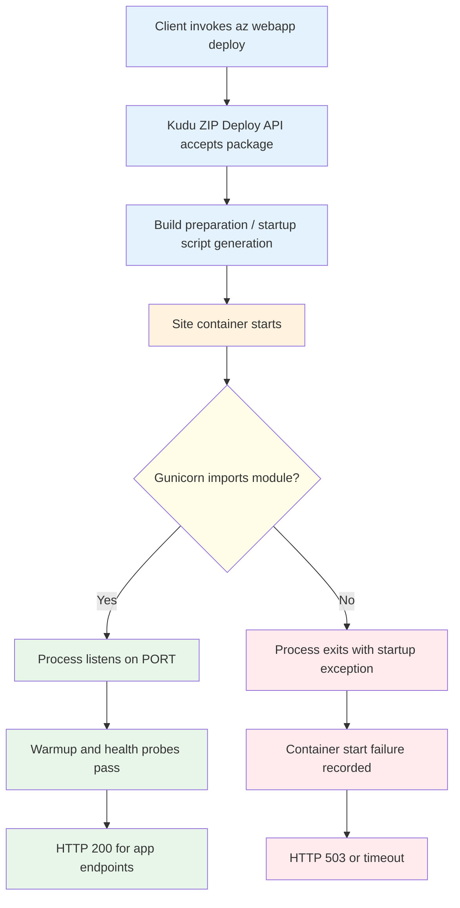
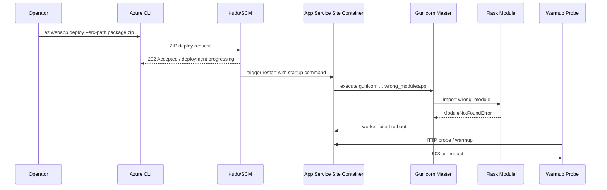
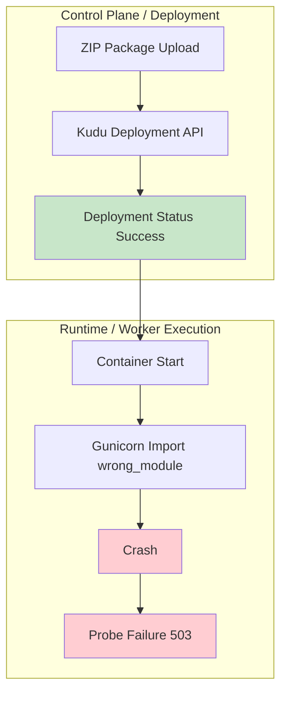
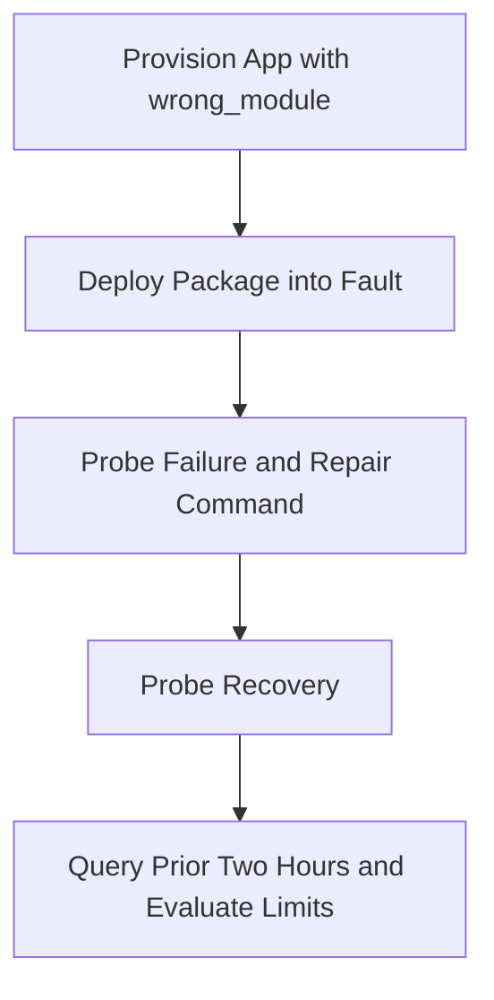

# Lab: Deployment Succeeded, Startup Failed (Wrong Module in Startup Command)

This lab reproduces a high-frequency Azure App Service Linux incident pattern:
deployment appears successful,
but runtime startup fails,
so the site returns 503 or timeout errors.

The lab is intentionally designed to prove one specific distinction:
**deployment success and runtime success are separate control-plane and data-plane outcomes**.

---

This guide helps you explain why `az webapp deploy` can succeed while the app still fails at runtime, trace the Linux startup lifecycle, detect `wrong_module:app` failures from logs, validate recovery after correcting the startup command to `app:app`, and produce an artifact-backed incident narrative.

!!! warning "Execution and evidence status"
    The structured healthy → fault → recovery runner completed on Azure on
    October 16, 2026 as run `20261016T075147Z-6d019de6e2f2`. Execution was
    **COMPLETE**, the Golden evaluator returned **SUPPORTED**, recovery reached
    HTTP 200, and cleanup was **VERIFIED** by a final `az group exists` result of
    `false`. The retained package is a sanitized bridge derived from the private
    raw runner capture. Independent reproduction remains **NOT_RUN**; this
    AI-agent execution does not satisfy the human-independence gate.

    The separate fault-first `trigger.sh` procedure remains **NOT_RUN** under its
    documented one-probe sequence. The April 4, 2026 artifacts remain historical
    observations with **INCONCLUSIVE** causal ordering and unverified cleanup.

    Start with the [runbook](#3-runbook). Review the [historical evidence](#4-experiment-log) and its [timeline limitation](#47-hypothesis-verdict). The fixed scope is Linux B1, Python 3.11, a dedicated resource group, one web app, and one Log Analytics workspace. Configuration/API access and public HTTPS reachability are required.

## Lab Metadata

| Attribute | Value |
|---|---|
| Difficulty | Intermediate |
| Estimated Duration | 45-60 minutes |
| Tier | Basic |
| Failure Mode | Deployment succeeds, but the app fails startup because Gunicorn references a non-existent module |
| Skills Practiced | Startup command validation, deployment-vs-runtime analysis, console and platform log correlation, recovery verification |

## 1) Background

### 1.1 Why this lab exists

In App Service Linux,
deployment and process startup are decoupled.

A deployment pipeline (ZIP deploy / Oryx build / Kudu APIs) can complete successfully,
yet the process entrypoint may crash immediately once container startup begins.

This is exactly what happens when Gunicorn is pointed to a module that does not exist.

In this lab:

- The configured startup command initially uses `wrong_module:app`.
- The code package itself is valid.
- Deployment APIs return success signals.
- Runtime logs show `ModuleNotFoundError`.
- Health endpoint remains unavailable until startup command is corrected.

### 1.2 Deployment success vs runtime success

Use this mental model:

- **Deployment success** means the platform accepted and unpacked/build-prepared your package.
- **Runtime success** means worker process booted,
  app bound to expected port,
  and warmup probes succeeded.

Deployment success does **not** imply runtime success.

<!-- diagram-id: troubleshooting-lab-guides-deployment-succeeded-startup-failed-diagram-1 -->


| Command/Flag | Purpose |
|---|---|
| `az webapp deploy` | Deploy application code to the Web App via Kudu ZIP Deploy API |

#### Portal view: Deployment Center (control-plane deployment status)

[[[ shot("troubleshooting--deployment-center--01-deployment-center") ]]]

The `Deployment Center` blade is the Portal-visible surface of the same Kudu ZIP Deploy / Oryx build pipeline that the diagram above traces from box A to box C. When this lab's `az webapp deploy --type zip` command completes, this blade is where an operator first looks to confirm "the deployment worked" - the `Settings` tab reports the configured source, the `Logs` tab lists each deployment ID with a `Success` status, and the production-slot banner reflects the lab's single-slot setup. The critical insight is that this entire blade is a control-plane view: a green `Success` here only tells you the package was accepted, unpacked, and that the startup command was scheduled - it tells you nothing about whether the worker actually imported `app:app`, bound `PORT`, or passed the warmup probe (boxes D through K in the diagram). Treat this blade as "deployment delivered to the host" evidence only, and pair it with the runtime evidence from sections 3.6 through 3.10 before declaring an incident resolved.

### 1.3 Startup lifecycle details on App Service Linux

For Python on App Service Linux,
the high-level startup chain is:

1. Site content is deployed.
2. Platform prepares startup invocation (often via Oryx-generated script).
3. Container starts.
4. Startup command launches Gunicorn.
5. Gunicorn resolves `<module>:<application-object>`.
6. Worker boots if module import succeeds.
7. Warmup probes verify app responsiveness.

If step 5 fails,
Gunicorn exits,
container cannot become healthy,
and probes keep failing until timeout / restart.

<!-- diagram-id: troubleshooting-lab-guides-deployment-succeeded-startup-failed-diagram-2 -->


| Command/Flag | Purpose |
|---|---|
| `az webapp deploy --src-path package.zip` | Upload a ZIP package to the Web App; Kudu accepts the artifact even if the startup command is invalid |

### 1.4 Why `wrong_module:app` fails immediately

Gunicorn expects `module:callable`.

In this lab app,
the Flask object is defined in `app.py` as `app = Flask(__name__)`.

Therefore,
valid module reference is:

```text
app:app
```

Invalid reference:

```text
wrong_module:app
```

The failure occurs before request handling,
so the app never reaches a state where `/health` can respond.

### 1.5 Storage setting context for startup incidents

This lab focuses on module import failure,
but startup incidents are often misattributed to storage behavior.

`WEBSITES_ENABLE_APP_SERVICE_STORAGE` is relevant mostly for custom containers and shared `/home` storage semantics.

Key point for this incident class:

- Startup command and module resolution failures happen even when storage is fine.
- Do not over-index on storage when logs clearly show import exceptions.

### 1.6 App Service startup timeout signal

Platform logs in this dataset include this diagnostic phrase:

`Container did not start within expected time limit of 230s`

Interpretation:

- Platform waited for startup and warmup completion.
- App process never reached healthy serving state in time.
- The 230s marker is a startup/warmup failure symptom,
  not a deployment pipeline failure.

### 1.7 Failure mode taxonomy for this lab

| Layer | Signal | Observed in artifacts | Meaning |
|---|---|---|---|
| Deployment API | ZIP deploy 202 / deployment API 200 | Yes | Package accepted and deployment workflow running |
| HTTP endpoint | `/` and `/health` return 503 or timeout | Yes | Site process unavailable or not ready |
| Console log | `ModuleNotFoundError` / `No module named 'wrong_module'` | Yes | Gunicorn failed to import startup module |
| Platform log | `Container did not start within expected time limit of 230s` | Yes | Startup warmup not completed in SLA window |
| Post-fix health | `/health` returns 200 | Yes | Startup command corrected, runtime healthy |

### 1.8 Diagram: control-plane success with data-plane failure

<!-- diagram-id: troubleshooting-lab-guides-deployment-succeeded-startup-failed-diagram-3 -->


### 1.9 Background takeaway

When an incident says:

> “Deployment succeeded but app is down”

the first triage branch should include startup command validation,
not only deployment rollback.

---

## 2) Hypothesis

### 2.1 Primary hypothesis (this lab)

**When the startup command references a non-existent module (`wrong_module:app` instead of `app:app`), the container process crashes immediately, while deployment still reports success because package deployment and runtime boot are separate stages.**

### 2.2 Causal chain

```text
1. ZIP deploy uploads valid application code
      ↓
2. Kudu deployment APIs return success/accepted responses
      ↓
3. App restart runs startup command with wrong module
      ↓
4. Gunicorn import fails: ModuleNotFoundError
      ↓
5. Worker process exits before app can bind and serve
      ↓
6. Warmup/health probing fails (503/timeout)
      ↓
7. After startup command corrected to app:app, process boots and /health returns 200
```

### 2.3 Proof criteria for the checked-in procedure

All criteria below must be met:

1. The Bicep deployment provisions `wrong_module:app` before the application package is deployed.
2. `az webapp deploy` completes while that faulty startup command remains configured.
3. The trigger's first `/health` probe returns a non-200 result or times out.
4. The trigger changes the startup command to `app:app` without redeploying the package.
5. The trigger's post-repair `/health` probe returns 200, or a later manual probe confirms recovery after restart completes.
6. The verifier finds a matching `ModuleNotFoundError`, `wrong_module`, or `No module named` console-log row within its rolling two-hour query window. A zero count is inconclusive because ingestion may be delayed or the evidence may have aged out.

### 2.4 Disproof criteria

Any one condition disproves the hypothesis:

- Startup command is already correct during failure window.
- No module import errors exist in console logs.
- Runtime remains unhealthy even after command fixed to `app:app`.
- Failure is explained by unrelated root cause (for example platform outage,
  auth failures,
  or networking ACL blocks) with supporting evidence.

### 2.5 Alternate hypotheses considered

| Alternate hypothesis | Why considered | Historical indication; recheck on a new run |
|---|---|---|
| Code package is corrupt | 503 present | Historical artifacts show deployment success and later recovery without a package change, but their ordering is inconclusive |
| Port binding mismatch | Typical startup issue | Historical recovery followed an entrypoint repair; confirm the same sequence in a new isolated run |
| Storage mount issue | Can break startup in some custom setups | Historical logs contain `ModuleNotFoundError`; collect same-run evidence before rejecting storage issues |
| Python runtime mismatch | Can fail imports | Historical failure text names the configured missing module; recheck the active runtime and logs on a new run |

### 2.6 Expected observations if hypothesis is true

| Procedure stage | Expected from the checked-in scripts | Current procedure status |
|---|---|---|
| Provisioning | Bicep configures `wrong_module:app` | NOT_RUN |
| Deployment and initial probe | ZIP deployment completes, then `/health` is non-200 or times out | NOT_RUN |
| Automatic repair | Trigger changes the startup command to `app:app` | NOT_RUN |
| Post-repair probe | `/health` returns 200 after restart, or requires a later manual check | NOT_RUN |
| Verification | Rolling two-hour console-log query finds the targeted import-failure evidence | NOT_RUN |

### 2.7 Risk to production if not detected

- False confidence from green deployment pipeline.
- Extended outage while teams chase irrelevant causes.
- Repeated restarts increasing noise in platform logs.
- Customer-facing availability incidents despite “successful release” status.

---

## 3) Runbook

The current procedure is fault-first: Bicep provisions the web app with `wrong_module:app`, the trigger deploys valid application code into that fault, records one failed probe, repairs the startup command to `app:app`, and records one post-repair probe. The verifier then searches a rolling two-hour console-log window. The archived artifacts below came from an earlier procedure and are not evidence that these checked-in scripts have run successfully.

Define the expected fault, repair, and rolling query window before execution. Preserve terminal output and any collected evidence outside the disposable resource group without overwriting earlier captures. A successful repair probe does not assert cleanup or independent reproduction, and a zero verifier count is inconclusive rather than a pass.

Use only a dedicated disposable resource group with permission to create App Service and Log Analytics, configure diagnostics, query logs, and delete the group. B1 compute and Log Analytics ingestion incur charges until cleaned up. Run one experiment at a time with no concurrent configuration changes. Read [Clean Up](#clean-up) before deployment; it also applies to failed or interrupted runs. Raw captures contain real resource IDs and configuration: keep them private outside Git, review and sanitize before publication, and retain public transformation records separately.

### 3.0 Structured runner

After deploying the checked-in Bicep template, the new runner can establish its
own healthy baseline, inject `wrong_module:app`, collect bounded fault-window
evidence, and restore `app:app`. This runner is additive: the checked-in
`trigger.sh` and `verify.sh` still implement the fault-first procedure described
throughout sections 3.1–3.11.

```bash
export APP_NAME="$(az webapp list --resource-group "$RG" --query '[0].name' --output tsv | tr -d '\r\n')"
python3 labs/deployment-succeeded-startup-failed/run.py execute "$RG" "$APP_NAME" --output /tmp/startup-lab-private
export RUN_DIR="/tmp/startup-lab-private/<printed-run-directory>"
python3 labs/deployment-succeeded-startup-failed/run.py evaluate "$RUN_DIR"
```

| Command | Purpose |
|---|---|
| `az webapp list` | Read the single app name created in the dedicated resource group. |
| `--resource-group` | Limit discovery to the lab-owned resource group. |
| `--query '[0].name'` | Select the generated web-app name. |
| `--output tsv` | Return a shell-safe scalar; the pipeline strips Windows line endings. |
| `run.py execute` | Run healthy, fault, and recovery phases and print the immutable run directory. |
| `--output` | Store private raw evidence outside the repository. |
| `run.py evaluate` | Recompute the verdict from the saved run without contacting Azure. |

The runner contract is `labs/deployment-succeeded-startup-failed/contract.json`.
Exit codes are `0`
SUPPORTED, `1` CONTRADICTED, `2` INCONCLUSIVE, `3` NOT_TESTED, and `4`
evidence-invalid. Evidence validity, hypothesis, cleanup, and independent
reproduction remain separate. Do not edit a deficient run; preserve it and make
a new run after correcting the procedure.

Run `20261016T075147Z-6d019de6e2f2` exercised this path in Korea Central on B1
Linux with Python 3.11. Its capture window was
`2026-10-16T07:51:47.555754+00:00` through
`2026-10-16T08:01:33.709704+00:00`. The baseline returned 200, the fault reached
503, Log Analytics returned two exact fault-window
`ModuleNotFoundError: No module named 'wrong_module'` rows, and recovery returned
200. The retained evidence includes every timestamped probe and the three phase
windows. The cleanup record reached `VERIFIED` at
`2026-10-16T08:02:54.778086+00:00`, after which the separate group-existence
check returned `false`. The replayable sanitized package is under
`evidence/runs/20261016T075147Z-6d019de6e2f2/`.

### 3.1 Prerequisites

| Requirement | Validation command |
|---|---|
| Azure CLI authenticated | `az account show` |
| Resource provider access | `az group list --output table` |
| Bash shell | `bash --version` |
| Python 3.11 or newer (standard library only) | `python3 --version` |
| curl | `curl --version` |
| Azure CLI with Log Analytics query support and Bicep | `az version` and `az bicep version` |

### 3.2 Environment variables

```bash
export RG="rg-lab-startup"
export LOCATION="koreacentral"
```

### 3.3 Deploy infrastructure

```bash
az group create \
  --name "$RG" \
  --location "$LOCATION"

az deployment group create \
  --resource-group "$RG" \
  --template-file "labs/deployment-succeeded-startup-failed/main.bicep" \
  --parameters "baseName=labstart"
```

| Command/Flag | Purpose |
|---|---|
| `az group create` | Create the resource group for lab resources |
| `--name` | Resource group name |
| `--location` | Azure region for the resource group |
| `az deployment group create` | Deploy the Bicep template to provision App Service with the intentional `wrong_module:app` startup fault |
| `--resource-group` | Target dedicated lab resource group |
| `--template-file` | Path to the Bicep template that sets `wrong_module:app` before the package deployment |
| `--parameters baseName` | Base name prefix for all generated resource names |

Capture app name:

```bash
APP_NAME=$(az webapp list \
  --resource-group "$RG" \
  --query "[0].name" \
  --output tsv)

echo "$APP_NAME"
```

| Command | Purpose |
|---------|---------|
| `az webapp list --resource-group "$RG" --query "[0].name" --output tsv` | Lists web apps in the lab resource group and returns the first app name so the trigger can target it. |
| `--resource-group "$RG" --query "[0].name" --output tsv` | Limits the app list to this resource group. |
| `--query "[0].name" --output tsv` | Selects the `name` field from the first item in the returned web-app array. |
| `--output tsv` | Returns the app name as plain text for shell variable assignment. |

### 3.4 Trigger the incident

```bash
bash "labs/deployment-succeeded-startup-failed/trigger.sh" "$RG" "$APP_NAME"
```

The checked-in trigger packages and deploys the application while the Bicep-defined `wrong_module:app` startup command is active. After a 15-second wait it probes `/health` once, reports the non-200 result expected during the fault, changes the startup command to `gunicorn --bind=0.0.0.0:8000 app:app`, waits 20 seconds, and probes `/health` once more. A final `200` confirms recovery; any other status means the app may still be restarting and must be checked again manually.

```bash
bash "labs/deployment-succeeded-startup-failed/verify.sh" "$RG"
```

The checked-in verifier selects the first Log Analytics workspace in the resource group and queries `AppServiceConsoleLogs` from the previous two hours for `ModuleNotFoundError`, `wrong_module`, or `No module named`. It prints the matching count and up to 20 recent rows. A positive count is the expected startup-failure evidence; zero means evidence has not arrived or is outside the query window, not that the fault was absent.

!!! warning "NOT_RUN"
    This revised procedure has not been rerun for the currently checked-in `trigger.sh` and `verify.sh`. The archived artifacts later in this guide came from an earlier procedure and do not validate these exact commands.

Sections 3.5–3.11 provide optional manual diagnostics and recovery commands. Their illustrative rolling-window queries are separate from `verify.sh`, whose checked-in query searches the previous two hours. If interruption prevents automatic recovery, use 3.11 and then clean up; do not mark that interrupted run successful.

### 3.5 Verify startup command before and after

Before repair (Bicep-defined value for the checked-in procedure):

```text
gunicorn --bind=0.0.0.0:8000 --timeout=120 wrong_module:app
```

After repair (value set by the checked-in trigger):

```text
gunicorn --bind=0.0.0.0:8000 app:app
```

CLI verification command:

```bash
az webapp config show \
  --resource-group "$RG" \
  --name "$APP_NAME" \
  --query "appCommandLine" \
  --output tsv
```

| Command | Purpose |
|---------|---------|
| `az webapp config show --resource-group "$RG" --name "$APP_NAME" --query "appCommandLine" --output tsv` | Retrieves the configured startup command so you can compare the broken and fixed module references. |
| `--resource-group "$RG" --name "$APP_NAME" --query "appCommandLine" --output tsv` | Looks up the app configuration in this resource group. |
| `--name "$APP_NAME" --query "appCommandLine" --output tsv` | Targets this web app's configuration. |
| `--query "appCommandLine" --output tsv` | Projects only the `appCommandLine` field from the site configuration. |
| `--output tsv` | Returns the startup command as plain text for direct comparison. |

| Command/Flag | Purpose |
|---|---|
| `az webapp config show` | Retrieve the Web App site configuration |
| `--query "appCommandLine"` | Extract only the startup command to verify the module reference |
| `--output tsv` | Plain text output for easy comparison before and after fix |

### 3.6 Probe health endpoint during recovery

```bash
APP_HOST_NAME=$(az webapp show \
  --resource-group "$RG" \
  --name "$APP_NAME" \
  --query "defaultHostName" \
  --output tsv)

APP_URL="https://$APP_HOST_NAME"

for attempt in 1 2 3 4; do
  status_code=$(curl \
    --silent \
    --show-error \
    --output /dev/null \
    --write-out "%{http_code}" \
    --max-time 20 \
    "$APP_URL/health" || true)
  echo "$attempt,$status_code"
  sleep 8
done
```

| Command | Purpose |
|---------|---------|
| `az webapp show --resource-group "$RG" --name "$APP_NAME" --query "defaultHostName" --output tsv` | Retrieves the app hostname so the recovery probe loop can target the correct public URL. |
| `--resource-group "$RG" --name "$APP_NAME" --query "defaultHostName" --output tsv` | Looks up the app in this resource group. |
| `--name "$APP_NAME" --query "defaultHostName" --output tsv` | Targets this web app. |
| `--query "defaultHostName" --output tsv` | Projects only the app's `defaultHostName` field. |
| `--output tsv` | Returns the hostname as plain text for shell variable assignment. |

Observed sequence from artifact `recovery-probes-20260404T054537Z.csv`:

```text
1,000000,2026-04-04T05:46:52Z
2,000000,2026-04-04T05:47:05Z
3,000000,2026-04-04T05:47:24Z
4,200,2026-04-04T05:47:30Z
```

Interpretation:

- Attempts 1-3: startup not yet healthy.
- Attempt 4: service recovered after command correction and restart completion.

### 3.7 Collect diagnostics endpoints after recovery

```bash
curl --silent --show-error "$APP_URL/diag/stats"
curl --silent --show-error "$APP_URL/diag/env"
curl --silent --show-error "$APP_URL/health"
```

Observed post-fix health payload:

```json
{"status":"healthy"}
```

Observed post-fix stats payload (artifact):

```json
{"endpoint_counters":{"<unknown>":1,"diag_env":1,"diag_stats":1,"health":1},"pid":1896,"process_start_time":"2026-04-04T05:47:26.277049+00:00","request_count":5,"uptime_seconds":383.853}
```

### 3.8 Query KQL evidence (HTTP)

```kusto
AppServiceHTTPLogs
| where TimeGenerated > ago(4h)
| where CsHost contains "azurewebsites"
| where CsUriStem in ("/", "/health", "/diag/stats", "/diag/env", "/api/zipdeploy")
| project TimeGenerated, CsUriStem, ScStatus, TimeTaken, CsHost
| order by TimeGenerated desc
```

Observed statuses in artifact `kql-http-20260404T060610Z.json`:

- `200`: 12 rows
- `499`: 3 rows
- `503`: 5 rows
- `202`: 2 rows

### 3.9 Query KQL evidence (console)

Log stream catches Python tracebacks the instant Gunicorn emits them, well ahead of the ingestion lag that affects the query below. Keep the `Runtime` radio selected and pin `Instances` to a single worker so application-side boot failures aren't interleaved across instances, then use the query below to confirm the same lines landed in `AppServiceConsoleLogs` for reporting.

```kusto
AppServiceConsoleLogs
| where TimeGenerated > ago(4h)
| where ResultDescription has_any ("ModuleNotFoundError", "wrong_module", "Worker failed to boot")
| project TimeGenerated, ResultDescription
| order by TimeGenerated desc
```

Observed log lines:

```text
2026-04-04T05:55:06.4678473Z [2026-04-04 05:55:06 +0000] [1895] [ERROR] Reason: Worker failed to boot.
2026-04-04T05:55:04.0857549Z No module named 'wrong_module'
2026-04-04T05:55:04.0838827Z ModuleNotFoundError: No module named 'wrong_module'
2026-04-04T05:54:49.4185745Z Site's appCommandLine: gunicorn --bind=0.0.0.0:8000 --timeout=120 wrong_module:app
```

### 3.10 Query KQL evidence (platform)

```kusto
AppServicePlatformLogs
| where TimeGenerated > ago(4h)
| where Message has_any ("Container did not start within expected time limit of 230s", "Starting container", "stopped")
| project TimeGenerated, Level, Message
| order by TimeGenerated desc
```

Observed platform messages include:

```text
State: Stopping, Action: StoppingSiteContainers, LastErrorDetails: Container did not start within expected time limit of 230s.
State: Stopping, Action: CancellingStartup, LastErrorDetails: Container did not start within expected time limit of 230s.
Starting container: 31a19ef7e66d_app-labstartup-... .
Site: app-labstartup-... stopped.
```

### 3.11 Remediation command (direct)

If reproducing manually and app remains unhealthy,
force the known-good startup command:

```bash
az webapp config set \
  --resource-group "$RG" \
  --name "$APP_NAME" \
  --startup-file "gunicorn --bind=0.0.0.0:8000 app:app"
```

| Command | Purpose |
|---------|---------|
| `az webapp config set --resource-group "$RG" --name "$APP_NAME" --startup-file "gunicorn --bind=0.0.0.0:8000 app:app"` | Replaces the broken startup command with the same known-good Gunicorn command that the checked-in trigger applies. |
| `--resource-group "$RG" --name "$APP_NAME" --startup-file "gunicorn --bind=0.0.0.0:8000 app:app"` | Applies the configuration change in this resource group. |
| `--name "$APP_NAME" --startup-file "gunicorn --bind=0.0.0.0:8000 app:app"` | Targets this web app. |
| `--startup-file "gunicorn --bind=0.0.0.0:8000 app:app"` | Sets the app startup command to the exact corrected Gunicorn entrypoint used by `trigger.sh`. |

Then verify:

```bash
curl --silent --show-error --fail "$APP_URL/health"
```

## 4) Experiment Log

This section is a factual record from:

`labs/deployment-succeeded-startup-failed/artifacts-sanitized/`

### 4.1 Artifact inventory

| Phase | Artifact | Purpose |
|---|---|---|
| Baseline | `baseline/app-config.json` | Confirms initial startup command |
| Baseline | `baseline/startup-command.txt` | Human-readable startup command snapshot |
| Baseline | `baseline/app-state.json` | App resource state |
| Baseline | `baseline/root-response.txt` | Front-door symptom snapshot |
| Trigger | `trigger/startup-cmd-before-*.txt` | Command before remediation |
| Trigger | `trigger/startup-cmd-after-*.txt` | Command after remediation |
| Trigger | `trigger/recovery-probes-*.csv` | Health recovery timing |
| Trigger | `trigger/diag-stats-postfix-*.json` | Early post-fix process health |
| Trigger | `trigger/kql-http-*.json` | HTTP telemetry evidence |
| Trigger | `trigger/kql-console-*.json` | Module import failure evidence |
| Trigger | `trigger/kql-platform-*.json` | Startup timeout lifecycle evidence |
| Postfix | `postfix/diag-stats-*.json` | Stable post-fix process state |
| Postfix | `postfix/diag-env-*.json` | Runtime environment diagnostics |
| Postfix | `postfix/health-*.json` | Final health confirmation |

### 4.2 Baseline observations

#### 4.2.1 App is running as a resource, but not healthy as workload

File: `baseline/app-state.json`

```json
{
  "kind": "app,linux",
  "state": "Running"
}
```

Interpretation:

- Control-plane resource state is `Running`.
- This does not guarantee app process health.

#### 4.2.2 Startup command is misconfigured at baseline

File: `baseline/startup-command.txt`

```text
gunicorn --bind=0.0.0.0:8000 --timeout=120 wrong_module:app
```

File: `baseline/app-config.json` (`appCommandLine` field)

```text
gunicorn --bind=0.0.0.0:8000 --timeout=120 wrong_module:app
```

#### 4.2.3 User-facing symptom at baseline

File: `baseline/root-response.txt`

Observed content includes:

```html
:( Application Error
If you are the application administrator, you can access the diagnostic resources
```

This aligns with upstream 503 and startup failure patterns.

#### 4.2.4 Control-plane view: Deployment Center reports success

While the runtime is failing, the App Service control plane still reports the deployment as successful. This is the central illusion of "deployment succeeded but startup failed."

[[[ shot("troubleshooting--deployment-center--02-depstart-successful-deploy") ]]]

Purpose: Show that Deployment Center — the primary UI operators consult after a `az webapp deploy` — reports **Succeeded (Active)** for the exact deployment that produces a broken runtime.
Look for: The green "Succeeded" badge on the row with `OneDeploy` message and the timestamp of the deployment that immediately preceded the failure window.
Expected result: Deployment ID visible, Status column shows Succeeded, no error indication anywhere on this blade.
Next step: Cross-reference this timestamp against `AppServicePlatformLogs` runtime failure events (§4.4.4) — the two events are 90-120 seconds apart, which is the diagnostic window operators must learn to inspect.

### 4.3 Trigger and recovery observations

#### 4.3.1 Command change is explicit and minimal

Before:

```text
gunicorn --bind=0.0.0.0:8000 --timeout=120 wrong_module:app
```

After:

```text
gunicorn --bind=0.0.0.0:8000 --timeout=120 app:app
```

Only the module reference changed.

#### 4.3.2 Recovery probe timeline

File: `trigger/recovery-probes-20260404T054537Z.csv`

| Probe attempt | HTTP status | UTC timestamp |
|---|---|---|
| 1 | 000000 | 2026-04-04T05:46:52Z |
| 2 | 000000 | 2026-04-04T05:47:05Z |
| 3 | 000000 | 2026-04-04T05:47:24Z |
| 4 | 200 | 2026-04-04T05:47:30Z |

Interpretation:

- There is a short recovery window while restart stabilizes.
- Successful 200 appears once corrected startup process is serving.

#### 4.3.3 Early post-fix process evidence

File: `trigger/diag-stats-postfix-20260404T054537Z.json`

```json
{"endpoint_counters":{"<unknown>":1,"health":1},"pid":1896,"process_start_time":"2026-04-04T05:47:26.277049+00:00","request_count":3,"uptime_seconds":4.34}
```

Key detail:

- `process_start_time` is consistent with restart during fix.
- Process is now alive and counting requests.

### 4.4 Telemetry evidence from KQL artifacts

#### 4.4.1 HTTP log evidence

Artifact: `trigger/kql-http-20260404T060610Z.json`

Status summary:

| Status | Count | Interpretation |
|---|---|---|
| 200 | 12 | Healthy responses after fix |
| 499 | 3 | Client-aborted/timeout during unstable window |
| 503 | 5 | Unavailable during startup failure |
| 202 | 2 | Deployment API async accepted |

Selected rows:

| TimeGenerated (UTC) | Path | Status | TimeTaken(ms) |
|---|---|---|---|
| 2026-04-04T05:53:51.718877Z | /health | 200 | 4 |
| 2026-04-04T05:47:29.664099Z | /health | 200 | 71 |
| 2026-04-04T05:47:29.415736Z | /health | 499 | 19241 |
| 2026-04-04T05:47:29.415557Z | /health | 499 | 38700 |
| 2026-04-04T05:47:29.415363Z | /health | 499 | 58319 |
| 2026-04-04T05:46:16.764962Z | /health | 503 | 38965 |
| 2026-04-04T05:33:23.554879Z | / | 503 | 98 |
| 2026-04-04T05:32:59.155215Z | / | 503 | 37700 |
| 2026-04-04T05:16:36.397916Z | /api/zipdeploy | 202 | 2409 |

#### 4.4.2 Console log evidence (intended app-level cause, from prior artifact set)

Artifact: `trigger/kql-console-20260404T060610Z.json`

!!! note "Source and scope of this table"
    The rows below are from an earlier reproduction run (April 2026 timestamps). They document the **intended** app-level cause — the `wrong_module` reference producing a Python `ModuleNotFoundError` inside the container — and are the reason the container process exits and never becomes healthy. In the current re-capture run for this lab (July 2026), `AppServiceConsoleLogs` remained empty despite `az webapp log config --application-logging filesystem --level information --docker-container-logging filesystem` being enabled; the platform pipeline captured the same failure but only via `AppServicePlatformLogs` (see §4.4.4). The observed empty-`AppServiceConsoleLogs` state is consistent with the container exiting before console output was collected in LAW; the exact STDOUT collector timing on this failure mode is not proven from the data captured here. The operational conclusion — for this failure mode, treat `AppServicePlatformLogs` as authoritative — holds regardless of the underlying mechanism.

Critical rows:

| TimeGenerated (UTC) | ResultDescription |
|---|---|
| 2026-04-04T05:55:06.4678473Z | `[ERROR] Reason: Worker failed to boot.` |
| 2026-04-04T05:55:04.0857549Z | `No module named 'wrong_module'` |
| 2026-04-04T05:55:04.0838827Z | `ModuleNotFoundError: No module named 'wrong_module'` |
| 2026-04-04T05:54:49.4185745Z | `Site's appCommandLine: ... wrong_module:app` |

This is direct proof of startup command misconfiguration **when console output is captured**. When it is not (as in the current run), the platform log evidence in §4.4.4 becomes the authoritative source for the failure lifecycle.

#### 4.4.3 Platform log evidence

Artifact: `trigger/kql-platform-20260404T060610Z.json`

Representative messages:

| TimeGenerated (UTC) | Message excerpt |
|---|---|
| 2026-04-04T05:55:28.8291049Z | `LastErrorDetails: Container did not start within expected time limit of 230s` |
| 2026-04-04T05:55:07.6972411Z | `Action: CancellingStartup ... 230s` |
| 2026-04-04T05:54:17.193421Z | `Starting container: 31a19ef7e66d_...` |
| 2026-04-04T05:46:45.5817646Z | `Starting container: 855e20d9828b_...` |
| 2026-04-04T05:55:35.0262875Z | `Site: app-labstartup-... stopped.` |

This connects app-level exception to platform startup timeout behavior.

#### 4.4.4 Live KQL evidence: startup lifecycle in AppServicePlatformLogs

The following KQL, executed against `AppServicePlatformLogs` in the current lab workspace, categorizes every startup lifecycle event into a human-readable `Phase` column. It is the authoritative evidence for this run because `AppServiceConsoleLogs` did not capture container STDOUT before the process exited (see §4.4.2 note).

```kusto
AppServicePlatformLogs
| where TimeGenerated > ago(90m)
| extend Msg = tostring(coalesce(
    column_ifexists("Message", ""),
    column_ifexists("ResultDescription", ""),
    column_ifexists("Details", "")
))
| where Msg has_any (
    "PullingImage",
    "MountingVolumes",
    "exit code: 3",
    "ContainerTimeout",
    "terminated during site startup",
    "Failed to start site",
    "blocked due to multiple, consecutive cold start failures"
)
| extend Phase = case(
    Msg has "PullingImage", "Pulling image",
    Msg has "MountingVolumes", "Mounting volumes",
    Msg has "exit code: 3", "Process exited (code 3)",
    Msg has "ContainerTimeout", "Startup timeout (230s)",
    Msg has "terminated during site startup", "Startup cancelled by platform",
    Msg has "Failed to start site", "Site reverted/stopped",
    Msg has "blocked due to multiple, consecutive cold start failures", "Cold-start safety block",
    "Other"
)
| project TimeGenerated, Phase, Msg
| order by TimeGenerated asc
```

[[[ shot("troubleshooting--log-analytics--04-depstart-startup-failed-kql") ]]]

Purpose: Show the deterministic lifecycle that platform diagnostics record when a container fails to become healthy: image pull → volume mount → process exit (code 3) → platform cancels startup → startup timeout after 230s → site reverted/stopped. This lifecycle repeats on every restart attempt.
Look for:

- The `Phase` column matches the six stages described above.
- The `TimeGenerated` column shows all six stages happen within one 40-60 second window per restart cycle.
- The `Msg` column contains the raw platform strings (`Action: PullingImage`, `Container has finished running with exit code: 3`, `LastError: ContainerTimeout`) that support each Phase label.

Expected result: 200+ rows (271 in this capture) over a 90-minute window, showing the container retry loop that runs until the platform's cold-start safety block engages.
Next step: Use the timeline chart in §4.4.5 to see how these runtime events align against the control-plane deployment event.

!!! warning "Diagnostic deviation from the original playbook"
    The original intent for this lab was to capture `AppServiceConsoleLogs` rows containing the `ModuleNotFoundError` traceback around the startup timeout window. In this re-capture run, `AppServiceConsoleLogs` stayed at **0 rows** for the failure window even though diagnostic settings were enabled via `az webapp log config --application-logging filesystem --level information --docker-container-logging filesystem` and the site was restarted and probed multiple times. `AppServicePlatformLogs` grew normally (543 → 710 rows during the probe cycle), which confirms the LAW ingestion pipeline is working end-to-end. This observed asymmetry — platform events present, console events absent — is consistent with the container exiting before console output was collected in LAW; the exact STDOUT collector timing on this failure mode is not proven from the data captured here. **Operational takeaway** (holds regardless of the underlying mechanism): for `deployment succeeded but startup failed` scenarios where the container exits before the health probe, treat `AppServicePlatformLogs` as the authoritative evidence source rather than `AppServiceConsoleLogs`. The `Phase` categorization above is the reusable pattern.

#### 4.4.5 Live KQL evidence: control-plane vs data-plane on the same timeline

The following KQL renders a column chart that overlays the successful deployment event (from Deployment Center metadata) against the platform-terminated startup events (from `AppServicePlatformLogs`) on a single minute-binned timeline. The single orange bar at the deploy timestamp against a sustained wall of red/blue/teal runtime-failure bars is the visual proof that "deployment succeeded" and "app running healthily" are two disjoint claims.

```kusto
let deploy = datatable(TimeGenerated:datetime, Event:string) [
    datetime(2026-07-02T15:23:30Z), "Deploy succeeded (control-plane)"
];
let runtime =
    AppServicePlatformLogs
    | where TimeGenerated > ago(120m)
    | extend Msg = tostring(coalesce(
        column_ifexists("Message", ""),
        column_ifexists("ResultDescription", ""),
        column_ifexists("Details", "")
    ))
    | where Msg has_any ("exit code: 3", "ContainerTimeout", "terminated during site startup")
    | extend Event = case(
        Msg has "exit code: 3", "Container exited (code 3)",
        Msg has "ContainerTimeout", "Startup timeout",
        "Platform cancelled startup"
    )
    | project TimeGenerated, Event;
union deploy, runtime
| summarize Count = count() by bin(TimeGenerated, 1m), Event
| render columnchart
```

The `deploy` datatable row is synthesized from the Deployment Center capture in §4.2.4 because `AppServiceHTTPLogs` only captures traffic to the front-door `*.azurewebsites.net` hostname, not to the SCM/Kudu (`*.scm.azurewebsites.net`) endpoint that receives ZIP deploys. This is by design in App Service diagnostic settings.

[[[ shot("troubleshooting--log-analytics--05-depstart-runtime-vs-deploy-timeline") ]]]

Purpose: Visually collapse the entire lab hypothesis into a single chart. The orange bar and the teal/blue bars are literally on the same time axis, in the same query result, in the same LAW workspace — and yet they represent completely disjoint outcomes.
Look for:

- The **single, isolated orange bar** at ~3:24 PM: this is the control-plane's report of success.
- The **~2 minute quiet gap** immediately after: the platform is pulling the image and starting the container.
- The **first sustained wave of colored bars** from 3:25 PM to ~3:35 PM: the container repeatedly fails to boot and platform terminates each attempt.
- The **quiescence from 3:36 PM to 3:48 PM**: the platform's cold-start safety block engages and stops retrying.
- The **second wave at 3:50-3:52 PM**: external HTTP probes to the front-door woke the container up, and it failed again identically.

Expected result: One tiny orange bar (count = 1) against 35+ runtime failure bars. If your capture shows any other pattern (for example, no runtime bars at all, or the orange bar appearing after the runtime bars), the hypothesis is falsified — treat the container as healthy or investigate a different failure mode.
Next step: In your own investigations, save this query into a Log Analytics workbook so any incident responder can render the same control-plane vs data-plane split for any deployment ID in under 60 seconds.

### 4.5 Postfix observations

#### 4.5.1 Final health

File: `postfix/health-20260404T055349Z.json`

```json
{"status":"healthy"}
```

#### 4.5.2 Final process stats

File: `postfix/diag-stats-20260404T055349Z.json`

```json
{"endpoint_counters":{"<unknown>":1,"diag_env":1,"diag_stats":1,"health":1},"pid":1896,"process_start_time":"2026-04-04T05:47:26.277049+00:00","request_count":5,"uptime_seconds":383.853}
```

#### 4.5.3 Final environment snapshot

File: `postfix/diag-env-20260404T055349Z.json`

```json
{"APP_STARTUP_COMMAND":"<unset>","PORT":"8000","SCM_DO_BUILD_DURING_DEPLOYMENT":"true","STARTUP_COMMAND":"<unset>","WEBSITES_PORT":"<unset>","WEBSITE_HOSTNAME":"app-labstartup-pt7yrjbt2zmv2.<azurewebsites-domain-redacted>","WEBSITE_INSTANCE_ID":"f7914080a1e04baaab7e548dc057c38527ceb352eed71d9074f19e190f413990","WEBSITE_SLOT_NAME":"<unset>"}
```

### 4.6 Timeline reconstruction

| Approx UTC | Event | Evidence |
|---|---|---|
| 05:16 | ZIP deploy accepted | HTTP log `/api/zipdeploy` status 202 |
| 05:32-05:46 | App endpoints return 503 / timeout patterns | HTTP logs for `/` and `/health` |
| 05:54-05:55 | Console logs show `wrong_module` import failures | Console KQL artifact |
| 05:46-05:47 | Recovery probes transition from `000000` to `200` | Recovery CSV |
| 05:47 onward | `/diag/stats`, `/diag/env`, `/health` return 200 | Trigger and postfix artifacts |

### 4.7 Hypothesis verdict

Verdict: **INCONCLUSIVE** for a single ordered causal run.

[Observed] The stored recovery probes reach 200 around 05:47 UTC, while the retained wrong-module console rows are timestamped 05:54–05:55 UTC. The set also lacks a pre-fault HTTP 200 capture and verified cleanup record. These records preserve useful examples of startup failure and health responses, but do not establish that the shown fault preceded the shown recovery in one isolated run.

[Not Proven] The historical collection does not prove that only the entrypoint changed or exclude concurrent restarts, networking failures, or mixed collection windows. Reevaluate the original timestamps without relabeling them as a new Azure run. The checked-in fault-first procedure requires a new deployment/fault/repair sequence, evidence from the verifier's rolling two-hour window, cleanup verification, and independent review before promotion.

### 4.8 Operational guidance distilled from this experiment

1. Always verify `appCommandLine` during startup incidents.
2. Separate deployment telemetry from runtime telemetry in dashboards.
3. Query console logs for import exceptions before scaling or redeploying.
4. Capture platform timeout messages (`230s`) for incident chronology.
5. Promote a pre-release startup command lint rule for Python apps.

### 4.9 Reusable KQL snippets

#### Console startup failures

```kusto
AppServiceConsoleLogs
| where TimeGenerated > ago(24h)
| where ResultDescription has_any (
    "ModuleNotFoundError",
    "No module named",
    "Worker failed to boot",
    "appCommandLine"
)
| project TimeGenerated, ResultDescription
| order by TimeGenerated desc
```

#### HTTP availability around deployment

```kusto
AppServiceHTTPLogs
| where TimeGenerated > ago(24h)
| where CsUriStem in ("/", "/health", "/api/zipdeploy", "/api/deployments/latest")
| summarize count() by CsUriStem, ScStatus
| order by CsUriStem asc, ScStatus asc
```

#### Platform startup timeout tracing

```kusto
AppServicePlatformLogs
| where TimeGenerated > ago(24h)
| where Message has_any (
    "Container did not start within expected time limit of 230s",
    "Starting container",
    "CancellingStartup",
    "stopped"
)
| project TimeGenerated, Level, Message
| order by TimeGenerated desc
```

---

## Expected Evidence

This section defines what you SHOULD observe at each phase of the lab. Use it to validate your investigation is on track.

### After Provisioning, Before the Trigger

| Evidence Source | Expected State | What to Capture |
|---|---|---|
| Deployment APIs (`/api/zipdeploy`, deployment status) | Deployment workflow returns success/accepted (200/202) | Successful deployment response and timestamp |
| App startup command config | Intentional missing-module reference provisioned by Bicep | `gunicorn --bind=0.0.0.0:8000 --timeout=120 wrong_module:app` |
| Application package | Not yet deployed by the trigger | Bicep deployment output and the trigger's subsequent deployment output |

### During Incident

| Evidence Source | Expected State | Key Indicator |
|---|---|---|
| AppServiceHTTPLogs | User-facing paths fail with 503 and long request duration | Repeated `503` with `TimeTaken` around `49751-49765 ms` |
| AppServiceConsoleLogs | Import failure for the targeted module in the fault window | `ModuleNotFoundError` mentioning `wrong_module`; absent logs are INCONCLUSIVE |
| AppServicePlatformLogs | Startup probe/cancellation/termination sequence appears | `Site startup probe failed after 43.86s`, `CancellingStartup, LastError: ContainerTimeout`, `Site container terminated during site startup`, `Failed to start site. Revert by stopping site.` |

### After Recovery

| Evidence Source | Expected State | Key Indicator |
|---|---|---|
| Startup command config | Module reference corrected by the trigger | `gunicorn --bind=0.0.0.0:8000 app:app` |
| Health endpoint | App starts and serves normally | The trigger's second `/health` probe returns `200`, or a later manual probe confirms recovery |
| AppServiceHTTPLogs | Availability restored | 200 responses resume for user-facing requests |
| AppServiceConsoleLogs | Fault evidence appears within the verifier window | `verify.sh` reports a positive count from its rolling two-hour query; zero remains inconclusive |

### Evidence Timeline

<!-- diagram-id: troubleshooting-lab-guides-deployment-succeeded-startup-failed-diagram-4 -->


### Evidence interpretation and falsification

For the checked-in fault-first procedure, deployment success while `wrong_module:app` is configured, a failed first probe, same-resource import-failure evidence within the verifier's rolling two-hour window, and recovery after the trigger sets `app:app` support the scoped hypothesis. A healthy app under the wrong-module configuration contradicts the predicted fault. A missing log match, a transport-only error, or a post-repair non-200 leaves the cause unresolved and requires additional collection rather than a pass. Platform restart, dependency problems, and concurrent changes remain competing explanations; a 503 or screenshot alone does not establish the module as the cause.

## Clean Up

Preserve terminal output and evidence outside the resource group, then clean up the dedicated group directly:

```bash
az group delete --name "$RG" --yes
az group exists --name "$RG"
```

| Command/Flag | Purpose |
|---|---|
| `az group delete` | Delete all resources in the dedicated lab group and wait for completion |
| `az group exists` | Verify the group no longer exists; expected output is `false` |
| `--name` | Dedicated resource group to delete/check |
| `--yes` | Confirm deletion of that group |

Save both command results with UTC timestamps. An accepted deletion request alone is not cleanup verification. No deletion or residual-resource check has been executed for the revised procedure.

## Related Playbook

- [Deployment Succeeded but Startup Failed](../playbooks/startup-availability/deployment-succeeded-startup-failed.md)

## See Also

- [Playbook: Deployment Succeeded but Startup Failed](../playbooks/startup-availability/deployment-succeeded-startup-failed.md)
- [Playbook: Container Didn't Respond to HTTP Pings](../playbooks/startup-availability/container-didnt-respond-to-http-pings.md)
- [Playbook: Warmup vs Health Check](../playbooks/startup-availability/warmup-vs-health-check.md)
- [Lab: Failed to Forward Request](./failed-to-forward-request.md)

## Sources

- [Configure a Linux Python app for Azure App Service](https://learn.microsoft.com/en-us/azure/app-service/configure-language-python)
- [Configure a custom startup file for Linux apps in Azure App Service](https://learn.microsoft.com/en-us/azure/app-service/configure-language-python#container-characteristics)
- [Configure a custom container for Azure App Service](https://learn.microsoft.com/en-us/azure/app-service/configure-custom-container)
- [Deploy files to Azure App Service](https://learn.microsoft.com/en-us/azure/app-service/deploy-zip)
- [Enable diagnostics logging for Azure App Service](https://learn.microsoft.com/en-us/azure/app-service/troubleshoot-diagnostic-logs)
- [Monitor App Service with Azure Monitor](https://learn.microsoft.com/en-us/azure/app-service/monitor-app-service)
