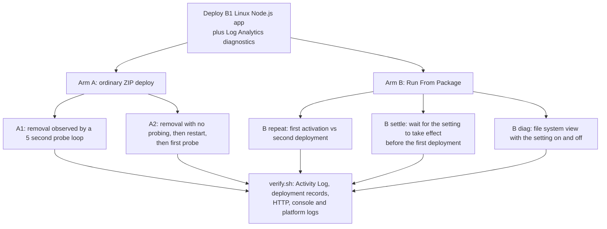

# Lab: Missing wwwroot Content Timeline and Run From Package

This lab practices the evidence discipline from the [Missing wwwroot Files and HTTP 404 playbook](../playbooks/missing-wwwroot-files-404.md) on a **synthetic** failure. The only way a file disappears is an explicit call that the experimenter makes. The call is instrumented, protected by a per-run token, and limited to one asset. The lab does not model a platform fault and does not show how to identify an unknown actor; it shows what the evidence sources can and cannot date when the actor is known by construction.

## Lab Metadata

| Attribute | Value |
|---|---|
| Difficulty | Intermediate |
| Estimated Duration | 2-3 hours (deployments take 1-3 minutes each, and the settle arm waits 4 minutes) |
| Tier | Basic (B1 Linux App Service Plan, Node.js 20) |
| Failure Mode | A static asset becomes absent from `wwwroot` and returns `404`; the lab instruments the only removal path |
| Skills Practiced | Building a file-loss timeline, reading Activity Log and HTTP logs without over-reading them, separating restart adjacency from causation, verifying a Run From Package mount instead of trusting the setting |

## 1) Background

### 1.1 Question

When an expected asset returns `404` and a restart is nearby, which observations date the loss and which only date the symptom? Separately: does Run From Package make `wwwroot` read-only on a Linux code app, and what happened when deployments followed the setting change closely?

### 1.2 Design

The app is a zero-dependency Node.js server that serves `/assets/probe.txt` from `wwwroot`. `POST /lab/remove-asset` removes that one asset, requires a per-run token in a request header, and writes one `LAB_AUDIT` console line that carries a non-secret run ID. The token is generated by `trigger.sh`, passed to the app as an app setting, and never written to a log, an artifact, or the repository. `GET /lab/fs` is also token-protected and returns only a summary: the `wwwroot` mount entry, a write test result, and the package directory listing.

<!-- diagram-id: lab-missing-wwwroot-content-arms -->


## 2) Hypothesis

- **H-A:** A removal inside the app is dated precisely only by instrumentation. The Activity Log records management operations such as app-setting writes and restarts, but no entry for the file removal. The first logged `404` dates the symptom and becomes queryable in Log Analytics only after an ingestion delay.
- **H-B:** A restart that happens before the first observed `404` does not mean the restart removed the file. The file is absent before the restart and still absent after a new process starts.
- **H-C (falsification arm):** With `WEBSITE_RUN_FROM_PACKAGE=1`, the same removal attempt fails with a read-only error because the package is mounted read-only.

### Predictions

1. The `LAB_AUDIT` removal time precedes the first `404` by well under a second when you probe, and by about a minute or more when you do not.
2. After a restart, the first `404` is seen within seconds of the restart request while the removal was minutes earlier.
3. With Run From Package enabled, the removal returns an error and the asset keeps returning `200`.

## 3) Runbook

### 3.1 Setup

Deploy the infrastructure with the shared script. It creates `rg-lab-missing-wwwroot-content`, deploys `main.bicep` (B1 Linux plan, Node.js 20 app, Log Analytics workspace, diagnostic settings), and writes `artifacts/.env`.

```bash
./labs/_shared/scripts/deploy-lab.sh missing-wwwroot-content koreacentral B1
source artifacts/.env
```

### 3.2 Experiment

Run each arm against the deployed app. `trigger.sh` packages the app (`package.sh`), deploys it with `az webapp deploy`, generates the per-run token, and writes a timestamped timeline and a manifest to `artifacts/raw/experiment/`. Each deployment waits until `/healthz` reports a new `startedAt` and stops the arm if none appears, because a `200` right after a deployment can come from the previous process.

```bash
./labs/missing-wwwroot-content/trigger.sh "$RG" "$APP_NAME" arm-a
./labs/missing-wwwroot-content/trigger.sh "$RG" "$APP_NAME" arm-b-repeat
./labs/missing-wwwroot-content/trigger.sh "$RG" "$APP_NAME" arm-b-settle
./labs/missing-wwwroot-content/trigger.sh "$RG" "$APP_NAME" arm-b-diag
```

| Arm | What it does |
|---|---|
| `arm-a` | Ordinary ZIP deploy. A1 removes the asset while a probe loop runs. A2 redeploys, removes the asset with no probing, waits, restarts the app, and probes after the restart |
| `arm-b-repeat` | Removes the setting and waits, deploys ordinarily, enables Run From Package and deploys immediately (first activation), attempts the removal, then deploys a second time and attempts the removal again |
| `arm-b-settle` | Removes the setting, redeploys ordinarily, enables the setting, waits for the setting change to restart the app plus 120 seconds, then deploys once and attempts the removal |
| `arm-b-diag` | Records the file system view with the setting on, then removes the setting and deploys immediately |

### 3.3 Collect evidence and clean up

`verify.sh` collects the Activity Log, plan-level Activity Log events, deployment records, and five KQL results. `SINCE` limits all of them to your run, so earlier activity is not mixed in. `cleanup.sh` deletes the resource group and keeps the `az group exists` result.

```bash
SINCE=2026-10-13T14:47:00Z ./labs/missing-wwwroot-content/verify.sh "$RG" "$APP_NAME" artifacts/raw/evidence
./labs/missing-wwwroot-content/cleanup.sh "$RG" artifacts/raw/evidence
```

The KQL results are logged-event evidence only if HTTP logging was enabled for the whole window. Rows can take two minutes or more to become queryable.

## 4) Experiment Log

All times are UTC on 2026-10-13. Sanitized outputs and per-arm manifests are under `labs/missing-wwwroot-content/artifacts-sanitized/`. App and host names are replaced with `<app-name>`.

### 4.1 Provenance and scope of the committed evidence

- Every arm used in the tables below ran on a B1 Linux plan with Node.js 20 in Korea Central (Azure CLI 2.89.0). Arm A and the two `arm-b-repeat` attempts ran together on one deployment of the lab. The `arm-b-settle` and `arm-b-diag` arms in the main results ran on a second deployment, because a first run of those two arms was invalidated (below).
- **A plan SKU change by something other than the experimenter.** During the first deployment, the Activity Log shows a `Microsoft.Web/serverfarms/write` at 15:36:49 by a service principal (identity redacted), and the manifests of the first `arm-b-settle` and `arm-b-diag` runs report `F1` at the end. Arm A and both repeat attempts finished before that change (the plan history in `f1-plan-run/plan-activity.json` shows no plan write between 14:40 and 15:36). Because the change happened during the first settle arm, those two arms were re-run on a fresh B1 deployment whose manifests record `B1` at start and end. The first results agreed with the re-run and are kept under `f1-plan-run/` for transparency; they are not used in the tables below.
- Each manifest records the run ID, arm times, plan SKU at start and end, package hash, and the source revision. The lab files were uncommitted at run time, so the manifests report `sourceDirtyAtRun: true`.
- `trigger.sh` changed during the runs: `arm-b-repeat` gained a step that removes the setting and waits before starting (its first attempt ran without it), and the manifests gained the SKU fields before the re-run. Other arm logic is the committed code.
- The first deployment's `evidence/` files were collected after the invalidated F1 arms had run. To keep that period out, the Activity Log, console-audit, platform-lifecycle, and deployment-record files were cut to events before 15:30 (a plain time filter, no other edits), and the aggregate KQL results that could not be re-bounded (latest logged success and the ingestion-delay summary) were removed. `deployment-records.json` holds only the latest 10 records at collection time, so it does not cover Arm A.
- Earlier exploratory runs used scripts that did not wait for a new process or protect the removal endpoint, and gave different numbers. They are excluded.

### 4.2 Arm A1: removal with a 5 second probe loop

| Event | Time | Source |
|---|---|---|
| Removal request sent | 14:51:15.620 | `arm-a-timeline.log` |
| Removal recorded by the app | 14:51:15.780 | `LAB_AUDIT asset-removed` with the run ID |
| First probe `404` (client side) | 14:51:15.969 | `arm-a1-probe.log` |
| First `404` row in `AppServiceHTTPLogs` | 14:51:16.106 | `TimeGenerated` of the row |

The probe loop produced 18 results: 4 `200` followed by 14 `404`.

### 4.3 Arm A2: removal with no probing, then a restart

| Event | Time | Source |
|---|---|---|
| Removal recorded by the app | 14:53:33.694 | `LAB_AUDIT asset-removed` |
| Restart requested | 14:55:03.808 | `arm-a-timeline.log` |
| Activity Log `restart/action` Started | 14:55:06.204 | `activity-log.json` |
| Restart command returned | 14:55:09.475 | `arm-a-timeline.log` |
| First probe after the restart request: `404`, `startedAt` unchanged (14:53:16.070) | 14:55:09.631 | `arm-a-timeline.log` |
| New process `startedAt` | 14:55:53.692 | `/healthz` |
| New process observed by polling | 14:56:00.852 | `arm-a-timeline.log` |
| Probe after the new process | 14:56:01.016 | `404` |

### 4.4 Arm B: Run From Package

| Step | Removal result | `wwwroot` mount | Write test | `SitePackages` content |
|---|---|---|---|---|
| Repeat attempt 2, first deployment right after enabling the setting | `200`, asset removed | No separate mount | `ok` | Two older ZIPs, no new ZIP, no `packagename.txt` |
| Repeat attempts 1 and 2, second deployment | not reached; the deployment failed (see 4.5) | not reached | not reached | not reached |
| Settle, first deployment after the setting took effect plus 120 seconds | `500`, `EROFS`; asset still `200` | `fuse.fuse-zip ... ro` | `EROFS` | One ZIP and `packagename.txt` |
| Diag, setting on | not attempted | `fuse.fuse-zip ... ro` | `EROFS` | Two ZIPs and `packagename.txt` |
| Diag, setting removed, deployed immediately | not attempted | No separate mount | `ok` | A third ZIP was stored; `packagename.txt` still present |

In attempt 1 of `arm-b-repeat` the first deployment also allowed the removal (`200`); the file system summary was not retained for that attempt.

### 4.5 The second Run From Package deployment

In both attempts of `arm-b-repeat`, the second deployment started 0.1 s after the first removal. The platform log then recorded `Update mount on running container.` followed by `Container failed to remount volume. Terminate.` (0.5 s later in attempt 2; 1.7 s and 0.2 s in two pairs in attempt 1), and the container was stopped and recreated. The Azure CLI reported `Site failed to start` after 611 s with `Deployment failed because the site failed to start within 10 mins.` A Kudu deployment record from the same minute shows `complete: true` and `status: 4`. The site did start later: at 15:04:55 in attempt 1 and 15:25:22 in attempt 2.

### 4.6 Control-plane and log evidence

The retained Activity Log (events from 14:48:06 to 15:19:34, covering Arm A and the start of the repeat attempts) contains these operation types: `Microsoft.Web/sites/config/write` (12 events, the app-setting changes), `Microsoft.Web/sites/publishxml/action` (10 events, the publishing-profile retrieval that accompanies `az webapp deploy`), `Microsoft.Web/sites/write` (1), `Microsoft.Web/sites/restart/action` (2, one restart as Started and Succeeded), and Azure Policy evaluation events under `Microsoft.Authorization/policies` (12). No entry names a file or the removal. The deployments themselves appear in the deployment records, not as a separate Activity Log operation type.

The six deployment records that end before 15:30 (14:59 to 15:21, the repeat attempts) are all `OneDeploy` with `status: 4`.

The ingestion delay was measured only on the B1 re-run, on the two HTTP-log rows for the asset: 56 s and 73 s between `TimeGenerated` and ingestion (`evidence-b1-settle-diag/kql-ingestion-lag.json`). Two rows are too few for a distribution, so treat the delay as roughly a minute, not as a bound.

Each deployment's retained cleanup record shows `groupExistsAfterDelete` as the string `"false"` (`evidence/cleanup.json` and `evidence-b1-settle-diag/cleanup.json`). The settle and diag evidence is in `evidence-b1-settle-diag/`; Arm A and the repeat attempts are in `evidence/`.

## Expected Evidence

| Evidence Source | Expected State |
|---|---|
| `LAB_AUDIT` lines (`AppServiceConsoleLogs`) | One `asset-removed` per successful removal and `asset-remove-failed` with code `EROFS` when the mount is read-only, each with the run ID |
| `activity-log.json` | App-setting writes, publishing-profile retrievals, one restart, and policy events; no file-level event |
| `evidence/kql-http-404.json` | Earliest and latest logged `404` for the asset |
| `evidence-b1-settle-diag/kql-ingestion-lag.json` | Rows and the minimum, median, and maximum ingestion delay (B1 re-run) |
| `arm-b-*-fs.json` | `wwwroot` mount entry, `writeTest`, and `SitePackages` listing for each activation |
| `arm-a-timeline.log` | Removal, restart, and probe timestamps for A1 and A2 |
| `failed-attempt/` | Timeline, CLI result, and platform lines for the two second-deployment failures |

### Falsification

The hypotheses would be falsified by any of these:

- The Activity Log contained an entry that names the removed file or the removal action (falsifies H-A's control-plane claim).
- The asset reappeared after the new process started (falsifies H-B's claim that the restart neither removed nor restored it).
- Removal succeeded after the package was mounted read-only (falsifies H-C).

Observed: none of these occurred for H-A and H-B. H-C failed in its naive form: the first deployment right after enabling the setting did **not** produce a read-only mount, and the removal succeeded. The removal prediction held in the settle arm only (`EROFS`); the diag arm did not attempt a removal and independently corroborated the read-only mount through its write test (`EROFS`).

## Observation

- [Observed] The Activity Log in the run window listed setting writes, publishing-profile retrievals, one restart, and policy events. It listed nothing about the file.
- [Observed] In A1 the first client `404` came 0.2 s after the instrumented removal, and the first `404` row in HTTP logs carried a `TimeGenerated` 0.3 s after it.
- [Observed] In A2 the removal preceded the restart request by 90.1 s, and the first `404` was seen 5.8 s after the restart request while `startedAt` still showed the old process.
- [Observed] After the new process started, the asset still returned `404`.
- [Observed] On first activation after enabling Run From Package, `wwwroot` was writable and no new ZIP or `packagename.txt` was written. In the settle arm, `wwwroot` was a `fuse-zip` read-only mount and the removal returned `EROFS`. In the diag arm with the setting on, `wwwroot` was the same kind of mount and the write test returned `EROFS`; no removal was attempted there.
- [Observed] When the setting was removed and a deployment followed immediately, a new ZIP was still stored under `/home/data/SitePackages` but `wwwroot` was not mounted.
- [Observed] A second Run From Package deployment after a writable first activation ended in `Container failed to remount volume. Terminate.` in two of two attempts, while the Kudu record reported success.

## Measurement

| Measure | Value | Basis |
|---|---|---|
| Removal to first client `404` (A1) | 0.2 s | [Measured] timeline vs `LAB_AUDIT` |
| Removal to first logged `404` (A1) | 0.3 s event time | [Measured] `TimeGenerated` of the row |
| Ingestion delay of HTTP-log rows | 56 s and 73 s | [Measured] 2 rows from the B1 re-run; too few for a distribution |
| Removal to first observed `404` (A2) | 95.9 s | [Measured] |
| Restart request to first observed `404` (A2) | 5.8 s | [Measured] |
| Restart request to new process start (A2) | 49.9 s by `startedAt`; 57.0 s by polling | [Measured] |
| First deployment after enabling the setting | Not mounted (2 of 2 attempts) | [Measured] |
| Deployment after the setting took effect | Mounted read-only; removal `EROFS` (settle arm, 1 of 1); write test `EROFS` (diag arm, 1 of 1) | [Measured] |
| Second deployment after a writable first activation | Remount failure (2 of 2 attempts) | [Measured] |

## Analysis

- **H-A:** Instrumentation dated the removal to a fraction of a second. The control-plane log did not contain the removal. The logged `404` is a symptom timestamp, and rows reached the workspace about a minute after the event in the two measured cases.
- **H-B:** In A2 the first `404` observation sat 5.8 seconds after the restart request but 95.9 seconds after the removal. A reader without the audit line would see "restart, then 404" and could wrongly blame the restart. The old process was still serving when that `404` was returned, so the restart could not have caused the absence.
- **H-C:** The mount behaves as documented once the package is selected. The deviation is timing. [Inferred] A deployment right after changing the setting acted on the previous setting value: enabling and then deploying stored no package, and removing the setting and then deploying still stored one. The settle arm, which waited for the setting change to restart the app plus 120 seconds, mounted on its first deployment.
- **Second deployment:** [Correlated] The remount failure followed a first activation that had not mounted. The same arm's deployments reported success in Kudu while the CLI reported a failed start.

[Not Proven] The internal mechanism of either behavior. The lab shows the order dependence and the failure, not why they happen. The settle arm and the diag arm each ran once on the final deployment, the repeat arm twice, on one runtime and one region.

## Conclusion

- H-A is supported for this run: a file removed inside the app was datable only through instrumentation, and the Activity Log did not record it.
- H-B is supported: removal preceded the restart, the first `404` arrived with the old process still serving, and the file stayed absent after the new process started.
- H-C is supported only in refined form. Run From Package produced a read-only mount and `EROFS` once the setting had taken effect (settle arm, one run), but not on a deployment submitted right after enabling the setting. Verify the mount rather than assuming it, and do not read a successful Kudu record as proof that the site started.

## Solution

- Date the loss with evidence you control: an audit line on any code path that deletes or overwrites content, and an artifact manifest per release.
- For Run From Package, change the setting, wait for it to take effect (a new app process), then deploy, and verify the mount with a write test or the mount entry rather than trusting the app-setting value.
- Confirm site health after a deployment from the app, not only from the deployment record.
- Keep mutable files out of `wwwroot`.

## Prevention

- Add a periodic request for a known static asset so the first absent state is observed rather than inferred.
- Record deployment mode, setting values, and process start time with every release.
- Treat `deploy-end` as "upload finished", not "new process serving".

## Takeaway

A restart next to a `404` is adjacency, not cause. The Activity Log tells you what was done to the app, not what happened to a file inside it, and Run From Package becomes read-only only after the package is actually selected.

## Support Takeaway

Ask for the last time the file was proven present, the first time it was proven absent, and the process start times. If the deployment and the setting change were close together, verify the mount before trusting it. An empty Activity Log for file operations is expected, not evidence of innocence.

## Clean Up

```bash
./labs/missing-wwwroot-content/cleanup.sh "$RG" artifacts/raw/evidence
```

`cleanup.sh` runs `az group delete --resource-group "$RG" --yes`, then records `az group exists` in `cleanup.json`. To delete without the record, use the command below.

```bash
az group delete --resource-group "$RG" --yes --no-wait
```

| Command/Flag | Purpose |
|---|---|
| `az group delete` | Deletes the resource group and every lab resource in it |
| `--resource-group "$RG"` | Names the lab resource group (`rg-lab-missing-wwwroot-content`) |
| `--yes` | Skips the confirmation prompt |
| `--no-wait` | Returns immediately while deletion continues |

## Related Playbook

- [Missing wwwroot Files and HTTP 404](../playbooks/missing-wwwroot-files-404.md)

## See Also

- [Run From Package](../../platform/run-from-package.md)
- [Deployment Failures](../playbooks/deployment-failures.md)
- [Kudu Overview](../../platform/kudu-overview.md)

## Sources

- [Run your app from a ZIP package (Microsoft Learn)](https://learn.microsoft.com/en-us/azure/app-service/deploy-run-package)
- [Azure activity log (Microsoft Learn)](https://learn.microsoft.com/en-us/azure/azure-monitor/platform/activity-log)
- [Operating system functionality on Azure App Service (Microsoft Learn)](https://learn.microsoft.com/en-us/azure/app-service/operating-system-functionality)
