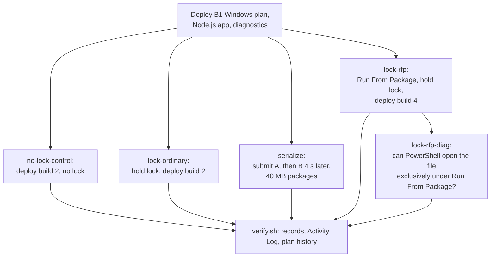

# Lab: ZIP Deploy File Lock, Run From Package, and Deployment Serialization

This lab tests two claims from the [Deployment Failures playbook](../playbooks/deployment-failures.md) on a **synthetic** Windows app: what an ordinary ZIP deployment does when a running process holds a content file open, and whether a second deployment submitted during the first is queued, interleaved, or rejected. The only lock is the one the app creates on request, and the only concurrent deployment is the one the script submits.

## Lab Metadata

| Attribute | Value |
|---|---|
| Difficulty | Advanced |
| Estimated Duration | 90-120 minutes (a Windows plan takes several minutes to deploy and each arm has settle waits) |
| Tier | Basic (B1 Windows App Service Plan, Node.js 20 on iisnode) |
| Failure Mode | A ZIP deployment reports success while a locked file keeps its old content; a second deployment during the first is rejected |
| Skills Practiced | Controlled lock creation, control-versus-treatment comparison, reading Kudu deployment logs and records, interpreting a successful deployment record, testing deployment concurrency |

## 1) Background

### 1.1 Question

Microsoft Learn says that with ordinary ZIP deployment the deployment and the running app share `wwwroot`, so a deployment can fail on file lock conflicts and the app can run with partly updated files. Does a lock cause a visible deployment failure on App Service for Windows, or something quieter? And what does a second concurrent deployment do?

### 1.2 Design

A zero-dependency Node.js app runs under iisnode. `POST /lab/hold-lock` (token-protected) starts a child PowerShell process that opens `data/lockme.txt` with no sharing for 120 seconds, then releases it. `GET /lab/state` reports the build ID read from `build.txt`, and a write-open probe of `lockme.txt` (`EBUSY` while it is locked) with its size. Each build changes **both** files **and their sizes**, so an overwrite is visible and cannot be skipped by a size comparison. The per-run token is generated by `trigger.sh`, passed as an app setting and a request header, and never written to logs, artifacts, or the repository.

<!-- diagram-id: lab-zipdeploy-file-lock-serialization-arms -->


## 2) Hypothesis

- **H-1:** With an exclusive handle held on a content file, an ordinary ZIP deployment reports success (CLI exit 0, Kudu record `complete`) while the locked file keeps its old content and unlocked files update.
- **H-2 (control):** The same deployment with **no** lock updates every file, so any stale file in H-1 is caused by the lock and not by size or timestamp comparison.
- **H-3:** With Run From Package, the deployment skips extraction, so a held handle does not make the deployment leave a file stale.
- **H-4:** A second deployment submitted while the first is running is rejected with an error and does not interleave content with the first.

### Predictions

1. Lock arm: `build` becomes 2 and `lockme.txt` stays at its build 1 size (109 bytes). Control: `lockme.txt` becomes build 2 (209 bytes).
2. Run From Package arm: `build` and `lockme.txt` both reach the new build.
3. Serialization arm: one deployment succeeds, the other returns an error, and the final content comes from one build only.

## 3) Runbook

### 3.1 Setup

```bash
./labs/_shared/scripts/deploy-lab.sh zipdeploy-file-lock-serialization koreacentral B1
source artifacts/.env
```

This creates `rg-lab-zipdeploy-file-lock-serialization` with a B1 Windows plan, a Node.js 20 app, a Log Analytics workspace, and diagnostic settings. Windows plan names are limited to 40 characters, so the template truncates the base name.

### 3.2 Experiment

```bash
./labs/zipdeploy-file-lock-serialization/trigger.sh "$RG" "$APP_NAME" no-lock-control
./labs/zipdeploy-file-lock-serialization/trigger.sh "$RG" "$APP_NAME" lock-ordinary
./labs/zipdeploy-file-lock-serialization/trigger.sh "$RG" "$APP_NAME" serialize
./labs/zipdeploy-file-lock-serialization/trigger.sh "$RG" "$APP_NAME" lock-rfp
./labs/zipdeploy-file-lock-serialization/trigger.sh "$RG" "$APP_NAME" lock-rfp-diag
```

| Arm | What it does |
|---|---|
| `no-lock-control` | Removes the Run From Package setting and waits, deploys build 1, then build 2 with no lock |
| `lock-ordinary` | Same start, then holds the lock until `writeOpen` reports `EBUSY` and deploys build 2 |
| `serialize` | Submits deployment A (build 5, 40 MB), then deployment B (build 6, 40 MB) 4 seconds later |
| `lock-rfp` | Enables Run From Package and waits 150 seconds, deploys build 3, tries to hold the lock (three attempts), deploys build 4 |
| `lock-rfp-diag` | With the setting still on, asks PowerShell to open the file exclusively and report the result |

### 3.3 Collect evidence and clean up

```bash
SINCE=2026-10-13T22:48:00Z ./labs/zipdeploy-file-lock-serialization/verify.sh "$RG" "$APP_NAME" artifacts/raw/evidence
./labs/zipdeploy-file-lock-serialization/cleanup.sh "$RG" artifacts/raw/evidence
```

`verify.sh` collects deployment records, the Activity Log (24 hours, limited by `SINCE`), and plan-level Activity Log events. `cleanup.sh` deletes the resource group and keeps the `az group exists` result.

## 4) Experiment Log

All times are UTC on 2026-10-13. Sanitized outputs and per-arm manifests are under `labs/zipdeploy-file-lock-serialization/artifacts-sanitized/`. App and host names are replaced with `<app-name>`.

### 4.1 Provenance and scope of the committed evidence

- All five arms in the tables below ran on one deployment of the lab, on a B1 Windows plan with Node.js 20 in Korea Central (Azure CLI 2.89.0). Each manifest records `skuAtStart` and `skuAtEnd` as `B1`, the run ID, arm times, package-set hash, and source revision. The lab files were uncommitted at run time, so the manifests report `sourceDirtyAtRun: true`.
- **A plan write by something other than the experimenter.** The plan history in `evidence/activity-log-plan.json` shows a `Microsoft.Web/serverfarms/write` at 15:36:51 by a service principal (identity redacted) and a write by the experimenter at 16:05:50. The artifact proves only that these writes happened; it holds no SKU value. That the plan was `F1` in between is an operator observation (`az appservice plan list` reported `F1` before the experimenter's write restored `B1`). No retained result depends on it: every committed arm ran from 22:48 onward, and each manifest records `B1` at start and end. Runs made between the two writes are excluded. An earlier exploratory run in that period also left the locked file stale, but it is not committed.
- `lock-rfp-diag` was added to `trigger.sh` after the main arms had run, to explain the `lock-rfp` result. The control arm ran twice: the first run was interrupted by the host computer suspending for about six hours, so its timeline is kept only under `excluded/` and the control was re-run.

### 4.2 Control and locked deployment (build 1 to build 2)

| Measure | `no-lock-control` | `lock-ordinary` |
|---|---|---|
| Lock state before deploying | none; `writeOpen: ok` | `writeOpen: EBUSY`, 3.7 s after the hold request |
| `az webapp deploy` result | exit 0 | exit 0 |
| CLI duration | 18.7 s | 23.7 s |
| Kudu deployment record | `complete`, `status: 4`, 3.4 s | `complete`, `status: 4`, 6.0 s |
| `build` after deployment | `2` | `2` |
| `lockme.txt` size after deployment | 209 bytes (build 2) | 109 bytes (build 1, unchanged) |
| `lockme.txt` after the lock was released | 209 bytes | 109 bytes |

The Kudu log entry `Running deployment command...` has `type: 2` in the locked deployment and `type: 0` in the control. In both logs the sequence ends with `Build completed succesfully.`, `Requesting site restart`, and `Deployment successful.`; the log text names no file or error.

### 4.3 Concurrent deployments

| Event | Time | Source |
|---|---|---|
| Deployment A (40 MB) submitted | 22:54:11.612 | `serialize-timeline.log` |
| Deployment B (40 MB) submitted | 22:54:15.634 | `serialize-timeline.log` |
| Kudu record for the only deployment in the window: received, started, ended | 22:54:20.032, 22:54:20.300, 22:54:24.412 | `deployment-records.json` |
| B's CLI returned with exit 1 | 22:54:22.635 | `serialize-B.out` |
| A's CLI returned with exit 0 | 22:54:28.072 | `serialize-A.out` |

B's error was `Another deployment is in progress. Please wait until that process is complete before starting a new deployment.` The final state was `build: 5` with a 509-byte `lockme.txt`, both from deployment A.

### 4.4 Run From Package

| Step | Observation |
|---|---|
| Setting enabled | 22:55:36; baseline deployment (build 3) after a 150 s settle wait, 22:58:06-22:58:26 |
| Hold lock, attempts 1 to 3 | PowerShell child alive each time; `writeOpen` stayed `ok` for 30 s after each attempt; the lock never became effective |
| `lock-rfp-diag` | PowerShell reported `mode=FullLanguage` and `opened` |
| Deploy build 4 | CLI exit 0; Kudu record `complete`, `status: 4`, 1.6 s; Kudu log shows `Skipping build. Project type: Run-From-Zip` |
| State afterwards | `build: 4`, `lockme.txt` 409 bytes (build 4) |

## Expected Evidence

| Evidence Source | Expected State |
|---|---|
| `no-lock-control-timeline.log` | `build` 2 and `lockme.txt` 209 bytes after the deployment |
| `lock-ordinary-timeline.log` | `lock-effective` (`EBUSY`) before the deployment; `build` 2 and `lockme.txt` 109 bytes after |
| `*-latest-deployment-log.json` | Kudu log lines for the locked, control, and Run From Package deployments |
| `serialize-B.out` | An error for the second deployment |
| `lock-rfp-timeline.log`, `lock-rfp-diag-ps-test.json` | Lock attempts that never became effective, and the PowerShell result |
| `evidence/activity-log-plan.json` | Plan creation and any plan change |

### Falsification

The hypotheses would be falsified by any of these:

- The locked deployment updated `lockme.txt`, or failed with a non-zero exit (falsifies H-1's quiet-failure claim).
- The control left `lockme.txt` stale (falsifies H-2: a size or timestamp comparison would then explain H-1).
- Under Run From Package the deployment failed or left a file stale (falsifies H-3).
- Both concurrent deployments succeeded, or the final content mixed both builds (falsifies H-4).

Observed: H-1 and H-2 held. H-4 held for this single run. H-3 could not be tested: the lock never became effective under Run From Package, so the comparison does not exist.

## Observation

- [Observed] With the lock effective (`EBUSY`), an ordinary ZIP deployment finished with CLI exit 0 and a Kudu record `complete`, `status: 4`, and `build.txt` updated, but `lockme.txt` kept its 109 bytes, also after the lock was released.
- [Observed] The same deployment with no lock updated `lockme.txt` to 209 bytes.
- [Observed] The locked deployment took 6.0 s in Kudu against 3.4 s for the control, and its `Running deployment command...` log entry has `type: 2`.
- [Observed] The second of two overlapping deployments was rejected with `Another deployment is in progress`, and the final content came from the first deployment only.
- [Observed] With Run From Package enabled, three attempts to hold the lock produced no `EBUSY`, although PowerShell reported opening the file exclusively. The deployment of build 4 succeeded, the Kudu log skipped the build, and both files were updated.

## Measurement

| Measure | Value | Basis |
|---|---|---|
| Hold request to `EBUSY` | 3.7 s | [Measured] `lock-ordinary-timeline.log` |
| Kudu duration, control / locked / Run From Package | 3.4 s / 6.0 s / 1.6 s | [Measured] `deployment-records.json` |
| Locked-file size after a locked deployment | 109 bytes (expected 209) | [Measured] |
| Concurrent submissions rejected | 1 of 1 | [Measured] |
| Effective locks under Run From Package | 0 of 3 attempts | [Measured] |

## Analysis

- **H-1 and H-2:** The control rules out a size or timestamp explanation. The stale file followed the held lock, and nothing in the deployment result said so. A pipeline that checks only the exit code or the record status would call this release healthy.
- **Kudu log:** [Observed] The `Running deployment command...` entry has `type: 2` in the locked deployment and `type: 0` in the control. [Inferred] Kudu's log schema uses 2 for an error-level entry, so an error was logged during the copy step. [Not Proven] That the longer duration reflects retried copies. The log does not name the file, so the link to `lockme.txt` rests on the stale size, not on the log text.
- **H-3:** The Run From Package deployment updated both files and skipped the build step, but the lock was never effective, so there was no conflict to avoid. [Not Proven] Whether Run From Package avoids a conflict that an effective lock would cause, and why an exclusive handle was ineffective in this mode.
- **H-4:** [Measured] The second deployment was rejected, not queued. The time between submissions (4 s) fell inside the first deployment's upload and processing window.

## Conclusion

- H-1 is supported: a locked file survived a "successful" ZIP deployment on Windows with the old content, and the record and CLI reported success.
- H-2 is supported: the control updated the file.
- H-3 is untested: the experiment could not create the condition under Run From Package.
- H-4 is supported for one run of 40 MB packages: the second deployment was rejected and the content stayed consistent.

## Solution

- Verify content after a deployment instead of trusting the CLI exit code or the record status: check a version marker and a file that changed in the release.
- Release locks before deploying, or deploy to a slot and swap, so the running process does not hold files that the deployment must replace.
- Treat `Another deployment is in progress` as a retry condition in the pipeline, and do not submit overlapping deployments to the same app.

## Prevention

- Add a post-deployment check that compares a manifest of file hashes or sizes with the deployed files.
- Serialize releases in the pipeline (one deployment per app at a time).
- Prefer a deployment mode in which the running process does not share the deployment directory, and test the lock behavior of your own runtime before relying on it.

## Takeaway

A successful ZIP deployment record proves that the deployment tool finished. It does not prove that every file changed. On Windows, a held handle left a file stale without any error in the CLI result or the record, and only a control run showed that the lock was the cause.

## Support Takeaway

When a release is green but behavior matches the old version, compare file sizes or hashes between the artifact and the deployed files, and look at the Kudu deployment log for error-level entries. If two releases ran together, one of them may have been rejected, so check both pipeline results.

## Limitations

- One retained trial per arm, on one app in one deployment of the lab.
- B1 Windows plan, Node.js 20 under iisnode, Korea Central. The behavior of other runtimes, hosting modes, or regions is not tested.
- Serialization was tested only with two 40 MB packages, with B submitted 4.022 s after A. Other sizes or timings could behave differently.
- H-3 is untested: none of the three lock attempts under Run From Package produced `EBUSY`.
- The results describe what happened in these runs. They are not guarantees about App Service in general.

## Clean Up

```bash
./labs/zipdeploy-file-lock-serialization/cleanup.sh "$RG" artifacts/raw/evidence
```

`cleanup.sh` runs `az group delete --resource-group "$RG" --yes`, then records `az group exists` in `cleanup.json`. To delete without the record, use the command below.

```bash
az group delete --resource-group "$RG" --yes --no-wait
```

| Command/Flag | Purpose |
|---|---|
| `az group delete` | Deletes the resource group and every lab resource in it |
| `--resource-group "$RG"` | Names the lab resource group (`rg-lab-zipdeploy-file-lock-serialization`) |
| `--yes` | Skips the confirmation prompt |
| `--no-wait` | Returns immediately while deletion continues |

The retained cleanup record (`evidence/cleanup.json`) shows `groupExistsAfterDelete` as the string `"false"`.

## Related Playbook

- [Deployment Failures](../playbooks/deployment-failures.md)

## See Also

- [Run From Package](../../platform/run-from-package.md)
- [Lab: Missing wwwroot Content Timeline and Run From Package](missing-wwwroot-content.md)
- [ZIP Deploy and Run From Package (operations)](../../operations/deployment/zip-deploy.md)

## Sources

- [Run your app from a ZIP package (Microsoft Learn)](https://learn.microsoft.com/en-us/azure/app-service/deploy-run-package)
- [Deploy files to App Service (Microsoft Learn)](https://learn.microsoft.com/en-us/azure/app-service/deploy-zip)
