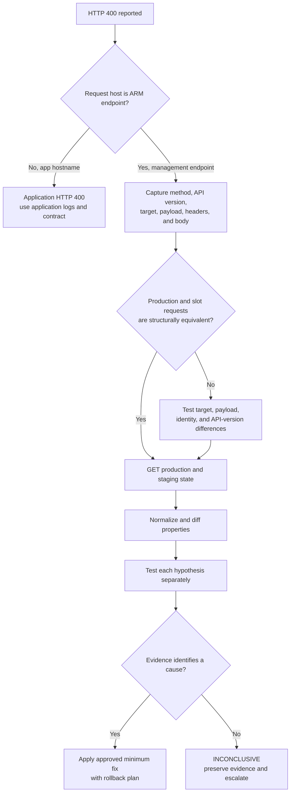

---
content_sources:
  diagrams:
    - id: arm-configuration-http-400-flow
      type: flowchart
      source: self-generated
      justification: Synthesized a control-plane isolation flow from Microsoft Learn guidance for ARM control-plane requests, App Service site and slot configuration REST operations, Activity Log, RBAC, locks, and deployment-slot settings.
      based_on:
        - https://learn.microsoft.com/en-us/azure/azure-resource-manager/management/control-plane-and-data-plane
        - https://learn.microsoft.com/en-us/rest/api/appservice/web-apps/update-configuration?view=rest-appservice-2024-11-01
        - https://learn.microsoft.com/en-us/rest/api/appservice/web-apps/update-configuration-slot?view=rest-appservice-2024-11-01
        - https://learn.microsoft.com/en-us/azure/azure-monitor/fundamentals/activity-log
        - https://learn.microsoft.com/en-us/azure/app-service/deploy-staging-slots
content_validation:
  status: verified
  last_reviewed: 2026-10-14
  reviewer: agent
  core_claims:
    - claim: Control-plane requests use the Azure Resource Manager endpoint, while application requests use the app's service-specific endpoint.
      source: https://learn.microsoft.com/en-us/azure/azure-resource-manager/management/control-plane-and-data-plane
      verified: true
    - claim: In App Service REST API version 2024-11-01, updating production site configuration uses PATCH on /sites/{name}/config/web, while a slot update inserts /slots/{slot} before /config/web.
      source: https://learn.microsoft.com/en-us/rest/api/appservice/web-apps/update-configuration-slot?view=rest-appservice-2024-11-01
      verified: true
    - claim: Azure Monitor Activity Log records control-plane management operations and supports filtering events by correlation ID.
      source: https://learn.microsoft.com/en-us/azure/azure-monitor/fundamentals/activity-log
      verified: true
    - claim: A ReadOnly management lock prevents authorized users from updating a resource and inherited parent locks apply to child resources.
      source: https://learn.microsoft.com/en-us/azure/azure-resource-manager/management/lock-resources
      verified: true
    - claim: App settings can be configured to stay with a deployment slot during swaps.
      source: https://learn.microsoft.com/en-us/azure/app-service/deploy-staging-slots
      verified: true
---

# Production ARM Configuration Update Returns HTTP 400

## 1. Summary

Use this playbook when an App Service configuration update aimed at production returns HTTP `400`, while a seemingly comparable update to a staging slot succeeds. It belongs at `docs/troubleshooting/playbooks/arm-configuration-http-400.md` because the symptom is a management-plane configuration failure with several competing hypotheses, not a deployment procedure or an application-response problem.

The successful slot request is a comparison point, not proof that the production payload, target, authorization context, or current resource state is valid. Do not classify the difference as an App Service platform defect until the exact requests and resource state have been normalized and every supported discriminator below is exhausted.

**Verification scope (2026-10-14):** Azure CLI command syntax was checked with local `az ... --help`. The JSON normalizer was executed locally against synthetic files. No request was sent to an Azure resource, no configuration was changed, and reproduction against a failing resource is `NOT_RUN`.

<!-- diagram-id: arm-configuration-http-400-flow -->


## 2. Common Misreadings

| Observation | Common misreading | Evidence-safe interpretation |
|---|---|---|
| An app URL returns `400` | ARM rejected a configuration update | A request to an app hostname is application traffic. First identify the destination host and response shape. |
| Production update returns `400`; slot update succeeds | Production App Service is defective | The requests may differ by target URI, payload, API version, identity, ETag, policy context, or effective configuration. |
| The JSON looks the same in a log line | The requests are identical | Compare the serialized, sanitized payload plus method, URI, API version, and headers. Logging may omit nulls, defaults, or nested properties. |
| `400` means RBAC or Azure Policy | Authorization or policy definitely blocked the request | RBAC and Resource Manager-mode policy denial commonly produce `403`; retain them as hypotheses only when the actual response or Activity Log supports them. |
| No matching Activity Log event appears immediately | ARM never received the request | Activity Log ingestion is not immediate, and failed pre-provider validation may offer different detail. Keep the outcome inconclusive until the search window and correlation ID are checked. |
| Repeating the write will provide more evidence | Retry is harmless | A write can restart workers or overwrite a concurrent change. Capture the original failure and prefer GETs first. |

## 3. Competing Hypotheses

| ID | Hypothesis | Primary discriminator |
|---|---|---|
| H1 | The `400` came from application traffic, not ARM | Request host is the app hostname rather than the environment's Resource Manager endpoint; body follows the application contract instead of an ARM `error` envelope. |
| H2 | The payload contains an invalid, unsupported, read-only, or immutable property | `error.code`, `error.message`, `error.details[].target`, or a minimal property-level comparison identifies the rejected field. |
| H3 | The caller used the production URI for slot intent, or the slot URI for production intent | The recorded resource path differs at `/sites/{name}` versus `/sites/{name}/slots/{slot}`. |
| H4 | App settings or slot-stickiness were treated as ordinary site configuration | The request uses the wrong configuration subresource, or production and staging differ in app-setting values or sticky-setting names. |
| H5 | The calling identity lacks the required production-scope action | The response or Activity Log shows authorization failure and effective role scope differs between production and slot. |
| H6 | An inherited lock or Azure Policy blocks the production operation | Lock inventory, policy detail, or Activity Log names the governing control. Do not force this explanation onto an unexplained `400`. |
| H7 | The property is incompatible with the production plan, OS, feature, or runtime | The REST schema accepts the field, but the two targets differ in runtime/plan-relevant state and the provider error names the incompatibility. |
| H8 | A concurrent writer or stale conditional request changed the resource context | Timeline overlaps another write, or the failing request carried `If-Match`/an ETag that no longer matches the latest GET. |

## 4. What to Check First

### 4.1 Separate ARM from application traffic

Record the full destination host before interpreting the status:

- **ARM/control plane:** the Azure environment's Resource Manager endpoint. In Azure global, this is `management.azure.com`, and the path contains `/subscriptions/.../providers/Microsoft.Web/...`.
- **Application traffic:** the app's default/custom hostname, API gateway, Front Door endpoint, or another data-plane route.

An ARM error normally has a top-level `error` object with fields such as `code`, `message`, `target`, and `details`. Do not rely on shape alone: proxies can rewrite responses, so host, method, and URI are the stronger boundary.

**Decision:**

- [Observed] If the captured request went to an app hostname, stop this playbook and investigate the application's route, validation, and logs.
- [Observed] If it went to the Resource Manager endpoint, continue with the exact operation.
- [Unknown] If the host or request trace is unavailable, label the origin `INCONCLUSIVE`; do not call it ARM validation.

### 4.2 Build the immutable request record

Capture the failing production request and the successful slot request independently. Do not reconstruct one from memory.

| Field | Capture exactly | Sanitization rule |
|---|---|---|
| Timestamp | UTC send and response times | Keep timestamps. |
| Operation | Client command/SDK operation and pipeline step | Remove local paths that identify people. |
| HTTP method | For example, `PATCH` | Keep verbatim. |
| API version | Query-string `api-version` | Keep verbatim. |
| Resource target | Full ARM path | Replace subscription with `<subscription-id>`; use synthetic resource names. |
| Request headers | `Content-Type`, conditional headers such as `If-Match`, and client request ID if set | Remove authorization and cookies. |
| Payload | Serialized JSON that was sent | Remove secrets and app-setting values; preserve property names and JSON types. |
| Status and body | Full ARM error envelope | Mask identifiers and secret-bearing values. |
| Response headers | `x-ms-correlation-request-id` and `x-ms-request-id` when present | Replace real values with `<correlation-request-id>` and `<request-id>` in shared artifacts. |

The App Service 2024-11-01 REST reference documents these site-configuration targets:

```http
PATCH https://management.azure.com/subscriptions/<subscription-id>/resourceGroups/rg-example/providers/Microsoft.Web/sites/app-example/config/web?api-version=2024-11-01

PATCH https://management.azure.com/subscriptions/<subscription-id>/resourceGroups/rg-example/providers/Microsoft.Web/sites/app-example/slots/staging/config/web?api-version=2024-11-01
```

The first path targets production. The second targets `staging`. Keep the method and API version with the path; path-only comparison is incomplete.

### 4.3 Capture the error and management timeline

Preserve `error.code`, `error.message`, `error.target`, every `error.details[]` entry, and `innererror` if returned. Treat the following as a **synthetic shape**, not an observed response:

```json
{
  "error": {
    "code": "<arm-error-code>",
    "message": "<sanitized-message>",
    "target": "<property-if-returned>",
    "details": [
      {
        "code": "<detail-code>",
        "message": "<sanitized-detail>",
        "target": "<property-if-returned>"
      }
    ]
  }
}
```

Query management activity around the failure. Substitute a narrow UTC interval; do not publish the returned caller identity or raw resource ID.

```bash
az monitor activity-log list \
    --resource-group $RG \
    --start-time 2026-10-14T08:00:00Z \
    --end-time 2026-10-14T08:15:00Z \
    --query "[?contains(resourceId, '/providers/Microsoft.Web/sites/')].{time:eventTimestamp,operation:operationName.value,status:status.value,correlationId:correlationId,resourceId:resourceId}" \
    --output json
```

| Command/Parameter | Purpose |
|---|---|
| `az monitor activity-log list` | Reads subscription Activity Log events; it does not mutate the app. |
| `--resource-group $RG` | Restricts results to the app's resource group. |
| `--start-time 2026-10-14T08:00:00Z` | Sets the synthetic UTC beginning of the investigation window; replace it with the incident time. |
| `--end-time 2026-10-14T08:15:00Z` | Sets the synthetic UTC end of the investigation window; replace it with the incident time. |
| `--query "..."` | Keeps Microsoft.Web site events and projects the timeline, status, correlation ID, and target. |
| `--output json` | Preserves nested values for evidence collection. |

If the failed response supplied a correlation ID, use the Activity Log correlation-ID filter to narrow the same time window. A matching event strengthens the request-to-operation link; no match is not proof that the request bypassed ARM.

### 4.4 Record concurrency context

Record whether the failing request supplied `If-Match`, what ETag or revision the client read before writing, and whether another deployment, portal save, IaC run, policy remediation, or automation job overlapped. Fetch current state again before any approved retry. Do not invent an ETag requirement when the specific App Service operation or client did not use one.

## 5. Evidence to Collect

### 5.1 Read production and staging configuration

These reads intentionally keep the two targets explicit:

```bash
az webapp config show \
    --resource-group $RG \
    --name $APP_NAME \
    --output json > /tmp/production-config.json

az webapp config show \
    --resource-group $RG \
    --name $APP_NAME \
    --slot staging \
    --output json > /tmp/staging-config.json
```

| Command/Parameter | Purpose |
|---|---|
| `az webapp config show` | Reads effective App Service site configuration. |
| `--resource-group $RG` | Selects the resource group containing the app. |
| `--name $APP_NAME` | Selects the parent App Service app. |
| `--slot staging` | Targets the staging slot only on the second command; omission means production. |
| `--output json` | Produces structured input for normalization. |

App settings are a secret-bearing surface. Save them only in an access-controlled temporary directory, compare names or redacted values, and delete local copies according to incident-handling policy.

```bash
az webapp config appsettings list \
    --resource-group $RG \
    --name $APP_NAME \
    --output json > /tmp/production-appsettings.json

az webapp config appsettings list \
    --resource-group $RG \
    --name $APP_NAME \
    --slot staging \
    --output json > /tmp/staging-appsettings.json
```

| Command/Parameter | Purpose |
|---|---|
| `az webapp config appsettings list` | Reads app-setting names and values for comparison; output can contain secrets. |
| `--resource-group $RG` | Selects the resource group containing the app. |
| `--name $APP_NAME` | Selects the parent App Service app. |
| `--slot staging` | Targets the staging slot only on the second command; omission means production. |
| `--output json` | Produces structured input for a protected comparison. |

Use REST GETs when the failing writer used a raw REST target, so comparison uses the same API version and resource shape:

```bash
az rest \
    --method get \
    --uri "https://management.azure.com/subscriptions/<subscription-id>/resourceGroups/rg-example/providers/Microsoft.Web/sites/app-example/config/web?api-version=2024-11-01" \
    --output json > /tmp/production-rest.json

az rest \
    --method get \
    --uri "https://management.azure.com/subscriptions/<subscription-id>/resourceGroups/rg-example/providers/Microsoft.Web/sites/app-example/slots/staging/config/web?api-version=2024-11-01" \
    --output json > /tmp/staging-rest.json
```

| Command/Parameter | Purpose |
|---|---|
| `az rest` | Calls the ARM REST endpoint using the signed-in CLI identity. |
| `--method get` | Makes the operation read-only. |
| `--uri ".../sites/app-example/config/web?api-version=2024-11-01"` | Reads synthetic production site configuration with the selected API version. |
| `--uri ".../sites/app-example/slots/staging/config/web?api-version=2024-11-01"` | Reads synthetic staging-slot configuration with the same API version. |
| `--output json` | Produces structured input for normalization. |

### 5.2 Normalize property-level differences

The following **illustrative**, standard-library-only Python 3.11+ script recursively sorts object keys and removes resource identity or commonly volatile metadata. It does not know which arrays are semantically unordered and does not redact secrets. Use it only on protected site-configuration JSON, review the ignored fields for the API shape, and never feed raw app-setting values into a shared artifact.

```python
import json
import sys
from pathlib import Path
from typing import TypeAlias, assert_never

JSON: TypeAlias = None | bool | int | float | str | list["JSON"] | dict[str, "JSON"]

IGNORED_KEYS = frozenset(
    {
        "etag",
        "id",
        "lastModifiedTimeUtc",
        "name",
        "resourceGroup",
        "type",
    }
)


def normalize(value: JSON) -> JSON:
    match value:
        case dict() as mapping:
            return {
                key: normalize(item)
                for key, item in sorted(mapping.items())
                if key not in IGNORED_KEYS
            }
        case list() as items:
            return [normalize(item) for item in items]
        case str() | int() | float() | bool() | None:
            return value
        case unreachable:
            assert_never(unreachable)


for filename in sys.argv[1:]:
    document: JSON = json.loads(Path(filename).read_text(encoding="utf-8"))
    output = Path(filename).with_suffix(".normalized.json")
    output.write_text(
        json.dumps(normalize(document), indent=2, sort_keys=True) + "\n",
        encoding="utf-8",
    )
```

Run it locally, then use a normal text diff:

```bash
python3 /tmp/normalize-appservice-config.py \
    /tmp/production-config.json \
    /tmp/staging-config.json

diff --unified \
    /tmp/production-config.normalized.json \
    /tmp/staging-config.normalized.json
```

Interpret differences one property at a time. A difference is correlated evidence, not proof of rejection. Compare app-setting **names**, sticky-setting declarations, and redacted value hashes separately because ordinary configuration GET responses can omit secret-bearing properties.

### 5.3 Synthetic request cases

These payloads are documentation fixtures. They were **not sent to Azure**, and no response is claimed.

**Synthetic valid-shape request:** a documented property with the production resource target.

```http
PATCH https://management.azure.com/subscriptions/<subscription-id>/resourceGroups/rg-example/providers/Microsoft.Web/sites/app-example/config/web?api-version=2024-11-01
Content-Type: application/json

{
  "properties": {
    "alwaysOn": true
  }
}
```

Whether the property is available depends on the target's plan and platform context. “Valid-shape” does not promise the request will succeed on every app.

**Synthetic invalid-property request:** a deliberately undocumented property used only to illustrate provider validation.

```http
PATCH https://management.azure.com/subscriptions/<subscription-id>/resourceGroups/rg-example/providers/Microsoft.Web/sites/app-example/config/web?api-version=2024-11-01
Content-Type: application/json

{
  "properties": {
    "notARealSiteConfigProperty": true
  }
}
```

Do not execute this request. Its exact response is intentionally unspecified.

**Synthetic wrong-target request:** the intent is staging, but the path omits `/slots/staging` and therefore addresses production.

```http
PATCH https://management.azure.com/subscriptions/<subscription-id>/resourceGroups/rg-example/providers/Microsoft.Web/sites/app-example/config/web?api-version=2024-11-01
Content-Type: application/json

{
  "properties": {
    "alwaysOn": true
  }
}
```

The corresponding staging target would be `/sites/app-example/slots/staging/config/web`. A syntactically valid wrong-target request might succeed, fail, or change the wrong resource; URI review must happen before any controlled mutation.

## 6. Validation and Disproof by Hypothesis

### H1: Application response mistaken for ARM validation

**Supports:** request host is the app/custom hostname, or the trace shows the request reached application middleware or a route.

**Weakens:** host is the Resource Manager endpoint, target is a `Microsoft.Web` resource path, and the response carries an ARM error envelope plus management correlation identifiers.

**Inconclusive:** only a screenshot saying “400” survives.

### H2: Invalid, immutable, or unsupported property

1. Compare the failing serialized payload against the request-body schema for the exact API version.
2. Remove response-only metadata from comparison, but do not silently remove a field from a proposed retry.
3. Map `error.details[].target` to the normalized property diff.
4. If one property is suspected, seek a documented validation mechanism. Do not probe production by repeatedly deleting fields from live writes.

**Supports:** provider detail names the field, type, allowed value, or read-only behavior.

**Weakens:** the exact field/value succeeds against the same target and current state in an authorized, approved test while all other request dimensions are held constant.

### H3: Site-versus-slot targeting

Compare the complete paths:

- Production: `/providers/Microsoft.Web/sites/{name}/config/web`
- Slot: `/providers/Microsoft.Web/sites/{name}/slots/{slot}/config/web`

Also compare the client command's `--slot` argument, SDK resource ID, and pipeline variable expansion. A staging success does not validate a production path, and a production path without `/slots/{slot}` is not an alias for staging.

**Supports:** intent and resource path disagree.

**Disproves:** both recorded paths match their intended targets, and the failure remains after correcting no target variable.

### H4: App-setting and sticky-setting treatment

Site configuration, app settings, and slot stickiness are related but distinct surfaces. Check:

1. Whether the client intended `/config/web` or an app-settings operation.
2. Production and staging app-setting names, with values redacted or compared by protected hash.
3. Which names are deployment-slot settings and therefore remain pinned during swaps.
4. Whether a full-object update accidentally included app settings or connection strings that normal configuration GETs do not return.

**Supports:** the request used the wrong subresource or the only meaningful difference is a sticky-setting declaration directly involved in the operation.

**Inconclusive:** secrets were omitted from both reads and the original serialized request is unavailable.

### H5: RBAC scope or identity

Record the principal used by each request. Compare effective permissions at the exact production and slot scopes, including group membership, deny assignments, and conditions. See [Security Operations](../../operations/security.md) for access-management safeguards.

**Supports:** the actual error or Activity Log shows authorization denial for the production action and the principal lacks that action at production scope.

**Weakens:** the same principal has the required action at the exact target and no deny applies. A plain unexplained `400` alone does not support RBAC.

### H6: Locks or policy

Inspect locks inherited from subscription/resource-group scope and policy evidence without removing either control. A `ReadOnly` lock prevents updates even for otherwise authorized users. Resource Manager-mode Azure Policy `deny` normally returns `403`, so preserve the actual status rather than relabeling it.

**Supports:** the response or Activity Log names a lock/policy, or read-only inventory shows an applicable inherited control.

**Weakens:** no applicable control exists and the provider error identifies payload validation instead.

### H7: Feature, plan, OS, or runtime compatibility

Use the normalized GETs to compare only properties relevant to the failing field: Linux versus Windows runtime fields, plan-dependent options, runtime version, or feature enablement. Then verify that combination against the exact App Service REST/API or feature documentation.

**Supports:** provider detail states the target combination is unsupported, and the production/staging state difference matches that constraint.

**Inconclusive:** the environments differ but no documentation or provider detail connects the difference to rejection.

### H8: Concurrent updates or stale ETag context

Build a timeline from client logs and Activity Log. Identify overlapping portal saves, deployments, IaC runs, policy remediation, and automation. Compare any `If-Match` value sent by the failed request with the ETag from the read that preceded it and with a fresh GET.

**Supports:** a conditional-write failure or operation timeline proves the request used stale state or overlapped another writer.

**Weakens:** no conditional header was used, no other write overlaps, and the ARM error names a deterministic field validation problem.

## 7. Likely Root Cause Patterns

| Pattern | Evidence combination | Resolution direction |
|---|---|---|
| Application `400` mislabeled as ARM | App hostname plus application error contract; no management resource path | Route to application/API troubleshooting and preserve the request trace. |
| Wrong resource target | Intent says staging but URI lacks `/slots/staging`, or inverse | Correct target construction in the client or pipeline; review for unintended changes before retry. |
| Full-object replay includes invalid metadata | Payload contains response-only or unsupported fields; detail points to one | Build a minimal documented request body rather than replaying a GET response. |
| App settings sent through wrong surface | `/config/web` update carries assumptions from app-settings list/set | Use the documented app-settings operation and preserve sticky-setting intent. |
| Governance control differs by scope | Activity Log or error names RBAC, inherited lock, or policy | Change the workflow or request an approved exception; do not silently remove governance. |
| Runtime/feature mismatch | Provider detail plus relevant normalized production/slot difference | Align the property with supported plan/OS/runtime behavior. |
| Competing writers | Overlapping operations or stale conditional context | Serialize writers, refresh state, and use the client's supported concurrency mechanism. |

If none of these patterns has direct evidence, the result remains **INCONCLUSIVE**. Preserve both request records, normalized diffs, Activity Log export, and exact UTC interval for escalation. Production-versus-staging difference alone is not evidence of a platform defect.

## 8. Immediate Mitigations

1. Stop automatic retries and overlapping configuration writers.
2. Keep production unchanged while collecting read-only GETs and Activity Log evidence.
3. If production is healthy, leave the rejected value unapplied until the cause is identified.
4. If an earlier approved change caused impact, use the team's known-good declarative configuration or documented rollback process; do not copy staging wholesale into production.
5. Escalate with the sanitized request pair, ARM error envelope, UTC timestamps, correlation identifiers, Activity Log evidence, normalized diff, and an explicit list of hypotheses that remain inconclusive.

### Safeguards for any controlled mutation

A mutation is outside the read-only diagnosis and requires all of the following before execution:

- Named authorization from the production owner and an approved change window.
- Exact target URI, method, API version, minimal payload, calling identity, and expected impact peer-reviewed.
- Fresh pre-change GET stored securely, including concurrency context supported by the client.
- Rollback payload or last-known-good declarative source prepared and independently reviewed.
- Health, restart, and representative business-request checks defined before the write.
- One writer only; automation and portal edits paused or coordinated.
- Stop conditions defined. An unexpected response means capture evidence and stop, not field-by-field retries.

Never use the synthetic invalid-property or wrong-target examples as mutation tests.

## 9. Prevention

- [ ] Log method, sanitized ARM path, API version, principal, payload hash, client request ID, response status, ARM error fields, and returned correlation identifiers for every configuration write.
- [ ] Generate production and slot resource IDs from typed deployment inputs; test that slot intent inserts `/slots/{slot}`.
- [ ] Send minimal documented PATCH bodies instead of serializing a prior GET response.
- [ ] Separate site configuration, app settings, connection strings, and slot-stickiness workflows.
- [ ] Serialize portal, IaC, pipeline, and policy-remediation writers or adopt supported conditional-update behavior.
- [ ] Add a pre-production check that reads and normalizes both targets without treating their difference as a failure by itself.
- [ ] Keep authorization, lock, and policy checks in the release preflight without weakening those controls.
- [ ] Retain a redacted diagnostic bundle template that preserves `INCONCLUSIVE` as a valid result.

## See Also

- [Deployment Failures](deployment-failures.md)
- [Security Operations](../../operations/security.md)
- [Deployment Slots Operations](../../operations/deployment-slots.md)
- [Playbooks](index.md)

## Sources

- [Control plane and data plane operations (Microsoft Learn)](https://learn.microsoft.com/en-us/azure/azure-resource-manager/management/control-plane-and-data-plane)
- [Web Apps - Update Configuration, API 2024-11-01 (Microsoft Learn)](https://learn.microsoft.com/en-us/rest/api/appservice/web-apps/update-configuration?view=rest-appservice-2024-11-01)
- [Web Apps - Update Configuration Slot, API 2024-11-01 (Microsoft Learn)](https://learn.microsoft.com/en-us/rest/api/appservice/web-apps/update-configuration-slot?view=rest-appservice-2024-11-01)
- [Deployments - Validate REST example with ARM correlation and request headers (Microsoft Learn)](https://learn.microsoft.com/en-us/rest/api/resources/deployments/validate?view=rest-resources-2025-04-01)
- [Activity Log in Azure Monitor (Microsoft Learn)](https://learn.microsoft.com/en-us/azure/azure-monitor/fundamentals/activity-log)
- [Lock Azure resources (Microsoft Learn)](https://learn.microsoft.com/en-us/azure/azure-resource-manager/management/lock-resources)
- [Azure Policy deny effect (Microsoft Learn)](https://learn.microsoft.com/en-us/azure/governance/policy/concepts/effect-deny)
- [Azure role-based access control overview (Microsoft Learn)](https://learn.microsoft.com/en-us/azure/role-based-access-control/overview)
- [Set up staging environments in Azure App Service (Microsoft Learn)](https://learn.microsoft.com/en-us/azure/app-service/deploy-staging-slots)
