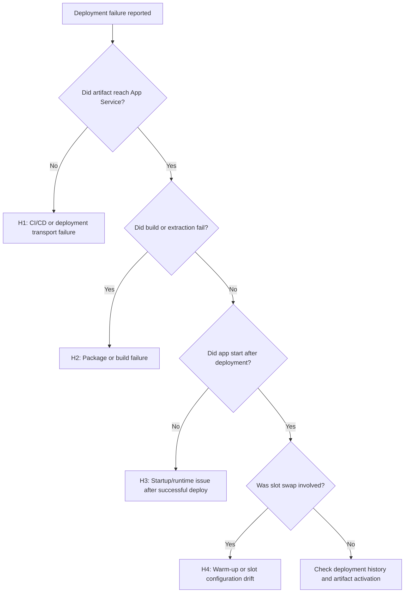
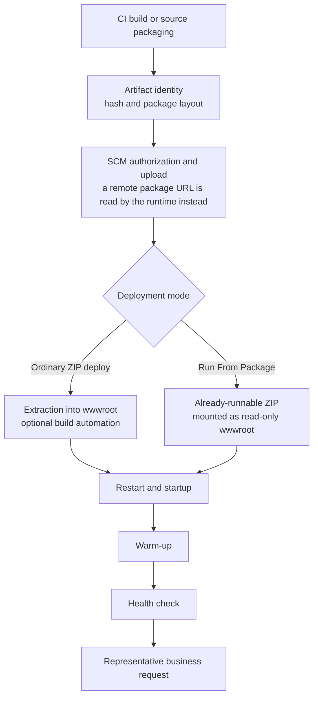

---
content_sources:
  diagrams:
    - id: deployment-failures-flow
      type: flowchart
      source: self-generated
      justification: "Synthesized deployment and post-deployment failure branches from Microsoft Learn guidance on deployment slots, diagnostics, and startup-related 502/503 troubleshooting."
      based_on:
        - https://learn.microsoft.com/en-us/azure/app-service/deploy-staging-slots
        - https://learn.microsoft.com/en-us/azure/app-service/troubleshoot-diagnostic-logs
        - https://learn.microsoft.com/en-us/azure/app-service/troubleshoot-http-502-http-503
    - id: deployment-release-phase-timeline
      type: flowchart
      source: self-generated
      justification: "Synthesized from Microsoft Learn ZIP deploy and Run From Package articles to show the two alternative activation branches (extraction versus package mount) between artifact upload and first healthy request. Learn does not publish one end-to-end sequence."
      based_on:
        - https://learn.microsoft.com/en-us/azure/app-service/deploy-zip
        - https://learn.microsoft.com/en-us/azure/app-service/deploy-run-package
        - https://learn.microsoft.com/en-us/azure/app-service/deploy-best-practices
content_validation:
  status: verified
  last_reviewed: 2026-10-13
  reviewer: agent
  core_claims:
    - claim: "Azure App Service deployment has three main components: deployment sources, build pipelines, and deployment mechanisms."
      source: "https://learn.microsoft.com/en-us/azure/app-service/deploy-best-practices"
      verified: true
    - claim: "The deployment mechanism places the built application into the /home/site/wwwroot directory of the web app."
      source: "https://learn.microsoft.com/en-us/azure/app-service/deploy-best-practices"
      verified: true
    - claim: "Kudu handles continuous deployments for App Service and provides HTTP deployment endpoints such as zipdeploy."
      source: "https://learn.microsoft.com/en-us/azure/app-service/deploy-best-practices"
      verified: true
    - claim: "With a Standard App Service Plan tier or better, deployment slots can be used to validate changes and swap into production without downtime."
      source: "https://learn.microsoft.com/en-us/azure/app-service/deploy-best-practices"
      verified: true
    - claim: "With Run From Package the ZIP is mounted as the read-only wwwroot instead of being copied, which eliminates file lock conflicts between deployment and runtime; it is unsupported for Python apps and Java apps on Azure App Service."
      source: "https://learn.microsoft.com/en-us/azure/app-service/deploy-run-package"
      verified: true
---

# Deployment Failures

## 1. Summary

This playbook applies when deployment to Azure App Service finishes with an error, appears successful but does not activate correctly, or fails during slot swap and promotion. Use it for ZipDeploy, GitHub Actions, Azure DevOps, local ZIP pushes, container image updates, and deployment slot swap workflows.

### Symptoms

- Deployment Center or CI/CD shows `Deployment failed`, `Package deployment using ZIP Deploy failed`, or `Oryx build failed`.
- A slot swap reports warm-up timeout, validation failure, or rollback.
- New content exists in the staging slot, but production still serves the old version.
- Deployment history shows success while the app returns `503`, `500`, or health check failures immediately after release.

### Common error messages

- `Failed to deploy web package to App Service.`
- `Package deployment failed. Extract zip failed.`
- `The deployment request failed because the app is restarting.`
- `Slot swap operation has failed because the source slot could not be warmed up.`
- `Container didn't respond to HTTP pings on port`.

<!-- diagram-id: deployment-failures-flow -->


### Release phase timeline

A successful CI pipeline proves only that the pipeline finished. Between the artifact and the first healthy business request the release crosses several boundaries, and extraction and package mounting are alternative branches rather than consecutive steps.

<!-- diagram-id: deployment-release-phase-timeline -->


Do not assume an exact ordering inside Kudu beyond what the deployment logs show. For how the mounted package works, see [Run From Package](../../platform/run-from-package.md).

## 2. Common Misreadings

| Observation | Often Misread As | Actually Means |
|---|---|---|
| CI job failed near the end | App Service platform outage | The package upload, Kudu build, or post-deploy restart may have failed in a narrow step. |
| Deployment history says `success` | Release is production-ready | Deployment transport and runtime activation are separate phases. |
| Slot swap failed | Staging code is always broken | Warm-up path, slot settings, or health behavior may be the actual blocker. |
| Old version is still serving | CDN caching only | The new package may not have been activated, or swap never completed. |
| Oryx logs mention warnings | Build definitely failed | Many warnings are survivable; isolate the first fatal line and the exit code. |
| Pipeline is green and deployment record is `complete` | Content is in place and serving requests | A successful deployment cannot prove that startup, warm-up, content layout, or a business request succeeded. |
| Run From Package is enabled | No deployment file-lock or concurrency problems can occur | Learn states it eliminates file lock conflicts between deployment and runtime. It does not cover upload failures, concurrent deployment races, or locks held outside `wwwroot`. |

## 3. Competing Hypotheses

| Hypothesis | Likelihood | Key Discriminator |
|---|---|---|
| H1: Deployment transport or Kudu orchestration failed | High | Deployment logs show upload interruption, SCM restart, auth failure, or timeout before extraction/build finishes. |
| H2: Artifact, package shape, or build phase failed | High | Oryx, extraction, or post-deploy script logs contain fatal build or packaging errors. |
| H3: Deployment succeeded but startup failed | High | Deployment history is green, but platform and console logs show startup or port-binding errors. |
| H4: Slot swap warm-up or slot-specific config caused release failure | Medium | Swap timeline aligns with warm-up timeout, unhealthy endpoint, or slot setting drift. |
| H5: Release completed, but traffic still targets old content | Medium | Deployment metadata changed, but host/slot state or routing indicates old slot or stale package path. |

## 4. What to Check First

1. **Inspect deployment history and the latest deployment record**

    ```bash
    az webapp log deployment list \
        --resource-group $RG \
        --name $APP_NAME \
        --output table
    ```

    | Command | Purpose |
    |---------|---------|
    | `az webapp log deployment list --resource-group $RG --name $APP_NAME --output table` | Lists deployment history records so you can verify whether the latest deployment completed. |
    | `--resource-group $RG` | Selects the resource group that contains the target web app or related resource. |
    | `--name $APP_NAME` | Specifies the target web app name for this command. |
    | `--output table` | Formats the command output as a readable table for quick triage. |

2. **Check app state, host name, and current slot swap status**

    ```bash
    az webapp show \
        --resource-group $RG \
        --name $APP_NAME \
        --query "{state:state,defaultHostName:defaultHostName,slotSwapStatus:slotSwapStatus}" \
        --output json
    ```

    | Command | Purpose |
    |---------|---------|
    | `az webapp show --resource-group $RG --name $APP_NAME --query "{state:state,defaultHostName:defaultHostName,slotSwapStatus:slotSwapStatus}" --output json` | Shows the app state, default hostname, and slot-swap status so you can confirm whether deployment reached the expected activation phase. |
    | `--resource-group $RG` | Selects the resource group that contains the target web app or related resource. |
    | `--name $APP_NAME` | Specifies the target web app name for this command. |
    | `--query "{state:state,defaultHostName:defaultHostName,slotSwapStatus:slotSwapStatus}"` | Projects only these named top-level properties into a smaller object before formatting the output. |
    | `--output json` | Formats the command output as JSON for full-fidelity inspection. |

3. **If slots are involved, list slot inventory and state**

    ```bash
    az webapp deployment slot list \
        --resource-group $RG \
        --name $APP_NAME \
        --query "[].{name:name,state:state,host:defaultHostName}" \
        --output table
    ```

    | Command | Purpose |
    |---------|---------|
    | `az webapp deployment slot list --resource-group $RG --name $APP_NAME --query "[].{name:name,state:state,host:defaultHostName}" --output table` | Lists deployment slots so you can compare slot names, state, and hostnames. |
    | `--resource-group $RG` | Selects the resource group that contains the target web app or related resource. |
    | `--name $APP_NAME` | Specifies the target web app name for this command. |
    | `--query "[].{name:name,state:state,host:defaultHostName}"` | Projects each returned array element into the listed fields before formatting the output. |
    | `--output table` | Formats the command output as a readable table for quick triage. |

4. **Inspect runtime configuration that affects activation after deployment**

    ```bash
    az webapp config show \
        --resource-group $RG \
        --name $APP_NAME \
        --query "{linuxFxVersion:linuxFxVersion,appCommandLine:appCommandLine,alwaysOn:alwaysOn}" \
        --output json
    ```

    | Command | Purpose |
    |---------|---------|
    | `az webapp config show --resource-group $RG --name $APP_NAME --query "{linuxFxVersion:linuxFxVersion,appCommandLine:appCommandLine,alwaysOn:alwaysOn}" --output json` | Shows the effective site configuration so you can inspect the runtime or startup-related properties. |
    | `--resource-group $RG` | Selects the resource group that contains the target web app or related resource. |
    | `--name $APP_NAME` | Specifies the target web app name for this command. |
    | `--query "{linuxFxVersion:linuxFxVersion,appCommandLine:appCommandLine,alwaysOn:alwaysOn}"` | Projects only these named top-level properties into a smaller object before formatting the output. |
    | `--output json` | Formats the command output as JSON for full-fidelity inspection. |

5. **Review deployment-critical app settings**

    ```bash
    az webapp config appsettings list \
        --resource-group $RG \
        --name $APP_NAME \
        --query "[?name=='SCM_DO_BUILD_DURING_DEPLOYMENT' || name=='WEBSITE_RUN_FROM_PACKAGE' || name=='WEBSITES_PORT' || name=='WEBSITE_SWAP_WARMUP_PING_PATH'].{name:name,value:value}" \
        --output table
    ```

    | Command | Purpose |
    |---------|---------|
    | `az webapp config appsettings list --resource-group $RG --name $APP_NAME --query "[?name=='SCM_DO_BUILD_DURING_DEPLOYMENT' \|\| name=='WEBSITE_RUN_FROM_PACKAGE' \|\| name=='WEBSITES_PORT' \|\| name=='WEBSITE_SWAP_WARMUP_PING_PATH'].{name:name,value:value}" --output table` | Lists app settings so you can verify the effective configuration keys involved in this scenario. |
    | `--resource-group $RG` | Selects the resource group that contains the target web app or related resource. |
    | `--name $APP_NAME` | Specifies the target web app name for this command. |
    | `--query "[?name=='SCM_DO_BUILD_DURING_DEPLOYMENT' \|\| name=='WEBSITE_RUN_FROM_PACKAGE' \|\| name=='WEBSITES_PORT' \|\| name=='WEBSITE_SWAP_WARMUP_PING_PATH'].{name:name,value:value}"` | Filters the returned list with JMESPath, then projects only the named fields into a smaller object per item. |
    | `--output table` | Formats the command output as a readable table for quick triage. |

Activity log is the control-plane source of truth for when a deployment, restart, or slot swap happened, which is what this timeline needs. Filter `Operation name` for values such as `Restart Web App`, `Swap Slots`, `Update site config`, `Stop Web App`, or `Start Web App`, and tighten `Timespan` to the incident window. The `Event initiated by` column separates user actions from CI service principals, and a `Succeeded` status proves only that the ARM operation completed, not that the worker is serving traffic. Use `Download as CSV` to attach the timeline to the ticket.

## 5. Evidence to Collect

Collect one timeline that includes deployment start, deployment end, app restart, first healthy response, and any swap event. That timeline prevents mixing build failures with startup failures.

### 5.1 KQL Queries

#### Query 1: Deployment-adjacent platform failures

```kusto
AppServicePlatformLogs
| where TimeGenerated > ago(24h)
| where Message has_any ("deployment", "ZipDeploy", "ContainerTimeout", "StoppingSiteContainers", "swap")
| project TimeGenerated, Level, Message
| order by TimeGenerated desc
```

| Column | Example data | Interpretation |
|---|---|---|
| `TimeGenerated` | `2026-04-07 08:11:43` | Aligns the failure with the release window. |
| `Level` | `Error` | Prioritize error rows near deployment completion. |
| `Message` | `Slot swap operation failed during warm-up` | Distinguishes deployment transport from slot validation issues. |

!!! tip "How to Read This"
    If deployment logs are ambiguous, platform lifecycle rows usually reveal whether App Service failed during activation, warm-up, or immediate restart.

#### Query 2: HTTP behavior after release

```kusto
AppServiceHTTPLogs
| where TimeGenerated > ago(24h)
| summarize Requests=count(), Errors=countif(ScStatus >= 500), P95=percentile(TimeTaken, 95) by bin(TimeGenerated, 5m), ScStatus
| order by TimeGenerated asc
```

| Column | Example data | Interpretation |
|---|---|---|
| `Requests` | `420` | Confirms whether traffic reached the app after deployment. |
| `Errors` | `420` | If all requests are failures, activation likely did not succeed. |
| `P95` | `49780` | Near-50-second latency often maps to startup timeout behavior. |
| `ScStatus` | `503` | Platform-generated unavailability is different from app-level 500s. |

!!! tip "How to Read This"
    A sudden wall of `503` or elevated latency right after deployment means the package may be present but the worker is not healthy enough to serve traffic.

#### Query 3: Startup console evidence after a green deployment

```kusto
AppServiceConsoleLogs
| where TimeGenerated > ago(24h)
| where ResultDescription has_any ("Oryx", "gunicorn", "Listening at", "ModuleNotFoundError", "npm ERR", "dotnet", "java")
| project TimeGenerated, Level, ResultDescription
| order by TimeGenerated desc
```

| Column | Example data | Interpretation |
|---|---|---|
| `ResultDescription` | `ModuleNotFoundError: No module named 'src'` | Build succeeded but startup command or artifact layout is wrong. |
| `ResultDescription` | `Listening at: http://0.0.0.0:8000` | Positive evidence that the process started. |
| `Level` | `Error` | On Linux, console severity can still contain benign runtime INFO lines, so read the full message body. |

!!! tip "How to Read This"
    This query is the fastest way to separate package delivery problems from runtime activation problems. Presence of normal startup lines weakens H1 and H2.

### 5.2 CLI Investigation

```bash
# Show the latest deployment records
az webapp log deployment list \
    --resource-group $RG \
    --name $APP_NAME \
    --output json
```

| Command | Purpose |
|---------|---------|
| `az webapp log deployment list --resource-group $RG --name $APP_NAME --output json` | Lists deployment history records so you can verify whether the latest deployment completed. |
| `--resource-group $RG` | Selects the resource group that contains the target web app or related resource. |
| `--name $APP_NAME` | Specifies the target web app name for this command. |
| `--output json` | Formats the command output as JSON for full-fidelity inspection. |

Sample output:

```json
[
  {
    "active": true,
    "author": "GitHubActions",
    "complete": true,
    "deployer": "ZipDeploy",
    "end_time": "2026-04-07T08:11:39Z",
    "id": "00000000-0000-0000-0000-000000000000",
    "message": "Created via push deployment"
  }
]
```

Interpretation:

- `complete: true` proves transport finished.
- `active: true` means this package should be the active content unless startup or routing failed afterward.
- A green deployment record does not disprove H3.

```bash
# Inspect slot state and swap status
az webapp show \
    --resource-group $RG \
    --name $APP_NAME \
    --query "{state:state,slotSwapStatus:slotSwapStatus,host:defaultHostName}" \
    --output json
```

| Command | Purpose |
|---------|---------|
| `az webapp show --resource-group $RG --name $APP_NAME --query "{state:state,slotSwapStatus:slotSwapStatus,host:defaultHostName}" --output json` | Shows the app state, default hostname, and slot-swap status so you can correlate deployment and promotion behavior. |
| `--resource-group $RG` | Selects the resource group that contains the target web app or related resource. |
| `--name $APP_NAME` | Specifies the target web app name for this command. |
| `--query "{state:state,slotSwapStatus:slotSwapStatus,host:defaultHostName}"` | Projects only these named top-level properties into a smaller object before formatting the output. |
| `--output json` | Formats the command output as JSON for full-fidelity inspection. |

Sample output:

```json
{
  "host": "<azurewebsites-domain-redacted>",
  "slotSwapStatus": {
    "destinationSlotName": "production",
    "sourceSlotName": "staging",
    "timestampUtc": "2026-04-07T08:12:01Z"
  },
  "state": "Running"
}
```

Interpretation:

- Running control plane state does not guarantee the worker is ready.
- Recent `slotSwapStatus` confirms the release path included slot promotion.
- Correlate this with HTTP and platform logs before repeating the swap.

### 5.3 Evidence by release phase

| Phase | Evidence to collect | Normal signal | Abnormal signal |
|---|---|---|---|
| CI build or packaging | External pipeline result, artifact hash, ZIP layout (no extra root directory) | Hash recorded; entry files at the ZIP root | Pipeline red, or ZIP contains a nested top-level directory |
| SCM authorization and upload | Deployment record, deployment ID, auth errors | Record present with a deployment ID, `complete: true`, and a successful result | Auth failure, upload interruption, or no record at all |
| Extraction or package mount | Kudu deployment log, `WEBSITE_RUN_FROM_PACKAGE` value, effective content path | Extraction finished, or the package is selected and mounted | `Extract zip failed`, or the app writes to a read-only `wwwroot` |
| Optional build automation | Kudu or Oryx build output, `SCM_DO_BUILD_DURING_DEPLOYMENT` value | Build exits cleanly for a source tree | Fatal build line, or build skipped for a source-tree artifact |
| Restart and startup | `AppServiceConsoleLogs`, `AppServicePlatformLogs`, process start time | Process starts, listens on the expected port, and stays up (check process start time and restart count) | `ContainerTimeout`, port mismatch, crash loop |
| Warm-up and health check | Warm-up path response, health check status | Expected status within the startup budget | Timeout, unhealthy instance, or swap rollback |
| First business request | `AppServiceHTTPLogs` for a representative route | 2xx for a real route | 404 or 5xx while the deployment record is green |

App Service does not provide a universal file-operation audit stream. When you need to know who wrote or removed a file, rely only on evidence you instrumented yourself, such as application audit events or a pipeline artifact manifest.

#### Differentiating the failure class

| Class | Distinguishing evidence |
|---|---|
| Failed upload | No deployment record, or a record that never reaches `complete: true`; auth or network error on the SCM endpoint |
| Failed build | Fatal Oryx or build lines in the deployment log for a source-tree artifact |
| Locked files during extraction | Extraction fails on ordinary ZIP deploy with a file-in-use or sharing-violation message, or independent evidence shows the running process held the affected file; a mounted package avoiding the failure supports, but does not by itself prove, a lock |
| Missing content | Deployment is green and the process starts, but expected files are absent from the effective content path |
| Healthy runtime | Warm-up passes and a representative business request returns the expected status |

## 6. Validation and Disproof by Hypothesis

### H1: Deployment transport or Kudu orchestration failed

**Proves if** deployment history is incomplete, missing, or ends before activation with timeout/auth/upload errors.

**Disproves if** the latest record is complete and logs move on to startup evidence.

Validation steps:

1. Confirm the latest deployment shows `complete: true`.
2. Re-check whether SCM restarted or a second deployment interrupted the first one.
3. If using external CI/CD, compare pipeline timestamp with App Service deployment timestamp.
4. To test whether deployments are serialized, use two controlled deployments with unique artifact IDs or hashes. Start deployment A; once A has a deployment ID and is still non-terminal, submit deployment B on purpose. Capture comparable server-side start and end timestamps and the final status of both. Overlapping execution intervals show concurrency; B starting only after A reaches a terminal state shows serialization. A record that never completes is evidence of interruption, not proof of overlap.

### H2: Artifact, package shape, or build phase failed

**Proves if** build logs contain the first fatal package, dependency, extraction, or post-build command failure.

**Disproves if** the artifact is deployed and startup logs show the app process actually launching.

Validation steps:

1. Identify whether `SCM_DO_BUILD_DURING_DEPLOYMENT` matches the artifact type.
2. Confirm the artifact includes the expected startup files and dependency manifest.
3. If `WEBSITE_RUN_FROM_PACKAGE` is enabled, verify the package itself contains the runnable app layout. See [Run From Package](../../platform/run-from-package.md) for the documented package requirements and limits.
4. If extraction failed on ordinary ZIP deploy, check whether the running app holds files in `wwwroot` open. Microsoft Learn notes that deployment and runtime share `wwwroot` on every method except Run From Package, so lock conflicts are possible there.
5. Treat Run From Package as a mitigation only where the runtime supports it. It is unsupported for Python apps and Java apps on Azure App Service, and an app that writes to `wwwroot` must move that state elsewhere first.

### H3: Deployment succeeded but startup failed

**Proves if** deployment history is green while platform logs show `ContainerTimeout`, port mismatch, crash loop, or repeated restarts.

**Disproves if** the app serves healthy traffic immediately after deployment.

Validation steps:

1. Correlate deployment end time with the first startup error.
2. Inspect console logs for entrypoint, port, dependency, or runtime-version mismatches.
3. Follow [Deployment Succeeded but Startup Failed](startup-availability/deployment-succeeded-startup-failed.md) if H3 dominates.

### H4: Slot swap warm-up or slot config drift

**Proves if** staging is healthy enough for manual browsing but swap still fails during warm-up or rollback.

**Disproves if** no slots were used or swap was never triggered.

Validation steps:

1. Compare staging and production slot settings that should or should not be sticky.
2. Review warm-up path, accepted statuses, and startup budget.
3. Follow [Slot Swap Failed During Warm-up](startup-availability/slot-swap-failed-during-warmup.md) for deeper isolation.

## 7. Likely Root Cause Patterns

| Pattern | Evidence | Resolution |
|---|---|---|
| Oryx/build mode mismatch | `SCM_DO_BUILD_DURING_DEPLOYMENT` conflicts with prebuilt artifact expectations | Align CI output with deployment mode and redeploy. |
| Startup command drift | Green deployment but console log shows module/path/command error | Correct `appCommandLine` or package layout. |
| Warm-up contract too strict | Swap fails though staging URL works | Simplify warm-up endpoint and fix slot-specific settings. |
| Partial release / stale routing | Deployment record changed but traffic still serves old content | Verify swap completion, active slot, and package activation path. |
| App restart during release | Platform log shows stop/start loops immediately after deploy | Remove bad app setting, reduce startup pressure, and redeploy. |

### Build-mode decision matrix

Choose the deployment mode from what the pipeline publishes.

| Pipeline output | Deployment mode | `SCM_DO_BUILD_DURING_DEPLOYMENT` | Guidance |
|---|---|---|---|
| Fully built, runnable ZIP | Run From Package | `false` or unset | Preferred package-mount case where the runtime is supported |
| Fully built, runnable ZIP | Ordinary ZIP deploy | `false` or unset | Extracts prepared files into `wwwroot` |
| Source tree that needs restore or build | Ordinary ZIP deploy | `true` | Kudu or Oryx performs build automation |
| Source tree that needs build | Run From Package | Not an appropriate combination | Build before packaging, or use ordinary ZIP deploy with build automation |
| Python source ZIP | Ordinary ZIP deploy | `true`, as the Python deployment guidance requires | Run From Package is unsupported |
| Java app package | Java-specific WAR, JAR, or EAR deployment | Follow the Java deployment method | Do not use `WEBSITE_RUN_FROM_PACKAGE` |

## 8. Immediate Mitigations

1. Freeze repeated deployments until one full evidence set is captured.
2. If production is unhealthy, roll back by swapping back or redeploying the last known good package.
3. If only staging is broken, stop promotion and validate startup in the slot URL before retrying.
4. Correct deployment mode mismatches such as run-from-package vs build-on-deploy, using the build-mode decision matrix in section 7.
5. If warm-up is the blocker, temporarily use a lighter readiness path that proves the worker can accept traffic.
6. Re-run the release only after confirming the first failing phase is fixed.

## 9. Prevention

### Prevention checklist

- [ ] Standardize one deployment method per app and document whether build happens in CI or in App Service.
- [ ] Keep a lightweight health or readiness path available for swap validation.
- [ ] Validate startup command, runtime stack, and slot-sticky settings before production promotion.
- [ ] Record deployment ID, commit SHA, and release timestamp in the app for quick correlation.
- [ ] Test rollback regularly so teams can recover without improvisation.

## See Also

- [Playbooks](index.md)
- [Deployment Succeeded but Startup Failed](startup-availability/deployment-succeeded-startup-failed.md)
- [Slot Swap Failed During Warm-up](startup-availability/slot-swap-failed-during-warmup.md)
- [Deployment Slots Operations](../../operations/deployment-slots.md)
- [Run From Package](../../platform/run-from-package.md)
- [Lab: ZIP Deploy File Lock, Run From Package, and Deployment Serialization](../lab-guides/zipdeploy-file-lock-serialization.md)
- [ZIP Deploy and Run From Package (operations)](../../operations/deployment/zip-deploy.md)
- [Deployment Options Reference](../../platform/deployment-options.md)

## Sources

- [Deploy files to Azure App Service (Microsoft Learn)](https://learn.microsoft.com/en-us/azure/app-service/deploy-zip)
- [Deploy to deployment slots in Azure App Service (Microsoft Learn)](https://learn.microsoft.com/en-us/azure/app-service/deploy-staging-slots)
- [Enable diagnostics logging for Azure App Service (Microsoft Learn)](https://learn.microsoft.com/en-us/azure/app-service/troubleshoot-diagnostic-logs)
- [Run your app from a ZIP package (Microsoft Learn)](https://learn.microsoft.com/en-us/azure/app-service/deploy-run-package)
- [Deployment best practices (Microsoft Learn)](https://learn.microsoft.com/en-us/azure/app-service/deploy-best-practices)
