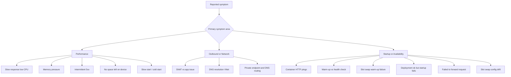

---
content_sources:
  diagrams:
    - id: playbook-map
      type: flowchart
      source: self-generated
      justification: Synthesized the playbook symptom map from Microsoft Learn troubleshooting topics that anchor this section.
      based_on:
        - https://learn.microsoft.com/en-us/azure/app-service/troubleshoot-diagnostic-logs
        - https://learn.microsoft.com/en-us/azure/app-service/troubleshoot-http-502-http-503
        - https://learn.microsoft.com/en-us/troubleshoot/azure/app-service/troubleshoot-performance-degradation
        - https://learn.microsoft.com/en-us/troubleshoot/azure/app-service/connection-issues-with-ssl-or-tls/troubleshoot-domain-and-tls-ssl-certificates
---
# Playbooks

Symptom-oriented troubleshooting guides for Azure App Service, with platform applicability stated in each playbook.

Each playbook follows a hypothesis-driven structure: start from the symptom, list competing hypotheses, collect evidence, validate or disprove, and identify the root cause.

The detector categories map closely to the playbooks below: `Availability and Performance` to the startup and performance playbooks, `Networking` to the outbound playbooks, and `Configuration and Management` plus `Deployment` to deployment failures. Open the detector hub first so Azure can surface the most likely detectors, then pick the matching playbook here for hypothesis-driven validation.

## Choose a Hosting Mode

| Hosting mode | Entry path |
|---|---|
| **Windows code** | Route by symptom through [Windows Playbooks and Evidence](#windows-playbooks-and-evidence). |
| **Windows custom container** | Begin with [Windows Container Health Probes](startup-availability/windows-container-health-probes.md); follow another Windows route only when its runtime model matches. |
| **Linux code or custom container** | Route through [Performance](#performance), [Outbound / Network](#outbound-network), or [Startup / Availability](#startup-availability); keep Linux paths and container settings separate from Windows guidance. |

## Windows Playbooks and Evidence

| Symptom or task | Existing guide |
|---|---|
| IIS startup, handler, or deployed `web.config` failure | [Windows IIS and web.config Startup](startup-availability/windows-iis-webconfig-startup.md) |
| Windows custom container never becomes healthy | [Windows Container Health Probes](startup-availability/windows-container-health-probes.md) |
| Need Windows Kudu tool selection or a platform tour | [Windows Kudu Diagnostics](startup-availability/windows-kudu-diagnostics.md) and [Kudu on Windows](../../platform/kudu-windows.md) |
| `w3wp` memory growth, recycle, or worker degradation | [Windows Memory Pressure and Worker Recycling](performance/windows-memory-pressure-worker-recycling.md) |
| `D:\home` or `D:\local` quota and filesystem symptoms | [Windows Filesystem Quotas](performance/windows-filesystem-quotas.md) |
| Windows Java SE `500.121` or httpPlatformHandler timeout | [Windows httpPlatformHandler KQL Pack](../kql/windows-httpplatformhandler/index.md) and [Windows Java httpPlatformHandler Timeout Lab](../lab-guides/windows-java-httpplatformhandler-timeout.md) |

The dedicated Windows set covers the symptoms above. Cross-platform deployment investigation also includes [Deployment Failures](deployment-failures.md), [Missing wwwroot Files and 404](missing-wwwroot-files-404.md), the [Missing wwwroot Content Lab](../lab-guides/missing-wwwroot-content.md), and the [ZIP Deploy File Lock Lab](../lab-guides/zipdeploy-file-lock-serialization.md). Other playbooks commonly use Linux examples; reuse their diagnostic method only after translating evidence through the correct hosting-mode guide.

<!-- diagram-id: playbook-map -->

---

## Performance

| Playbook | Symptom |
|----------|---------|
| [Performance Degradation](performance-degradation.md) | Slow response times, latency spikes, CPU or memory stress |
| [Tail Latency and Matched Baselines](performance/tail-latency-baseline-comparison.md) | Users report long delays while averages change little; compare matched request populations |
| [Slow Response but Low CPU](performance/slow-response-but-low-cpu.md) | High latency with CPU below saturation |
| [Memory Pressure & Worker Degradation](performance/memory-pressure-and-worker-degradation.md) | Gradual slowdown without CPU spikes |
| [Intermittent 5xx Under Load](performance/intermittent-5xx-under-load.md) | Sporadic server errors during traffic bursts |
| [No Space Left on Device](performance/no-space-left-on-device.md) | Disk full errors from /home or /tmp exhaustion |
| [Slow Start / Cold Start vs Regression](performance/slow-start-cold-start.md) | First request slow after deploy or idle — cold start or real problem? |

## Core Platform Playbooks

| Playbook | Symptom |
|----------|---------|
| [Deployment Failures](deployment-failures.md) | Failed deployments, slot issues, or swap failures |
| [SCM Client DNS and HTTP Failures](scm-access-dns-and-http-failures.md) | Kudu fails to open from one or several clients; distinguish name resolution, transport, HTTP rules and authentication |
| [Private Endpoint and Access Restriction Decisions](private-endpoint-access-restrictions.md) | PE approval without connectivity, unexpected allowlist exclusions, or safe private-only cutover |
| [Production ARM Configuration HTTP 400](arm-configuration-http-400.md) | Production configuration update returns ARM HTTP 400 while a comparable staging-slot request succeeds |
| [Missing wwwroot Files and 404](missing-wwwroot-files-404.md) | Expected static file absent from served content, later 404, actor and loss time unknown |
| [App Startup Failures](app-startup-failures.md) | Application or container never becomes ready |
| [mTLS Failures](mtls-failures.md) | Missing client certificate headers, failed validation, or outbound certificate loading issues |
| [SSL Certificate Issues](ssl-certificate-issues.md) | Custom domain TLS binding, renewal, or hostname mismatch problems |
| [Authentication Failures](authentication-failures.md) | Easy Auth, Entra ID, or identity-related sign-in failures |
| [CD RBAC Role Assignment Conflict](cd-rbac-role-assignment-conflict.md) | `RoleAssignmentExists` on Deployment Center reconnect with managed-identity ACR pulls |

### Process lifecycle and missing work

If work appears missing near a maintenance event, crash, configured restart, scale event, or deployment, use [Process Lifecycle and In-Flight Work](../../platform/process-lifecycle-and-in-flight-work.md#build-a-timestamped-identity-and-probe-timeline). It provides the shared symptom-first timeline and evidence method for these competing causes. A separate playbook would duplicate that method before the initiating lifecycle path is known.

## Outbound / Network

| Playbook | Symptom |
|----------|---------|
| [SNAT or Application Issue?](outbound-network/snat-or-application-issue.md) | Intermittent outbound connection failures |
| [DNS Resolution (VNet)](outbound-network/dns-resolution-vnet-integrated-app-service.md) | Name resolution failures in VNet-integrated apps |
| [Private Endpoint / DNS Confusion](outbound-network/private-endpoint-custom-dns-route-confusion.md) | Unreachable dependencies despite Private Endpoint |

## Startup / Availability

| Playbook | Symptom |
|----------|---------|
| [Container Didn't Respond to HTTP Pings](startup-availability/container-didnt-respond-to-http-pings.md) | Site fails to start after container launch |
| [Warm-up vs Health Check](startup-availability/warmup-vs-health-check.md) | Confusion between startup probing and health checks |
| [Slot Swap Failed During Warm-up](startup-availability/slot-swap-failed-during-warmup.md) | Swap fails due to warm-up timeout |
| [Deployment Succeeded but Startup Failed](startup-availability/deployment-succeeded-startup-failed.md) | Deploy green but app down — startup command or artifact mismatch |
| [Failed to Forward Request](startup-availability/failed-to-forward-request.md) | Platform proxy cannot reach app container at runtime |
| [Slot Swap Config Drift / Restart Race](startup-availability/slot-swap-config-drift.md) | Swap succeeds but production restarts or config breaks |
| [First Static-Asset Request Returns HTTP 500 After Deployment on Windows](startup-availability/windows-first-static-asset-request-500.md) | First static-asset request after deployment is 500, but the same request reloads as 200 |
| [Windows Slot-Swap First-Request Latency](startup-availability/windows-slot-swap-first-request-latency.md) | First business request is slow after a successful Windows slot swap |
| [Windows Slot-Swap Binding Drift and Worker Recycle](startup-availability/windows-slot-swap-binding-recycle.md) | Windows worker restarts near a swap and hostname-binding drift is one conditional hypothesis |

## See Also

- [Troubleshooting](../index.md)
- [First 10 Minutes Checklists](../first-10-minutes/index.md)
- [Hands-on Labs](../lab-guides/index.md)

## Sources

- [Microsoft Learn source 1](https://learn.microsoft.com/en-us/azure/app-service/troubleshoot-diagnostic-logs)
- [Microsoft Learn source 2](https://learn.microsoft.com/en-us/azure/app-service/troubleshoot-http-502-http-503)
- [Microsoft Learn source 3](https://learn.microsoft.com/en-us/troubleshoot/azure/app-service/troubleshoot-performance-degradation)
- [Microsoft Learn source 4](https://learn.microsoft.com/en-us/troubleshoot/azure/app-service/connection-issues-with-ssl-or-tls/troubleshoot-domain-and-tls-ssl-certificates)
