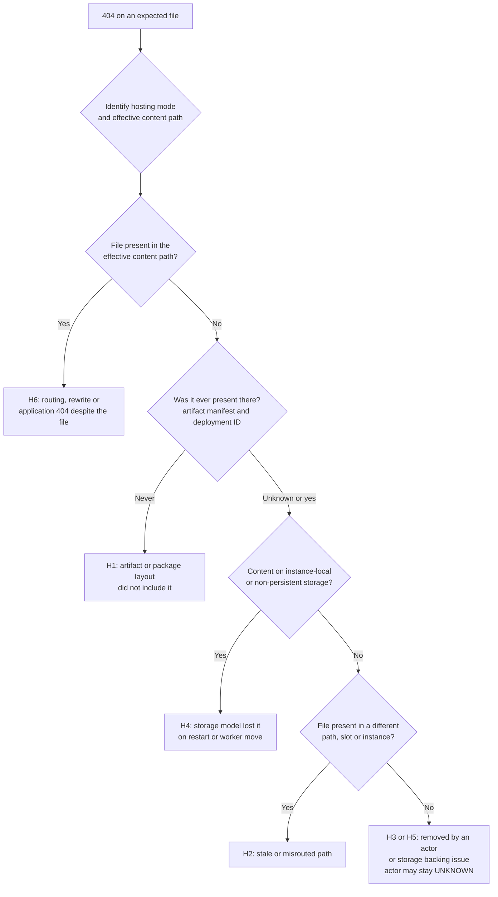

---
content_sources:
  diagrams:
    - id: missing-wwwroot-content-decision-flow
      type: flowchart
      source: self-generated
      justification: "Synthesized from Microsoft Learn articles on App Service file-system behavior, custom container persistent storage, Run From Package, and the Azure activity log to separate 'content absent', 'content in a different path', and 'content present but 404' before attributing a cause."
      based_on:
        - https://learn.microsoft.com/en-us/azure/app-service/operating-system-functionality
        - https://learn.microsoft.com/en-us/azure/app-service/configure-custom-container
        - https://learn.microsoft.com/en-us/azure/app-service/deploy-run-package
        - https://learn.microsoft.com/en-us/azure/azure-monitor/platform/activity-log
content_validation:
  status: verified
  last_reviewed: 2026-10-13
  reviewer: agent
  core_claims:
    - claim: "On Windows, the %HOME% directory maps to a content share in Azure Storage dedicated to the app and its files persist across app restarts, while %SystemDrive%\\local is temporary local storage whose changes are not persistent across app restarts."
      source: https://learn.microsoft.com/en-us/azure/app-service/operating-system-functionality
      verified: true
    - claim: "Persistent storage is enabled by default on Windows custom containers (C:\\home) and disabled by default on Linux custom containers (/home); when it is disabled, writes to the home directory are not persisted across restarts or across instances, and when it is enabled, files already in persistent storage overwrite the matching contents of the container's home directory at startup, with C:\\home\\LogFiles on Windows and /home/LogFiles on Linux as the only exceptions."
      source: https://learn.microsoft.com/en-us/azure/app-service/configure-custom-container
      verified: true
    - claim: "With Run From Package the ZIP is mounted as the read-only wwwroot directory, so an app that tries to write files there receives an error."
      source: https://learn.microsoft.com/en-us/azure/app-service/deploy-run-package
      verified: true
    - claim: "The deployment mechanism puts the built app into the /home/site/wwwroot directory, which is a mounted storage location shared by all instances of the web app."
      source: https://learn.microsoft.com/en-us/azure/app-service/deploy-best-practices
      verified: true
    - claim: "The Azure activity log records control plane (management) operations such as Resource Manager deployments, whereas resource logs capture data plane operations within a resource; activity log events are retained for 90 days."
      source: https://learn.microsoft.com/en-us/azure/azure-monitor/platform/activity-log
      verified: true
---

# Missing wwwroot Files and HTTP 404

## 1. Summary

This playbook applies when an expected static file or application asset, such as `index.html`, is proven absent from the content the app actually serves, and an HTTP 404 follows. It is built for the case where the **actor and the time of loss remain unknown**. Its main rule: a restart, an image refresh, a worker move, or a later 404 that happens *near* the loss does not establish that the platform deleted the file.

### Symptoms

- A file that was deployed earlier is not found when you browse the content in Kudu.
- Requests for that file return `404`, sometimes only after a restart, a container refresh, or a move to another worker.
- The deployment record is green and the process runs, yet the static asset is missing.

### What this playbook does not do

It does not attribute the loss to the platform, to the application, or to a person without matching evidence. A result of `UNKNOWN` for the cause and the loss time is an acceptable outcome. For failed or partial releases, use [Deployment Failures](deployment-failures.md) instead.

<!-- diagram-id: missing-wwwroot-content-decision-flow -->


## 2. Common Misreadings

| Observation | Often Misread As | Actually Means |
|---|---|---|
| File missing, then a restart was seen | The restart deleted the file | The two events are adjacent in time. Persistent shared content normally survives restarts, so a restart alone does not explain deletion. |
| 404 started after a worker move | Content was lost during the move | The new instance may be reading a different path, an empty local path, or content that was never persisted. |
| No restart or deployment in Activity Log | Nobody changed the content | Activity Log records management operations. File operations inside the app content are not among them, so absence proves nothing about who removed a file. |
| File absent in Kudu | File absent from what the app serves | Kudu and the app can see different file systems, notably on Linux where the Kudu container differs from the app container. |
| Run From Package is on and the file is gone | The package was modified | The mounted package is read-only; check whether the package in use is the one you think it is. |
| A later deployment restored the file | The earlier loss was a platform fault | Recovery by redeploy shows the artifact had the file. It does not show how or when the file disappeared. |

## 3. Competing Hypotheses

| Hypothesis | Likelihood | Key Discriminator |
|---|---|---|
| H1: The artifact or package layout never contained the file | Medium | Artifact manifest and hash for the deployed ZIP lack the file; a nested top-level directory in the ZIP shifted the layout. |
| H2: The file exists, but in a different path, slot, or instance than the one being read | Medium | The file is found under another content path, in the other slot, or on another instance. |
| H3: An actor removed or overwrote the file (app code, Kudu, FTP/FTPS, file manager, pipeline clean step) | Medium | Application audit events, pipeline logs, or FTP/Kudu access evidence that you instrumented. May remain untraceable. |
| H4: The content lived on instance-local or non-persistent storage and was lost on restart or relocation | Medium | Content path is `%SystemDrive%\local`, or a custom container with persistent storage disabled, or content overwritten by persistent `/home` at startup. |
| H5: A mounted storage path or content-share backing issue hid the content | Low | Storage mount configuration changed, or the mounted share is unreachable or mapped to the wrong target. |
| H6: The file is present but a routing, rewrite, or application rule returns 404 | Medium | File is present in the effective path while specific URLs 404; rewrite or route rules match the failing URL. |

## 4. What to Check First

1. **Identify the hosting mode and the effective content path.** Do not interpret `wwwroot` until you know which row below applies. The modes have different storage contracts and must not be merged into one rule.

    | Hosting mode | Content location | Persistence and sharing | Where to look |
    |---|---|---|---|
    | Windows code app | `%HOME%\site\wwwroot` (`D:\home\site\wwwroot`) | `%HOME%` maps to an app-dedicated Azure Storage content share and persists across restarts; `%SystemDrive%\local` is temporary and does not persist across restarts | Kudu file browser or Debug Console |
    | Linux code app | `/home/site/wwwroot` | Mounted storage location shared by all instances, per the deployment best-practices article; Learn pages used here do not describe instance-local paths for Linux code apps | Kudu for the shared view; the app container shell for runtime-effective paths and instance-local state |
    | Windows custom container | Serving path is defined by the image or app (for example the path your Dockerfile serves from); `C:\home` is only the App Service persistence root | Persistent storage enabled by default; if disabled, writes are not kept across restarts or instances; when enabled, persisted files overwrite matching container content at startup except `C:\home\LogFiles` | The image-defined serving path first, then `C:\home` through Kudu |
    | Linux custom container | Serving path is defined by the image or app (for example `/app`); `/home` is only the App Service persistence root | Persistent storage disabled by default; if disabled, writes are not kept across restarts or instances; when enabled, persisted files overwrite matching container content at startup except `/home/LogFiles` | The image-defined serving path through the container shell, then `/home` through Kudu |
    | Run From Package (any supported mode) | `wwwroot` as a read-only mount of the ZIP | Content is the package; for the Windows `SitePackages` and `packagename.txt` details see [Run From Package](../../platform/run-from-package.md); no Linux equivalent path is documented | Package contents and manifest |
    | Custom Azure Storage mount | The configured mount path | Backed by the external storage account, independent of the app's own content | Storage mount list and storage account |


    ```bash
    az webapp config appsettings list \
        --resource-group $RG \
        --name $APP_NAME \
        --query "[?name=='WEBSITE_RUN_FROM_PACKAGE' || name=='WEBSITES_ENABLE_APP_SERVICE_STORAGE' || name=='SCM_DO_BUILD_DURING_DEPLOYMENT'].{name:name,value:value}" \
        --output table
    ```

    | Command | Purpose |
    |---------|---------|
    | `az webapp config appsettings list --resource-group $RG --name $APP_NAME --query "[?name=='WEBSITE_RUN_FROM_PACKAGE' \|\| name=='WEBSITES_ENABLE_APP_SERVICE_STORAGE' \|\| name=='SCM_DO_BUILD_DURING_DEPLOYMENT'].{name:name,value:value}" --output table` | Lists the settings that decide where content lives and whether it is built or mounted. |
    | `--resource-group $RG` | Selects the resource group that contains the web app. |
    | `--name $APP_NAME` | Selects the web app. |
    | `--query "[?name=='WEBSITE_RUN_FROM_PACKAGE' \|\| name=='WEBSITES_ENABLE_APP_SERVICE_STORAGE' \|\| name=='SCM_DO_BUILD_DURING_DEPLOYMENT'].{name:name,value:value}"` | Keeps only the content-location settings and projects name and value. |
    | `--output table` | Formats the result for quick triage. |

2. **List custom storage mounts** that may supply or replace content paths.

    ```bash
    az webapp config storage-account list \
        --resource-group $RG \
        --name $APP_NAME \
        --output table
    ```

    | Command | Purpose |
    |---------|---------|
    | `az webapp config storage-account list --resource-group $RG --name $APP_NAME --output table` | Lists Azure Storage mounts configured on the app so you can see which paths are backed by external storage. |
    | `--resource-group $RG` | Selects the resource group that contains the web app. |
    | `--name $APP_NAME` | Selects the web app. |
    | `--output table` | Formats the result for quick triage. |

3. **Pull the management-plane timeline** for the incident window.

    ```bash
    az monitor activity-log list \
        --resource-group $RG \
        --offset 7d \
        --max-events 200 \
        --query "[?contains(resourceId, '$APP_NAME')].{time:eventTimestamp,operation:operationName.value,caller:caller,status:status.value}" \
        --output table
    ```

    | Command | Purpose |
    |---------|---------|
    | `az monitor activity-log list --resource-group $RG --offset 7d --max-events 200 --query "[?contains(resourceId, '$APP_NAME')].{time:eventTimestamp,operation:operationName.value,caller:caller,status:status.value}" --output table` | Lists management operations on the app such as deployments, app-setting changes, restarts, and swaps. |
    | `--resource-group $RG` | Limits the query to the app's resource group. |
    | `--offset 7d` | Looks back seven days from now; activity log events are kept for 90 days. |
    | `--max-events 200` | Raises the record limit above the CLI default of 50 so the resource group's events are not truncated before the query filter runs. |
    | `--query "[?contains(resourceId, '$APP_NAME')].{time:eventTimestamp,operation:operationName.value,caller:caller,status:status.value}"` | Keeps only events for this app and projects time, operation, caller, and status. |
    | `--output table` | Formats the result for quick triage. |

    Use Activity Log only for management-plane events: deployments, app-setting changes, restarts, swaps, and storage-mount configuration. It does not record individual file operations inside the app content.

4. **Inspect the content in Kudu**, then confirm from the app side. Use Kudu's file browser or Debug Console for the effective shared content and the deployment records. On Linux, also check the app container's own shell for runtime-effective paths and instance-local state, because the Kudu container has a different local file system. See [Kudu Overview](../../platform/kudu-overview.md), [Kudu on Windows](../../platform/kudu-windows.md), and [Kudu on Linux](../../platform/kudu-linux.md).

## 5. Evidence to Collect

Build one timeline where each row is a separate, independently evidenced fact. Record whether each source actually existed for the incident window. A source that was not enabled or not retained gives `UNKNOWN`, never a negative observation: missing telemetry is not evidence that nothing happened. A current Kudu listing shows the present state only, not history.

| Timeline field | Evidence source | Availability to confirm for the window | Notes |
|---|---|---|---|
| Last proven file-present time | Artifact manifest, a past Kudu listing you saved, a logged successful request for the file | Was the manifest stored, or HTTP logging enabled and retained, at that time? | Must be an observation, not an assumption from the deploy time |
| First proven file-absent time | Kudu listing or app-side check, with slot and instance named | Only the time you actually checked; a later check does not date the loss | Record the effective content path that was checked |
| First logged 404 | `AppServiceHTTPLogs` | HTTP logs enabled and retained for the window | The earliest retained 404, independent of when the file went missing |
| Control-plane deployments and configuration changes | Activity Log, deployment records, artifact hash | Activity Log keeps 90 days; ZIP and Kudu content deployments appear in deployment records, not as every ARM operation | Include the deployment mode |
| Content mounting mode | App settings, storage mounts, container type | Current configuration only unless changes appear in Activity Log | See section 4, step 1 |
| Process restart | `AppServicePlatformLogs`, process start time | Platform logs enabled and retained | Restart count and timing |
| Instance or host change | Instance or host identifier columns in HTTP or platform logs | Logs enabled; Learn does not guarantee an explicit relocation event | Infer a move only from a change in the identifier, and do not equate it with data loss |
| Storage events | Storage mount configuration changes, storage account logs | Only if storage logging was enabled | Often `UNKNOWN` |
| Recovery | The action and time after which the file reappeared | Your own change record | Redeploy proves the artifact, not the loss cause |
| Slot, instance, artifact digest | Slot name, instance ID, ZIP hash | Recorded at deploy time | Needed to compare like with like |

### 5.1 KQL Queries

#### Query 1: Earliest and latest logged 404 for the file

```kusto
AppServiceHTTPLogs
| where TimeGenerated > ago(7d)
| where CsUriStem endswith "/index.html"
| where ScStatus == 404
| summarize FirstLogged404=min(TimeGenerated), LastLogged404=max(TimeGenerated), Count404=count()
```

Interpretation: `FirstLogged404` is the earliest 404 for that exact path suffix that HTTP logging recorded and retained. It dates the *symptom*, not the loss, and it is meaningful only if HTTP logs were enabled for the whole window. Change the path to the real asset.

#### Query 1b: Latest logged success for the same file

```kusto
AppServiceHTTPLogs
| where TimeGenerated > ago(7d)
| where CsUriStem endswith "/index.html"
| where ScStatus between (200 .. 399)
| summarize LastLoggedSuccess=max(TimeGenerated)
```

Interpretation: the interval between `LastLoggedSuccess` and `FirstLogged404` is an upper bound on when the file became unreachable through that URL, and only when requests arrived during the interval. Keep these two timestamps as separate timeline fields; do not merge them with the file-absent observation.

#### Query 2: Platform lifecycle rows around the window

```kusto
AppServicePlatformLogs
| where TimeGenerated > ago(7d)
| where Message has_any ("restart", "Starting", "Stopping", "container", "site", "deployment")
| project TimeGenerated, Level, Message
| order by TimeGenerated asc
```

Interpretation: use these rows to place restarts and container starts on the timeline. Adjacency to the first 404 is a correlation, not a cause. There is no platform log table for file deletion inside the app content, so do not expect a KQL result to name an actor.

### 5.2 Timeline template

```text
Incident: missing <path>
Hosting mode / content path: <value or UNKNOWN>
Last file-present: <timestamp + source or UNKNOWN>
First file-absent: <timestamp + source or UNKNOWN>
First 404: <timestamp + source>
Restart / relocation: <timestamps or UNKNOWN>
Deployments in window: <deployment IDs and hashes>
Most supported hypothesis: <H1..H6 or UNKNOWN>
Actor: <name or UNKNOWN>
Loss time: <timestamp or UNKNOWN>
Evidence that would change this conclusion: <list>
```

## 6. Validation and Disproof by Hypothesis

Where a hypothesis can be proven or disproven by a single observation, the section says so. For hypotheses that depend on evidence you may not have collected (H3, H4, H5), the section lists **supporting** and **weakening** observations instead, and only a matching path, operation, and time can support a specific causal statement.

### H1: The artifact or package layout never contained the file

**Proves if** the manifest and hash of the deployed ZIP do not list the file, or the ZIP has an extra top-level directory so entry files are not at the root.

**Disproves if** the same artifact hash that was deployed lists the file at the expected path.

Validation steps:

1. Compare the deployed artifact's manifest with the expected file list.
2. Confirm the ZIP root contains the entry files directly, with no nested root directory.
3. If the app uses Run From Package, verify the package in use and its layout; see [Run From Package](../../platform/run-from-package.md).

### H2: The file exists in a different path, slot, or instance

**Proves if** the file is found under another content path, in the other slot, or on another instance.

**Disproves if** the file is absent from all of those and from the artifact's deployed location.

Validation steps:

1. Name the slot and instance for every check you record.
2. Compare the content path the runtime serves against the one you inspected. On Linux code apps, build output may be served from a runtime app path rather than `wwwroot`.
3. If a swap happened, compare content and slot-specific settings in both slots.

### H3: An actor removed or overwrote the file

**Supporting observations:** evidence you instrumented, such as application audit events, pipeline logs of a clean step, or FTP/Kudu access records, shows an operation on the same path, at a time consistent with the loss, by an identifiable actor. A record like that can support a specific operation.

**Weakening observations:** audit sources that were active for the whole window show no matching operation. That weakens the hypothesis for the covered actors only; it cannot rule out deletion by something that was not instrumented.

Validation steps:

1. Check pipeline definitions for steps that clear or sync the deployment directory.
2. Check whether application code writes to or deletes from the content directory.
3. Check which actors had Kudu, FTP/FTPS, or file-manager access in the window.

An absence of matching platform operations is not proof that a particular other actor did it. File deletion that was not instrumented may be untraceable.

### H4: The content lived on instance-local or non-persistent storage

**Supporting observations:** the content path is `%SystemDrive%\local` or other instance-local storage; or the app is a custom container with persistent storage disabled and the file was written to the home directory (`C:\home` or `/home`); or persistent storage replaced the container's own home content at startup. To attribute the loss to a lifecycle event, you also need the same effective path observed present before, and absent after, the identified restart or relocation.

**Weakening observations:** the content path is the persistent shared content location and the file was written there, or the file was already absent before the restart or relocation.

Validation steps:

1. Determine the platform and container type. Windows custom containers (`C:\home`) have persistent storage enabled by default; Linux custom containers (`/home`) have it disabled by default.
2. Check `WEBSITES_ENABLE_APP_SERVICE_STORAGE`. When persistent storage is enabled, files already in persistent storage overwrite matching contents of the container's home directory at startup, except `C:\home\LogFiles` on Windows and `/home/LogFiles` on Linux.
3. Confirm whether the lost file was written at runtime or baked into the image.

### H5: A mounted storage path or content-share backing issue

**Supporting observations:** a custom Azure Storage mount was added, changed, or is unreachable, the missing path lies under it, and the timing is consistent with the observed file-absent time.

**Weakening observations:** the missing path is not under any configured mount, or the mount configuration and reachability were unchanged and healthy across the window.

Validation steps:

1. List storage mounts and compare their mount paths with the missing file's path.
2. Check Activity Log for storage-mount configuration changes in the window.
3. Verify connectivity to the storage account; see [App Service to Azure Storage connectivity](../../platform/storage-connectivity.md).

### H6: The file is present but a routing or rewrite rule returns 404

**Proves if** the file is present in the effective content path while the specific URL returns `404`.

**Disproves if** the file is absent from the effective path.

Validation steps:

1. Request the file by a path that bypasses rewrite rules.
2. Review `web.config` rewrite rules or application routes for patterns that match the failing URL.
3. Check case sensitivity and path separators, especially on Linux.

## 7. Likely Root Cause Patterns

| Pattern | Evidence | Resolution |
|---|---|---|
| Artifact omitted the file | Manifest lacks the file; deployed hash matches | Fix the packaging step and redeploy |
| Content written to non-persistent storage | Path is local or persistent storage is disabled | Write runtime content to persistent shared storage or a supported mount |
| Pipeline clean step removed content | Pipeline log shows a clear or sync operation | Remove or scope the clean step |
| Wrong effective path | File found elsewhere or in another slot | Align the served path and slot settings |
| Rewrite rule produced the 404 | File present; URL rule matches | Correct the rule |
| Cause not determinable | No instrumented evidence for H3 or H5 | Record `UNKNOWN`, add instrumentation, and monitor |

## 8. Immediate Mitigations

1. Restore the file from the known-good artifact by redeploying it, and record that this proves the artifact but not the cause.
2. Do not restart or redeploy repeatedly before capturing the timeline fields in section 5.
3. If the content was on non-persistent storage, move it to persistent shared content or a supported storage mount.
4. If a pipeline clean step is implicated, disable it until it is scoped.
5. Add a synthetic request for a known static asset to your post-deploy checks so the next loss is dated by observation.

## 9. Prevention

### Prevention checklist

- [ ] Publish an artifact manifest and hash with every release and store the deployment ID alongside it.
- [ ] Add a post-deploy and periodic check that requests a known static asset.
- [ ] Keep mutable runtime files out of the deployment directory; use persistent storage or an external service.
- [ ] Emit application audit events for any code path that deletes or overwrites content files.
- [ ] Document the hosting mode and effective content path for each app.
- [ ] Record `UNKNOWN` explicitly in incident reviews instead of inferring a cause.

## See Also

- [Playbooks](index.md)
- [Deployment Failures](deployment-failures.md)
- [Run From Package](../../platform/run-from-package.md)
- [Kudu Overview](../../platform/kudu-overview.md)
- [Kudu on Windows](../../platform/kudu-windows.md)
- [Kudu on Linux](../../platform/kudu-linux.md)
- [App Service to Azure Storage connectivity](../../platform/storage-connectivity.md)
- [ZIP Deploy and Run From Package (operations)](../../operations/deployment/zip-deploy.md)

## Sources

- [Operating system functionality on Azure App Service (Microsoft Learn)](https://learn.microsoft.com/en-us/azure/app-service/operating-system-functionality)
- [Configure a custom container for Azure App Service (Microsoft Learn)](https://learn.microsoft.com/en-us/azure/app-service/configure-custom-container)
- [Run your app from a ZIP package (Microsoft Learn)](https://learn.microsoft.com/en-us/azure/app-service/deploy-run-package)
- [Deployment best practices (Microsoft Learn)](https://learn.microsoft.com/en-us/azure/app-service/deploy-best-practices)
- [Azure activity log (Microsoft Learn)](https://learn.microsoft.com/en-us/azure/azure-monitor/platform/activity-log)
- [AppServiceHTTPLogs table reference (Microsoft Learn)](https://learn.microsoft.com/en-us/azure/azure-monitor/reference/tables/appservicehttplogs)
- [AppServicePlatformLogs table reference (Microsoft Learn)](https://learn.microsoft.com/en-us/azure/azure-monitor/reference/tables/appserviceplatformlogs)
