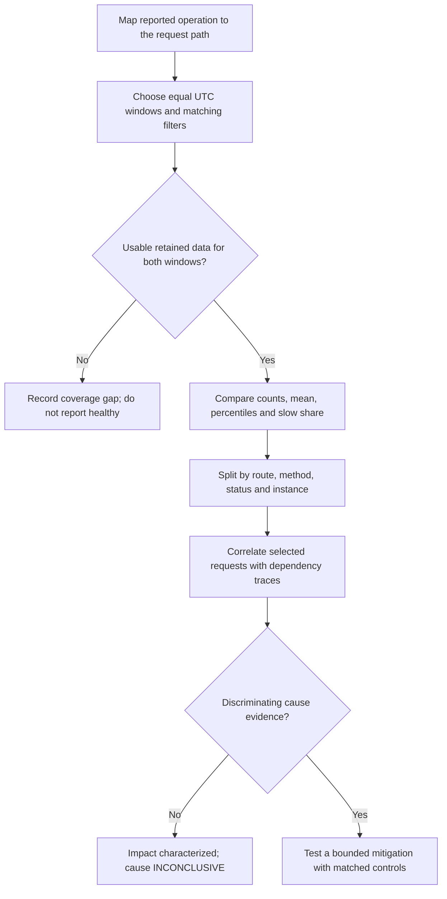

# Tail Latency and Matched Baseline Comparison

## 1. Summary

Use this playbook when users report occasional long delays while the overall average changes little. The first question is **which requests were slow**, not **which component caused them**. This method applies to Windows and Linux where the named logs are available; it does not require an assumed platform incident or CPU bottleneck.

**Verification boundary:** the metadata records a public-source review. Azure/KQL execution is **NOT_RUN** and causal hypotheses are **NOT_TESTED**. The worked example below is an invented distribution, not customer measurements or a retained KQL result. Local arithmetic checks do not certify cloud query execution or independent reproduction.

<!-- diagram-id: tail-latency-impact-to-cause-flow -->


## 2. Common Misreadings

| Observation | Unsupported conclusion | Better interpretation |
|---|---|---|
| Average response time is near normal | The reported slow requests did not happen | The mean can conceal a slower minority. Inspect tail percentiles and counts. |
| P99 resembles the reported delay | The platform or database caused the delay | The durations are compatible; neither request identity nor causation is established. |
| One route has high P99 | Its code is defective | Request mix, payload, dependencies, routing and instance state still need comparison. |
| CPU is low | There is no application-side bottleneck | Waits, locks and dependency delays require separate evidence. |
| No rows in a window | Zero requests or zero latency | Collection, retention, scope and timing may be incomplete. |
| Latency improves after scaling or restart | Root cause has been proved | Recovery and causal discrimination are different claims. |

## 3. Competing Hypotheses

| ID | Hypothesis | Needed discriminator |
|---|---|---|
| H1 | A minority of server requests became slower | Comparable route/method populations show a tail or slow-share change. |
| H2 | Traffic composition changed rather than within-route performance | Route proportions changed while sufficiently sampled within-route distributions remain similar. |
| H3 | Browser/network work explains a timing gap | Correlated client timings account for time outside the measured server interval. |
| H4 | An application or dependency path became slower | Matched request traces and relevant spans identify the slow path; overlapping work is considered. |
| H5 | The comparison is distorted by telemetry coverage | Missing intervals, scope differences, sampling changes or invalid durations affect the compared populations. |

## 4. What to Check First

1. Map the reported URL and user action to the actual App Service route. A portal, proxy, embedded page or upstream service URL is not automatically the App Service request URL. Record the mapping evidence before selecting a resource.
2. Define the timing boundary: browser end-to-end, HTTP server log, application request span, or dependency span. Compare equivalent boundaries, not similarly named metrics.
3. Choose equal-duration UTC intervals with identical host, resource and route inclusion rules. The previous day's same hours are a starting control, not proof of comparable workload; compare the same weekday or business schedule when appropriate.
4. Verify logging, retention and ingestion coverage for both intervals. Ensure the query editor's time scope includes both; a last-hour UI filter can invalidate a wider query.
5. Keep request counts and usable timing counts alongside percentiles. Inspect smaller route/status groups before attributing a whole-app change to every user.

## 5. Evidence to Collect

### Matched-window KQL

Required table: `AppServiceHTTPLogs`. The field names and millisecond unit come from its [Microsoft Learn schema](https://learn.microsoft.com/en-us/azure/azure-monitor/reference/tables/appservicehttplogs). Replace all three inputs below: resource ID, host, and example incident times. The January dates are arbitrary query inputs, not a capture date. Select the actual `CsHost` value observed for the intended traffic; do not mix main-site and SCM records.

The query requires positive, non-overlapping windows; with the one-day offset its duration must be at most one day. Invalid inputs produce `INVALID_WINDOW`. For a longer investigation, choose a separate non-overlapping baseline before adapting the query. The query retains empty window rows with explicit status. It does not invent latency values when no usable timing data exists. It has not been executed against Azure in this change.

```kusto
let TargetResourceId = '<resource-id>';
let TargetHost = '<app-hostname>';
let IncidentStart = datetime(2026-01-20T09:00:00Z);
let IncidentEnd = datetime(2026-01-20T10:00:00Z);
let BaselineStart = IncidentStart - 1d;
let BaselineEnd = IncidentEnd - 1d;
let ValidWindows = IncidentStart < IncidentEnd and BaselineEnd <= IncidentStart;
let SlowThresholdMs = 10000.0;
let Windowed = materialize(
    AppServiceHTTPLogs
    | where ValidWindows
    | where _ResourceId =~ TargetResourceId
    | where CsHost =~ TargetHost
    | where (TimeGenerated >= BaselineStart and TimeGenerated < BaselineEnd)
         or (TimeGenerated >= IncidentStart and TimeGenerated < IncidentEnd)
    | extend Period = iff(TimeGenerated < IncidentStart, 'Baseline', 'Incident')
    | extend DurationMs = iff(TimeTaken >= 0, todouble(TimeTaken), real(null))
);
let Summary = Windowed
    | summarize RetainedRows=count(), TimedRows=countif(isnotnull(DurationMs)),
        MeanMs=avg(DurationMs), P50Ms=percentile(DurationMs, 50),
        P95Ms=percentile(DurationMs, 95), P99Ms=percentile(DurationMs, 99),
        SlowRows=countif(DurationMs > SlowThresholdMs),
        ErrorRows=countif(ScStatus between (500 .. 599))
      by Period;
datatable(Period:string) ['Baseline', 'Incident']
| join kind=leftouter Summary on Period
| extend RetainedRows=coalesce(RetainedRows, tolong(0)),
         TimedRows=coalesce(TimedRows, tolong(0)),
         SlowRows=coalesce(SlowRows, tolong(0)),
         ErrorRows=coalesce(ErrorRows, tolong(0))
| extend DataStatus=case(not(ValidWindows), 'INVALID_WINDOW',
                         RetainedRows == 0, 'NO_RETAINED_ROWS',
                         TimedRows == 0, 'NO_VALID_TIMINGS', 'ROWS_PRESENT'),
         SlowPct=iff(TimedRows > 0, 100.0 * SlowRows / TimedRows, real(null)),
         ErrorPct=iff(RetainedRows > 0, 100.0 * ErrorRows / RetainedRows, real(null))
| project Period, DataStatus, RetainedRows, TimedRows, MeanMs,
          P50Ms, P95Ms, P99Ms, SlowRows, SlowPct, ErrorRows, ErrorPct
| order by Period asc
```

| Output | Interpretation |
|---|---|
| `RetainedRows`, `TimedRows` | Observed rows versus rows with nonnegative, non-null duration. Neither certifies that every real request was collected. |
| `MeanMs`, `P50Ms`, `P95Ms`, `P99Ms` | Milliseconds for usable timings; missing values remain missing. |
| `SlowRows`, `SlowPct` | Count and percentage above the chosen threshold, using **TimedRows** as denominator. |
| `ErrorRows`, `ErrorPct` | HTTP 5xx count and percentage over retained rows, independent of whether timing is usable. |
| `DataStatus` | `ROWS_PRESENT` is a data-presence label, not a health or completeness verdict. |

[Measured] Report the selected windows, filters, timing unit and counts with any result. Excluding invalid timing values can change the population; investigate a mismatch between retained and timed counts. Do not claim zero traffic from the skeleton's zero retained-row count.

For a route-level comparison, retain the inputs and `Windowed` definition above and replace everything starting at `let Summary` with the following pipeline. This fragment is **not standalone**:

```kusto
Windowed
| summarize RetainedRows=count(), TimedRows=countif(isnotnull(DurationMs)),
    P95Ms=percentile(DurationMs, 95), P99Ms=percentile(DurationMs, 99),
    SlowRows=countif(DurationMs > SlowThresholdMs)
  by Period, CsUriStem, CsMethod, ScStatus, ComputerName
| order by P99Ms desc
```

An absent route-period row is not a zero-duration route. Small groups make extreme percentiles unstable, and instance changes make direct per-instance comparisons harder. Normalize paths containing IDs before exporting or aggregating them into published examples. Do not publish user identifiers, query strings or raw production host names.

### A fully synthetic worked example

This invented example uses 1,000 timings per window. Baseline: 980 requests at 1 second and 20 at 15 seconds. Incident: 970 at 1 second and 30 at 25 seconds. All requests have valid durations and HTTP 200 in this example.

| Synthetic window | Requests | Mean seconds | P50 seconds | P95 seconds | P99 seconds | Requests over 10 seconds | Slow percentage |
|---|---:|---:|---:|---:|---:|---:|---:|
| Baseline | 1000 | 1.28 | 1 | 1 | 15 | 20 | 2.0 |
| Incident | 1000 | 1.72 | 1 | 1 | 25 | 30 | 3.0 |

The exact nearest-rank arithmetic is checked by `tests/ci/test_generalized_case_docs.py`. These are **synthetic arithmetic values**, not observed Azure output. Kusto uses estimated percentiles, so the table is not an assertion of byte-for-byte KQL results.

[Inferred from the synthetic model] A minority can experience a 25-second server duration while the overall mean remains below 2 seconds. This example proves only that such a distribution is possible, not that any real user or incident followed it.

### Correlating beyond percentiles

Use individual request IDs, operation/trace IDs, parent-child span relationships, UTC timestamps, artifact version and instance identity. The [Application Insights data model](https://learn.microsoft.com/en-us/azure/azure-monitor/app/data-model-complete) distinguishes browser, request and dependency telemetry, including `requests`/`dependencies` in the Application Insights view and `AppRequests`/`AppDependencies` in Log Analytics. Convert timespan `duration` and numeric `DurationMs` explicitly before comparison; do not paste field names between schemas unchanged.

A dependency's P99 subtracted from a request's P99 is **not** the dependency's contribution to a request. Nor can parallel dependency durations simply be added. Examine the correlated critical path. Check the actual SDK/collector [sampling configuration](https://learn.microsoft.com/en-us/azure/azure-monitor/app/opentelemetry-sampling); retained Application Insights spans may not represent the same population as HTTP logs. Counts, weights and percentile estimation require an explicit sampling model, not a silent table substitution.

## 6. Validation and Disproof by Hypothesis

| Hypothesis | Supporting observation | Weakening observation or missing-evidence boundary |
|---|---|---|
| H1 | Matched route/method timings show a larger slow share or tail | Only aggregate mix changes, or coverage differs; within-route degradation remains unproven. |
| H2 | More traffic reaches already expensive paths with similar within-path distributions | Comparable paths become slower even after controlling their proportions. |
| H3 | A correlated browser waterfall accounts for a client/server timing gap | Correlated server requests already explain the measured delay; extra client time still needs measurement. |
| H4 | Slow request traces identify a matching wait or dependency path | An unrelated high dependency percentile or low CPU alone cannot isolate the cause. Missing spans leave it INCONCLUSIVE. |
| H5 | Known dropped intervals, changed sampling or filters alter the compared populations | Comparable coverage and filters weaken this explanation; they do not prove a different cause. |

## 7. Likely Root Cause Patterns

| Evidence state | Permitted conclusion |
|---|---|
| Matched samples establish slower requests, but no discriminating traces | Impact characterized; bottleneck and root cause UNKNOWN. |
| Only request mix changes under the selected controls | Aggregate latency changed with workload composition; a within-route regression is not established. |
| Correlated spans identify a slow dependency critical path | Dependency contribution is supported for those traced requests; investigate its cause separately. |
| Either interval lacks adequate retained data | Comparison is INCONCLUSIVE; do not replace missing measurements with zeros. |

A safe case-note pattern is: "The selected retained request population shows a change in [metric] over [window] compared with [baseline]. This characterizes server-side impact under [filters]. The source of the delay is not yet established; the next discriminator is [specific correlated evidence]."

## 8. Immediate Mitigations

Preserve the evidence window before restarts or scaling obscure process state. Use a bounded, approved mitigation tied to an observed failure mode and record rollback conditions. Compare subsequent periods under matching filters and workload; successful mitigation is recovery evidence, not automatic proof of the original hypothesis.

## 9. Prevention

Monitor tail percentiles and slow-request share alongside average latency, traffic and errors. Preserve diagnostic coverage, request/dependency correlation and deployment identity. Do not average per-minute P99 values to produce a daily P99; recompute from the appropriate request population. Keep source review, sample collection, query execution and causal conclusion dates separate.

## See Also

- [Playbooks](../index.md)
- [Performance Degradation](../performance-degradation.md)
- [Slow Response but Low CPU](slow-response-but-low-cpu.md)
- [HTTP Latency by Status Code](../../kql/http/latency-trend-by-status-code.md)
- [Windows Slot-Swap First-Request Latency](../startup-availability/windows-slot-swap-first-request-latency.md)

## Sources

- [AppServiceHTTPLogs fields and units](https://learn.microsoft.com/en-us/azure/azure-monitor/reference/tables/appservicehttplogs)
- [AppServiceHTTPLogs example queries](https://learn.microsoft.com/en-us/azure/azure-monitor/reference/queries/appservicehttplogs)
- [Kusto percentile aggregation](https://learn.microsoft.com/en-us/kusto/query/percentiles-aggregation-function)
- [Application Insights telemetry model](https://learn.microsoft.com/en-us/azure/azure-monitor/app/data-model-complete)
- [Application Insights OpenTelemetry sampling](https://learn.microsoft.com/en-us/azure/azure-monitor/app/opentelemetry-sampling)
