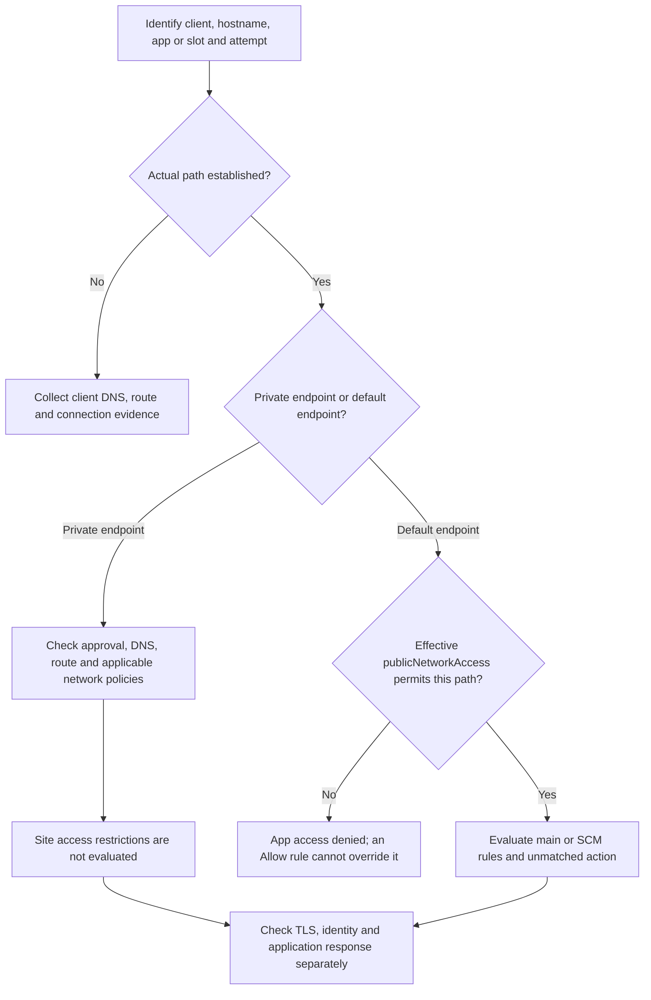

# Private Endpoint and Access Restriction Decisions

## 1. Summary

Use this playbook for three distinct tasks: a private endpoint exists but a client cannot connect; adding an allow rule unexpectedly excludes other clients; or a private-only cutover must preserve authorized application and deployment access. A configuration inquiry does not imply an outage or a confirmed defect.

Start with the actual request path. A private endpoint connection marked Approved is control-plane state, not proof that a particular client resolved, connected, authenticated or completed a business request. Likewise, a Portal setting describing public access does not prove reachability from every internet client.

**Verification boundary:** source review only. Azure commands, KQL, client probes and cutover are **NOT_RUN**; hypotheses are **NOT_TESTED**, and missing discriminating evidence leaves them **INCONCLUSIVE**. Independent human reproduction is **NOT_MET**. No customer names, original incident timestamps, private telemetry or captured results appear here.

Scope: App Service inbound access. For SCM-specific browser/DNS probes, use [SCM Client Access Failures](scm-access-dns-and-http-failures.md). Functions hosting and dependency requirements require their own checks. Azure Container Apps internal-environment and ingress semantics are not App Service rules.

<!-- diagram-id: private-endpoint-access-policy-flow -->


## 2. Common Misreadings

| Observation | Unsupported conclusion | Next discriminator |
|---|---|---|
| PE is Approved and provisioning succeeded | The browser or deployment agent can reach it | Test that client's actual DNS, route and TLS path. |
| A CNAME contains privatelink | Traffic reached the private endpoint | Inspect the final address and actual connection path, including any proxy. |
| VNet Integration is enabled | Inbound requests are private | Identify the inbound endpoint; integration is outbound. |
| An IP Allow rule exists | It creates connectivity or overrides disabled public access | Determine the endpoint and app-access gate first. |
| A Deny rule exists but private requests work | App Service ignored its rules | Site rules do not evaluate PE ingress. |
| Main site works | SCM, deployment and Portal Test/Run work | Test each target from its real operator or agent path. |
| No rule-match audit entry | No network rejection occurred | Check logging coverage and unmatched-rule limitations. |

## 3. Competing Hypotheses

| ID | Hypothesis | Evidence needed |
|---|---|---|
| H1 | The client is not using the intended private path | Client-side DNS chain, final address, route/proxy and endpoint connection evidence. |
| H2 | Default endpoint app access is disabled | Actual default-path attempt and effective publicNetworkAccess for the correct app or slot. |
| H3 | A site rule or unmatched action rejects the request | Applicable main/SCM rules, priority/order, actual source context and correlated response. |
| H4 | Private transport or its network policy is the blocker | Correct PE target plus route, TCP/TLS and applicable NSG/UDR evidence. |
| H5 | Connectivity succeeds but authentication or the app rejects work | Correlated response origin, authenticated identity and application diagnostics. |

An HTTP 403 alone cannot choose among network policy, proxy, authentication and application explanations. A DNS failure and a different attempt's HTTP rejection must not be combined into one invented sequence.

## 4. What to Check First

### Identify the endpoint and effective policy

Use the original bound application hostname, not a raw PE IP or a privatelink name substituted into the browser URL. For multitenant apps, validate both the app and SCM private DNS records. Check the particular slot: private endpoints cannot be shared between slots. PE and VNet Integration use separate subnets; enabling integration does not supply a workstation's inbound route. See [private endpoint scope and DNS](https://learn.microsoft.com/en-us/azure/app-service/overview-private-endpoint).

The following is an **expected policy matrix**, not measured HTTP results. Assumptions: the selected endpoint is reachable and the described configuration is effective. Admission through a network gate does not guarantee HTTP 200, successful authentication or business completion.

| Actual inbound path | App access | Site rule state | Policy interpretation |
|---|---|---|---|
| Private endpoint | Any publicNetworkAccess value | Any main/SCM site rules | Site rules NOT_EVALUATED; private transport, applicable network policies and application identity still matter. |
| Default endpoint | Disabled | Even a matching Allow | BLOCKED at app access; the site Allow cannot reopen it. |
| Default endpoint | Enabled | Matching Allow | ADMITTED by the matching site rule only. |
| Default endpoint | Enabled | Matching Deny | BLOCKED by the matching site rule. |
| Default endpoint | Enabled | No match; explicit default Deny | BLOCKED by unmatched action. |
| Default endpoint | Enabled | No match; explicit default Allow | ADMITTED by unmatched action only. |
| Default endpoint | Enabled | No match; default unset; zero configured rules | Implicit ALLOW at site access only. |
| Default endpoint | Enabled | No match; default unset; one or more configured rules | Implicit DENY for unmatched traffic. |
| Default endpoint | null; no PE exists | Evaluate applicable site rules | App-access default ENABLED; not proof of HTTP success. |
| Default endpoint | null; PE exists | Any site rule | App-access default DISABLED. |
| Unknown path or unavailable effective configuration | UNKNOWN | UNKNOWN | INCONCLUSIVE; collect evidence instead of choosing a row. |

Source: [access evaluation and defaults](https://learn.microsoft.com/en-us/azure/app-service/overview-access-restrictions). Keep Enabled, Disabled and an explicitly unset property distinct. A missing field in a CLI projection is not proof that the raw property is null: check the resource response/API context before applying a default. Avoid relying on implicit defaults for a planned security posture.

For **ILB ASE**, the default endpoint is internal to its network; enabling publicNetworkAccess permits that default path, not direct internet exposure. The public/private labels used for multitenant apps must not be copied unchanged to ASE.

### Evaluate only the applicable rule collection

For default-path traffic, preserve rule priority and original API order. Lower numerical priority is evaluated first; equal-priority rules follow their returned API order. Prefer unique priorities for clear intent. Record `ipSecurityRestrictions`, `ipSecurityRestrictionsDefaultAction`, `scmIpSecurityRestrictions`, `scmIpSecurityRestrictionsDefaultAction` and `scmIpSecurityRestrictionsUseMain`. When SCM inherits main rules, do not diagnose from an unused separate SCM list.

Adding the first Allow rule can implicitly deny other sources when the unmatched action was not explicitly set. Check the source seen at the relevant hop, not simply the user's workstation address: proxy/NAT egress, service tags and configured header filters are different inputs. An IPv4-only rule is not an IPv6 policy. A claimed client header is not a substitute for validating the trusted ingress path.

A **Microsoft.Web service endpoint** is not a Private Endpoint. Apps configured with private endpoints do not support service-endpoint-based access restriction rules; do not prescribe them as an interchangeable fix. For private-path NSG or route enforcement, inspect PE subnet `privateEndpointNetworkPolicies` and applicable policies: [network policy support must be enabled for PE NSG/UDR enforcement](https://learn.microsoft.com/en-us/azure/private-link/disable-private-endpoint-network-policy). Integration-subnet inbound rules do not provide an inbound firewall for the app.

## 5. Evidence to Collect

Keep one record per client, target and attempt. Preserve UTC privately; use aliases and synthetic examples in public material.

| Layer | Evidence | What it does not prove |
|---|---|---|
| Intent | Public-only, private-only or intentionally mixed design | Effective deployed configuration. |
| Target | App/slot, main/SCM hostname and binding | Correct client resolution. |
| PE control plane | Provisioning, connection state, approved target/subresource and PE NIC address | End-to-end connectivity. |
| Client path | Resolver/proxy/VPN context, final DNS answer, TCP/TLS and response origin | Business authorization or completion. |
| Policy | Effective publicNetworkAccess, applicable rules/defaults, SCM inheritance, change time | That a particular request reached that policy. |
| Outcome | Status and correlated audit/app evidence, with logging coverage | A cause uniquely determined from HTTP status alone. |

### Read-only configuration snapshot

These examples target a Web App's production site. For a named slot, add `--slot "$SLOT_NAME"` to **both** commands. Verify the selected account/subscription and resource before collecting. Retain results only in approved restricted storage; configured IPs, headers and resource names can be sensitive.

```bash
az webapp show \
  --resource-group "$RG" \
  --name "$APP_NAME" \
  --query '{state:state,publicNetworkAccess:publicNetworkAccess}' \
  --output json

az webapp config access-restriction show \
  --resource-group "$RG" \
  --name "$APP_NAME" \
  --output json
```

| Command or parameter | Purpose |
|---|---|
| `az webapp show` | Read app state and the exposed public-access property, without changing it. |
| `az webapp config access-restriction show` | Read main/SCM restrictions, defaults and inheritance without filtering away rule details. |
| `--resource-group` | Select the resource group containing the intended app. |
| `--name` | Select the app. |
| `--query` | Project the two named fields; verify a missing/null value against the raw resource response. |
| `--output json` | Preserve structured output and rule order for analysis. |
| `--slot` | Optional named-slot selector; omit for production and keep both commands scoped identically. |

These commands do not inspect the client's route or certify PE approval. Use the bounded client probes in [SCM Client Access Failures](scm-access-dns-and-http-failures.md), substituting the correct main or SCM hostname and preserving the client's actual proxy configuration.

### Rule-match audit, where enabled and retained

The documented `AppServiceIPSecAuditLogs` columns include `CIp`, `CsHost`, `Result`, `Details` and `ServiceEndpoint`. The query uses explicit resource, host and half-open UTC filters. Replace placeholders and arbitrary example times; ensure the query UI covers the same interval.

```kusto
let TargetResourceId = '<resource-id>';
let TargetHost = '<app-or-scm-hostname>';
let StartUtc = datetime(2026-01-20T09:00:00Z);
let EndUtc = datetime(2026-01-20T10:00:00Z);
AppServiceIPSecAuditLogs
| where _ResourceId =~ TargetResourceId
| where TimeGenerated >= StartUtc and TimeGenerated < EndUtc
| where CsHost =~ TargetHost
| project TimeGenerated, CsHost, CIp, Result, Details, ServiceEndpoint
| order by TimeGenerated asc
```

[Not Proven] No rows is not proof of no denial. The access-restriction documentation describes logs for matched explicit rules, **excluding the unmatched rule**. Disabled app access, DNS/transport failure, PE traffic, disabled diagnostics, retention gaps and ingestion delays cannot be inferred away from an empty result. This is not a complete request audit. Do not invent private substatus mappings or assume every denied request reaches the worker HTTP log. Inspect sensitive output privately before publishing a reviewed excerpt.

## 6. Validation and Disproof by Hypothesis

| Hypothesis | Supporting observation | Observation that weakens it or requires restraint |
|---|---|---|
| H1 | Affected client resolves to a non-PE destination or uses a different proxy path | Correlated connection evidence establishes the intended PE path; a CNAME alone does not. |
| H2 | A default-path request is correlated with disabled effective app access | Confirmed PE ingress does not use that gate; unknown ingress leaves the conclusion open. |
| H3 | Actual source and policy version match a denying rule or documented unmatched behavior | PE ingress or a proxy-generated rejection does not establish site-rule denial. |
| H4 | On the intended PE path, connection evidence identifies routing or applicable NSG/UDR enforcement | A successful TLS connection shifts investigation to later layers; missing telemetry is not disproof. |
| H5 | The intended endpoint receives the authenticated request and app/identity evidence explains rejection | A failure before reaching that endpoint cannot be explained solely by its application code. |

A policy snapshot taken later is not automatically the policy at incident time. Correlate configuration changes, attempts and logs. Recovery after multiple simultaneous changes remains insufficient to identify one causal change.

## 7. Likely Root Cause Patterns

| Established evidence | Scoped conclusion |
|---|---|
| Wrong final DNS answer corrected with a matched client retest | That DNS configuration explains the tested path failure, not every reported HTTP rejection. |
| Disabled default endpoint with an unused Allow rule | The Allow rule cannot override app access; choose the intended topology rather than adding wider rules. |
| First rule added while unmatched action was unset | Unmatched clients are implicitly denied under that effective configuration. |
| Main accessible while SCM follows a different effective policy or DNS path | Investigate SCM independently; do not call the whole app unavailable. |
| Only approval or Portal configuration is known | Connectivity and cause remain UNKNOWN. |

## 8. Immediate Mitigations

### Plan a private-only cutover without losing the operator path

1. Record the intended policy, previous effective configuration, authorized change owner and rollback conditions. Inventory browser, main app, SCM, deployment-agent and applicable monitoring paths; do not start by disabling public access.
2. Establish the correct approved PE target and both DNS records, then validate from the **actual** authorized clients and deployment agent. A successful jump-host probe is not proof for another agent. Use a private-connected agent where required; no arbitrary hosted runner is assumed to have the route.
3. Change the default-endpoint policy only through the approved process. For Linux, plan for the documented application restart when publicNetworkAccess changes. Do not use a production restart, broad Allow rule or TLS bypass as a connectivity test.
4. Repeat positive and negative controls after the change. If rollback is needed, restore only the approved prior configuration, not unrestricted public access by default. Record recovery separately from cause.

| Intended posture | Positive control | Negative control |
|---|---|---|
| Public with selected sources | Approved default-path client admitted by applicable main/SCM rules | Unapproved source denied on the corresponding default path. |
| Private-only | Intended private clients and private-connected agent can reach their correct endpoints | Default endpoint access denied for both main and SCM. |
| Public main, private deployment | Approved public main request and intended private SCM request | Public SCM denied by its effective site policy; app access stays enabled for the public main path. |

A negative control must test the intended default path; a VPN client resolving the hostname privately is not such a control. A policy-admitted endpoint may still require authentication, so record network admission and authorized application success separately.

For **Functions Elastic Premium**, Microsoft Learn states that the browser itself needs private network access for Portal Test/Run with a PE. Portal sign-in alone is not enough. Runtime/trigger and Storage dependencies are separate outbound checks; use the [Functions networking documentation](https://learn.microsoft.com/en-us/azure/azure-functions/functions-networking-options). Do not infer all-plan compatibility or trigger health from this Web App playbook.

## 9. Prevention

Version explicit app-access values, unmatched defaults, main/SCM inheritance and unique rule priorities. Review IPv4/IPv6, proxy-source assumptions and endpoint type before adding an allowlist. Maintain DNS ownership and authorized private operator/agent paths. Test the required allowed and denied paths per slot after changes, and retain collection dates without relabeling source review or offline checks as Azure execution.

## See Also

- [Playbooks](index.md)
- [SCM Client Access Failures](scm-access-dns-and-http-failures.md)
- [Networking Operations](../../operations/networking.md)
- [Kudu Overview](../../platform/kudu-overview.md)
- [App-to-Storage Connectivity](../../platform/storage-connectivity.md)

## Sources

- [App Service access evaluation, defaults and audit limits](https://learn.microsoft.com/en-us/azure/app-service/overview-access-restrictions)
- [Private endpoint scope, DNS, slots and limitations](https://learn.microsoft.com/en-us/azure/app-service/overview-private-endpoint)
- [VNet Integration outbound scope](https://learn.microsoft.com/en-us/azure/app-service/overview-vnet-integration)
- [Private endpoint network policies](https://learn.microsoft.com/en-us/azure/private-link/disable-private-endpoint-network-policy)
- [AppServiceIPSecAuditLogs schema](https://learn.microsoft.com/en-us/azure/azure-monitor/reference/tables/appserviceipsecauditlogs)
- [Access restriction CLI](https://learn.microsoft.com/en-us/cli/azure/webapp/config/access-restriction)
- [Web App CLI](https://learn.microsoft.com/en-us/cli/azure/webapp)
- [Functions networking options](https://learn.microsoft.com/en-us/azure/azure-functions/functions-networking-options)
