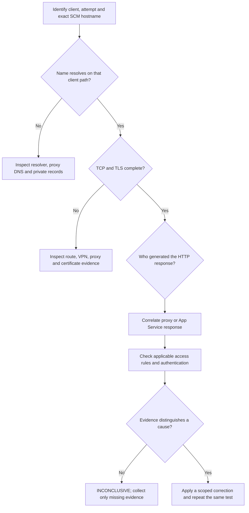

# SCM Access: Client DNS and HTTP Failures

## 1. Summary

Use this playbook when a browser cannot open Kudu/SCM for one or several apps. Start at the **affected client**, not inside the application. App-to-dependency DNS failures belong in [DNS Resolution in VNet-Integrated Apps](outbound-network/dns-resolution-vnet-integrated-app-service.md).

Private-only cutover, `publicNetworkAccess` defaults, rule priority and unmatched actions are policy questions covered by the Microsoft Learn access-restriction and private-endpoint overviews listed under Sources; this page owns per-client connection evidence and probes.

Separate a browser name-resolution failure from an HTTP rejection on a different attempt. Neither observation supplies the missing evidence for the other. Multiple affected apps suggest checking shared paths; membership in one subscription does not establish a subscription-wide platform failure.

**Verification boundary:** public-source review dated above; client probes and Azure reproduction **NOT_RUN**. There is no customer incident, captured diagnostic output, or established root cause on this page. Hypotheses start **NOT_TESTED**; unavailable discriminating evidence remains **INCONCLUSIVE**. Source verification is not live execution.

<!-- diagram-id: scm-client-access-layer-flow -->


Apply the stages to the actual connection path. An explicit proxy can return an HTTP CONNECT rejection before TLS to SCM completes. Record which hop produced the response; neither proxy connectivity nor TLS to a proxy establishes TLS to SCM. If the response origin cannot be corroborated, record it as Unknown.

## 2. Common Misreadings

| Observation | Unsupported conclusion | Better interpretation |
|---|---|---|
| Browser reports a name-resolution error | SCM access restrictions caused that error | Name-resolution evidence is needed for this attempt; an HTTP rule has not been identified as its cause. |
| Another attempt returned HTTP 403 | DNS was healthy for every client | An HTTP responder was reached on that path; identify the responder and correlate the attempt. |
| The main app opens | SCM must also open | SCM has a different target hostname and may inherit the main-site restrictions or use separate restrictions. |
| Several apps fail in one subscription | The subscription is down | Compare shared client, resolver, network and policy paths against unaffected controls. |
| Portal sign-in works | The client can reach private SCM | Portal authentication does not demonstrate connectivity to a different endpoint. |
| No app HTTP log row | The client never sent a request | Logging, retention, pre-worker rejection, proxy behavior and collection delay remain alternatives. |

## 3. Competing Hypotheses

| ID | Hypothesis | Discriminating evidence |
|---|---|---|
| H1 | Wrong hostname, resolver path, or private DNS records | Exact SCM hostname, CNAME chain and final answer differ from the intended topology on the affected path. |
| H2 | Default-endpoint access is rejected by configuration | A correlated App Service response and applicable public-access/main-SCM rule configuration support the rejection. |
| H3 | Client VPN, proxy, routing or TLS path fails | The same target behaves differently across authorized client paths; transport or certificate evidence identifies the failing stage. |
| H4 | Authentication or authorization fails after connectivity | The intended SCM endpoint is reachable and the authenticated request fails with corresponding identity/permission evidence. |
| H5 | SCM service behavior is impaired independently of the above | Correlated SCM failures persist on intended, authorized paths after the other hypotheses are tested. |

H5 is not the default explanation when H1-H4 lack data. More than one hypothesis can apply to different attempts.

## 4. What to Check First

1. Record the exact hostname launched by Advanced Tools, target slot, hosting mode and client alias. Use the actual SCM endpoint from [Kudu Overview](../../platform/kudu-overview.md); do not manufacture an ASE or slot hostname from a multitenant example.
2. Reuse existing screenshots and probe results when they already identify the same client, target and time. Ask only for missing dimensions or a justified fresh comparison.
3. Compare main and SCM names from the affected client path. For the documented multitenant default-hostname configuration, the private DNS system contains A records for `<app-name>.privatelink.azurewebsites.net` and `<app-name>.scm.privatelink.azurewebsites.net`, both resolving to the intended private endpoint IP. These are DNS records, not replacement browser URLs. See the [private endpoint DNS guidance](https://learn.microsoft.com/en-us/azure/app-service/overview-private-endpoint#kuduscm-endpoint).
4. Inspect public network access, the default/private endpoint choice, SCM rule inheritance, separate rules and unmatched-rule behavior read-only. Check `scmIpSecurityRestrictionsUseMain` ("Use main site rules"): when enabled, SCM uses the main-site restrictions; otherwise inspect SCM's own rules and unmatched action instead of assuming the main-site result applies (see [SCM restrictions](https://learn.microsoft.com/en-us/azure/app-service/app-service-ip-restrictions#restrict-access-to-an-scm-site) and the [site configuration reference](https://learn.microsoft.com/en-us/azure/templates/microsoft.web/sites/config-web)). Private-endpoint ingress is not evaluated against site access restrictions. ILB ASE has a different default endpoint model; consult [access restrictions](https://learn.microsoft.com/en-us/azure/app-service/overview-access-restrictions) before interpreting `publicNetworkAccess`.
5. Investigate authentication only after establishing the relevant endpoint path. For Kudu browser access using Microsoft Entra authentication, the assigned built-in or custom role over the application scope must include `Microsoft.Web/sites/publish/Action`. This is necessary for that authentication path; it does not establish DNS, network reachability or a successful sign-in. Use least privilege rather than granting Owner to test connectivity. See [Kudu permissions](https://learn.microsoft.com/en-us/azure/app-service/resources-kudu#rbac-permissions-required-to-access-kudu).

Do not change app-side `WEBSITE_DNS_SERVER` to repair workstation name resolution. A probe from Cloud Shell, WSL, a jump host or the app container may use a different resolver/proxy path from the failing browser; label that vantage point rather than presenting it as the same test.

## 5. Evidence to Collect

Use one row per attempt, with UTC collection time in private incident records. Use aliases and relative ordering when publishing an example.

| Field | Record | Interpretation boundary |
|---|---|---|
| Attempt and client | Local attempt ID, client alias, browser/tool version | A different client or tool is a separate observation. |
| Target | Main/SCM, app/slot alias, exact private target in restricted records | An app-level success does not validate SCM. |
| Resolver and path | Resolver identity, CNAME/final answer, VPN/proxy context | Some proxies resolve the target remotely; local DNS alone may not represent the browser. |
| Connection | TCP result, TLS error or certificate identity, curl exit code | A transport failure is not an application HTTP status. |
| HTTP | Status, response origin indicators, approved correlation evidence | A proxy may generate a response; status alone does not identify its source. |
| Server corroboration | Available customer-visible diagnostics and configuration | Missing telemetry is UNKNOWN, not evidence that nothing happened. |

Collect one row per attempt in this matrix. Leave a cell blank or `Unknown` rather than inventing a value; this template contains no observed results.

| Attempt ID | UTC collection time | Client alias | Resolver / proxy / VPN path | Target alias (main or SCM, app or slot) | DNS answer class | TCP outcome | TLS outcome | HTTP status | Corroborating evidence |
|---|---|---|---|---|---|---|---|---|---|
| | | | | | | | | | |

Classify the DNS answer as NXDOMAIN, timeout or no answer, public address, intended private-endpoint address, other answer, or Unknown. Record TCP and TLS separately and use `Unknown` or `not reached` when the observation does not establish that stage. Keep exact timestamps, hostnames and addresses in restricted records; publish aliases and relative ordering only.

### Bounded client probes

The following Bash example is for an approved shell on the affected client. Replace the placeholder. Do not run it from another machine and silently treat the result as browser evidence.

```bash
SCM_HOST='<scm-hostname>'
dns_rc=0
nslookup -timeout=5 -retry=1 "$SCM_HOST" || dns_rc=$?
printf 'dns_exit=%s\n' "$dns_rc"
curl_rc=0
curl --disable --silent --show-error --output /dev/null \
    --connect-timeout 10 --max-time 30 \
    --write-out 'http=%{http_code} remote_ip=%{remote_ip} total_seconds=%{time_total}\n' \
    "https://${SCM_HOST}/" || curl_rc=$?
printf 'curl_exit=%s\n' "$curl_rc"
```

| Command or option | Purpose |
|---|---|
| `nslookup` and `dns_exit` | Capture this shell's name-resolution result and exit status; retain the textual response, not only the exit code. |
| `-timeout=5 -retry=1` | Bound DNS waiting and retries. These are BIND-compatible `nslookup` options; other tools need their own documented limits. They bound DNS waits, not an independent whole-process deadline. |
| `dns_rc` | Capture the lookup's exit status through a shell OR-list, so a failing lookup still reaches the `printf` even when the shell runs with `set -e`. |
| `--disable` | Ignore the default curl configuration file so hidden options (redirects, credentials, insecure TLS) cannot change this probe. It must be the first curl argument. |
| `--silent --show-error` | Keep errors visible without a progress meter. |
| `--output /dev/null` | Discard the response body; this is not a content inspection. |
| `--connect-timeout 10 --max-time 30` | Bound connection and total probe duration in seconds. |
| `--write-out` | Record HTTP code, connected peer and total duration. A proxy peer may be reported instead of the origin. |
| `curl_rc` | Preserve a nonzero curl exit instead of turning a failed transport probe into an HTTP success. |

This invocation supplies no SCM credentials or browser cookies and does not follow redirects; it is not the authenticated browser session. Preserve approved proxy and CA settings: if they came from the disabled configuration file, supply only those approved settings explicitly and record the resulting path. Without `--fail`, curl can exit 0 for HTTP 401 or 403, so a zero curl exit means the transfer completed, not that SCM authorization succeeded. A 401, 403 or redirect is not automatically an authenticated-browser failure. A reported HTTP code of `000` means no HTTP response code was obtained; it is not a server status. Check the accompanying error. Do not add `--insecure`, export tokens, or bypass a corporate proxy to make the probe green. A shell using different proxy settings remains a different path.

Store output in approved restricted storage. DNS responses, peer addresses, HAR files, URLs, headers and cookies may expose sensitive details. Publish only reviewed, sanitized excerpts; never attach raw authentication material. Command option definitions are in the [curl manual](https://curl.se/docs/manpage.html).

## 6. Validation and Disproof by Hypothesis

| Hypothesis | Supporting test | Observation that weakens it |
|---|---|---|
| H1 | Compare the same hostname through the intended resolver with an authorized known-good control. Validate both private DNS records. | The affected browser's actual resolver path returns the intended answer consistently during the failure. |
| H2 | Correlate response origin and attempt with the effective default-endpoint rules and source path. | Confirmed private-endpoint ingress means site restriction rules are not the applicable layer. A proxy-generated 403 does not prove an App Service deny. |
| H3 | Compare transport and TLS on the same client/target before and after one approved path correction. | Transport and TLS to the intended endpoint succeed during the affected attempt. |
| H4 | Compare the authenticated identity and scoped permission after reachability is established. | The same identity succeeds on the same endpoint while a failing attempt has a pre-HTTP error. |
| H5 | Correlate customer-visible SCM/service diagnostics and authorized control clients. | Failures follow only one resolver or client path, while the intended path works. |

[Not Proven] Recovery after several simultaneous changes cannot isolate which change mattered. If the failing request cannot be correlated, state **INCONCLUSIVE** rather than assigning another client's HTTP response to it.

## 7. Likely Root Cause Patterns

| Established evidence | Scoped conclusion |
|---|---|
| Missing SCM record on the intended resolver; intended resolution and reachability recover after that record alone is corrected and the matched test is repeated | **[Inferred]** The DNS defect is supported as an explanation for this tested failure. Recovery alone does not uniquely establish causation; retain resolver evidence and controls that distinguish alternatives. |
| Intended default endpoint rejects the correlated request under its effective rule | Access policy explains that HTTP rejection, not unrelated DNS failures. |
| Only one authorized proxy/VPN path fails | Investigate that path with its owner; SCM platform failure remains unproven. |
| Endpoint reachable but authenticated role lacks the documented permission | Correct scoped authorization; do not change DNS to address RBAC. |
| Correlation or required diagnostics unavailable | Cause UNKNOWN; document the evidence gap and next discriminating test. |

## 8. Immediate Mitigations

Use an already authorized private client path while its owner repairs an evidenced DNS or routing defect. Change only the implicated record or access rule with approval and a rollback record, then repeat the same client/target test. Do not broadly expose SCM, disable TLS verification or restart every app because several names fail from one workstation.

## 9. Prevention

Maintain separate main/SCM reachability checks from intended client networks, with DNS and HTTP outcomes recorded independently. Track private DNS ownership and client proxy assumptions alongside access configuration. Keep an evidence-request checklist so investigators do not repeatedly ask for already supplied results.

## See Also

- [Playbooks](index.md)
- [Kudu Overview](../../platform/kudu-overview.md)
- [Networking Operations](../../operations/networking.md)
- [Windows Kudu Diagnostics](startup-availability/windows-kudu-diagnostics.md)
- [Outbound DNS Investigation](outbound-network/dns-resolution-vnet-integrated-app-service.md)

## Sources

- [Kudu service and permissions](https://learn.microsoft.com/en-us/azure/app-service/resources-kudu)
- [Private endpoints and SCM DNS](https://learn.microsoft.com/en-us/azure/app-service/overview-private-endpoint)
- [App Service access restrictions](https://learn.microsoft.com/en-us/azure/app-service/overview-access-restrictions)
- [curl command manual](https://curl.se/docs/manpage.html)
