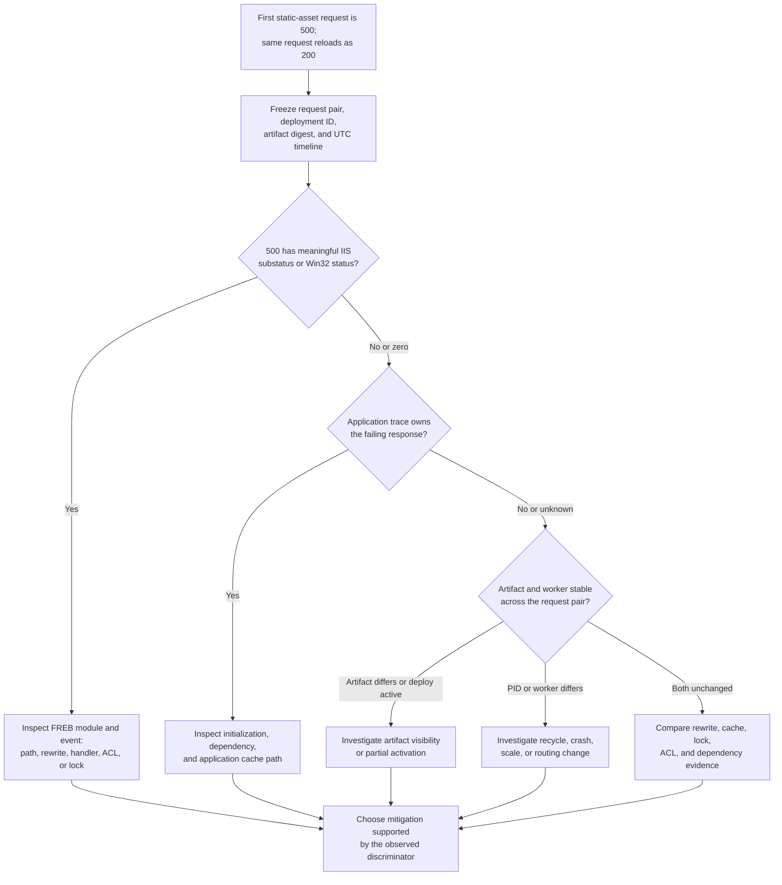

# First Static-Asset Request Returns HTTP 500 After Deployment on Windows

## 1. Summary

Use this playbook when a request for a static asset on **Windows App Service** returns HTTP `500` soon after deployment and an immediate reload of the same URL returns `200`. The ordering is a correlation to investigate, not proof of platform cold start, partial deployment, or any other cause.

Scope the incident to one immutable request pair: the failing request and the first successful reload. Preserve the exact path, method, relevant request headers, response status, deployment ID, artifact digest, and timestamps before another deployment or restart destroys the comparison.

This page starts at the HTTP/IIS boundary. It links to the [Deployment Failures](../deployment-failures.md#release-phase-timeline) release timeline and [evidence by release phase](../deployment-failures.md#53-evidence-by-release-phase) rather than repeating the ZIP/build/activation model. For package-mount semantics, use [Run From Package](../../../platform/run-from-package.md).

<!-- diagram-id: windows-first-static-asset-request-500-flow -->


## 2. Common Misreadings

| Observation | Do not conclude | What it establishes |
|---|---|---|
| First request is `500`, reload is `200` | Platform cold start caused the failure | Two requests had different outcomes; the changing variable is still unknown. |
| Deployment record is terminal and successful | Every expected file was visible to the request | The deployment operation completed; compare the served content hash or manifest separately. |
| `ScStatus == 500` | IIS generated the response | Both an application and IIS can return `500`; substatus, Win32 status, FREB, detailed errors, and app traces classify ownership. |
| `ScSubStatus` and `ScWin32Status` are `0` | IIS or the platform is healthy | No useful IIS substatus/Win32 discriminator was recorded in that row; correlate application and FREB evidence. |
| A worker or PID changed between requests | The worker change caused the first failure | The change is correlated; explain why it occurred and what failed before assigning cause. |
| Reload succeeds | Caching fixed the problem | A cache is only one hypothesis; the worker, artifact, dependency, or request headers may also have changed. |

## 3. Competing Hypotheses

| Hypothesis | Supporting evidence | Weakening evidence |
|---|---|---|
| **H1: Artifact visibility or partial deployment** | The failing request overlaps a non-terminal deployment; expected file is absent, stale, or has a different hash; ordinary ZIP extraction was in use | Deployment was terminal before both requests, the deployed and served content hashes match the same artifact, and no file changed between requests |
| **H2: Path, rewrite, or handler mismatch** | FREB identifies URL Rewrite, StaticFile, a managed handler, or an unexpected rewritten target; failure follows one path, extension, host, or header set | The same normalized path reaches the same handler with identical rewrite events and succeeds without a configuration change |
| **H3: Initialization race** | The same PID handles both requests; an application or module initialization trace starts before the `500` and completes before the `200` | StaticFile serves the request without application initialization, or initialization completed before the failing request |
| **H4: File lock or ACL** | FREB/detailed error contains an access, sharing, or Win32 failure; file open/permission evidence names the requested or configuration file | No lock/access signal exists, the content is readable throughout, and an unchanged file succeeds through the same module |
| **H5: Cache behavior** | First request is a cache miss and fails in a documented application/proxy cache path; reload is a hit; cache-key headers explain the split | Cache is bypassed with an explicit negative control and the failure still follows deployment or worker state |
| **H6: Dependency failure** | Application trace for the failing request records a timeout or exception from storage, a database, configuration, secret retrieval, or another dependency | Asset is served wholly by IIS and FREB shows the request never entered the application/dependency path |
| **H7: Worker change** | Failing and successful requests have different worker identity or PID, with a recycle/crash/scale event between them | The same worker and PID handle both requests and their process start time predates the deployment |

## 4. What to Check First

1. Preserve the failing and successful request as a pair. Record UTC timestamp, method, exact path and query, host, user agent, referrer, cache-related headers, correlation header, response status, and response headers. `AppServiceHTTPLogs` provides `CsMethod`, `CsUriStem`, `CsUriQuery`, `CsHost`, `UserAgent`, `Referer`, and `Cookie`; capture other headers at the client, application, proxy, or FREB layer.
2. Query `ScStatus`, `ScSubStatus`, and `ScWin32Status`. The [AppServiceHTTPLogs table reference](https://learn.microsoft.com/en-us/azure/azure-monitor/reference/tables/appservicehttplogs) documents all three columns. There is no current `AppServiceIISLogs` table in the [Microsoft.Web/sites table inventory](https://learn.microsoft.com/en-us/azure/azure-monitor/reference/tables/microsoft-web-sites); use `AppServiceHTTPLogs` for diagnostic-settings HTTP rows and the Windows W3C/FREB files for IIS detail.
3. Align the request pair with the Kudu deployment ID and its received, start, end, and terminal-state timestamps. Do not classify content while deployment is still in progress.
4. Compare the artifact digest recorded by the pipeline with a version marker or hash of the effective deployed asset. A filename alone is insufficient.
5. Capture worker identity for each request. `ComputerName` is available in `AppServiceHTTPLogs`; record PID and process start time through application instrumentation, a safe diagnostic endpoint, or contemporaneous process evidence. Do not infer PID from `ComputerName`.
6. Enable Windows detailed errors and failed-request tracing only long enough to capture the failing request. Microsoft Learn states that FREB records the IIS components and time spent in each component.
7. Identify whether release used a slot or deployed directly to production. For a slot release, compare the slot URL before promotion and the production URL after routing changes. For direct deployment, correlate the documented post-deployment restart.

!!! warning "Preserve the first failure"
    Repeated reloads can erase the only useful transition. Capture the first pair before restarting, redeploying, clearing caches, changing ACLs, or editing `web.config`.

## 5. Evidence to Collect

### 5.1 Request-pair query

Use an incident-specific UTC window and the exact asset path. String types for `ScSubStatus` and `ScWin32Status` in the Learn schema are preserved rather than coerced to integers.

```kusto
let WindowStart = datetime(2026-10-14 10:00:00Z);
let WindowEnd = datetime(2026-10-14 10:10:00Z);
let AssetPath = "/assets/site.css";
AppServiceHTTPLogs
| where TimeGenerated between (WindowStart .. WindowEnd)
| where CsUriStem == AssetPath
| project TimeGenerated, ComputerName, CsMethod, CsHost, CsUriStem, CsUriQuery,
          UserAgent, Referer, Cookie, ScStatus, ScSubStatus, ScWin32Status,
          ScBytes, TimeTaken
| order by TimeGenerated asc
```

[Observed] At the decision point, a nonzero or otherwise meaningful substatus/Win32 value routes the investigation toward the matching IIS/FREB event. A plain `500` row does not by itself identify whether IIS or application code generated the response.

### 5.2 Evidence matrix

| Evidence | Failing request | Successful reload | Comparison question |
|---|---|---|---|
| Request | UTC time, method, path/query, host, selected headers | Same fields | Was this actually the same request and cache key? |
| HTTP result | `ScStatus`, `ScSubStatus`, `ScWin32Status`, bytes, duration | Same fields | Did only status change, or did IIS classification and response size change too? |
| IIS/FREB | Trace file time, request URL, final module/event, rewritten URL, detailed error | Matching success-side W3C/app trace where available | Which component produced the failure, and did the route/handler differ? |
| Release | Deployment ID, mode, received/start/end time, terminal state | Same deployment ID and state | Did either request overlap deployment activity? |
| Content | Pipeline artifact digest, manifest entry, effective asset hash/size | Same checks | Was the artifact unchanged and fully visible? |
| Worker | `ComputerName`, instrumented PID, process start time | Same fields | Same worker and PID, or a routing/recycle boundary? |
| Topology | Slot hostname or direct-production hostname; swap/activity time if applicable | Same fields | Did routing/promotion change between requests? |

### 5.3 IIS versus application ownership

| Signal | Interpretation |
|---|---|
| Specific `ScSubStatus` or nonzero `ScWin32Status` plus a matching FREB IIS module/event | Supports an IIS pipeline, configuration, path, access, or handler branch; interpret the exact trace rather than the number alone |
| Application correlation ID and exception/response log for the failing request | Supports an application-generated `500` |
| `ScStatus=500`, zero/empty substatus and Win32 status, and no application trace | Ownership remains unknown; do not label it platform, IIS, or application generated |
| FREB shows the request handed to a managed handler before the failure | IIS observed the final status, but application/handler code can still own the response |

Windows web server logs and FREB are file-based evidence, not a separate `AppServiceIISLogs` Log Analytics table. App Service diagnostic dumps place raw W3C logs under `D:\Home\LogFiles\http\RawLogs` and FREB XML under `D:\Home\LogFiles\W3SVC#########`.

### 5.4 Minimal controlled static-file scenario with negative controls

**Execution status: `NOT_RUN`.** This is a documented design only. No Azure resources were created, no failure was induced, and no `500`/`200` result is claimed.

Use a non-production Windows app or disposable slot:

1. Deploy one static asset with a unique body and record the ZIP digest, per-file hash, deployment ID, deployment state, and expected slot hostname.
2. Enable W3C logging, detailed errors, and FREB for `500-599`; add request correlation plus worker/PID instrumentation without changing static-file routing.
3. After deployment reaches a terminal state, send one cache-bypassed `GET` and one identical reload. Preserve both responses and all evidence in section 5.2.
4. **Negative control A — no deployment:** repeat the pair against the unchanged artifact and same worker.
5. **Negative control B — cache bypass:** repeat with a unique query token and request directives that bypass caches under your control; document any cache layer that cannot be bypassed.
6. **Negative control C — known static handler:** request a second immutable asset that has no rewrite rule or application fallback.
7. **Negative control D — slot/direct distinction:** deploy and test on the slot URL before any swap. Do not inject a failure into production; compare direct deployment only in another disposable app if required.
8. Falsify a candidate when its discriminator does not follow the treatment: for example, unchanged hashes weaken partial content, same PID weakens worker change, and failure under cache bypass weakens a cache-only explanation.

### 5.5 What is not documented / not proven

| Statement | Status |
|---|---|
| The first request after every Windows deployment performs a platform initialization that can return `500` | Not documented and not proven |
| A `500` followed by `200` identifies cold start | Not proven; timing alone cannot distinguish the hypotheses in section 3 |
| `ScSubStatus=0` means the application generated the response | Not documented; ownership needs correlated IIS/FREB and application evidence |
| `ComputerName` is a process ID | False model; it is documented as the server name, so collect PID separately |
| Every scaled-out worker sees extracted content or a package switch simultaneously | Not documented by the cited sources |
| A successful ZIP deployment proves every file changed | Not proven; verify content identity |
| The repository's ZIP lock lab predicts all Windows runtimes and deployments | Not proven; it retained one synthetic run per arm on one B1 Windows Node.js app |

## 6. Validation and Disproof by Hypothesis

### H1: Artifact visibility or partial deployment

- **Supports:** the first request precedes terminal deployment state, or the effective asset hash differs from the release manifest and later changes to the expected value.
- **Weakens:** both requests occur after terminal state and the effective asset hash is unchanged and matches the artifact.
- **Disproof target:** reproduce the request pair against one immutable, verified artifact with no deployment in progress.
- Use the linked [release phase timeline](../deployment-failures.md#release-phase-timeline), not deployment success alone. The [ZIP file-lock lab](../../lab-guides/zipdeploy-file-lock-serialization.md) observed one synthetic Windows run where a green ordinary ZIP deployment left one exclusively locked file stale while another file updated. It is a single-run observation on one B1 Node.js app, not a general explanation for this symptom.

### H2: Path, rewrite, or handler mismatch

- **Supports:** FREB shows a different rewritten target, module, handler, or configuration failure for the `500`; variation follows path, extension, host, or request headers.
- **Weakens:** failing and successful requests traverse the same rewrite and handler events with unchanged configuration.
- **Disproof target:** request a known static-handler control asset and bypass application fallback. Follow [Windows IIS web.config Startup Failures](windows-iis-webconfig-startup.md) when the trace identifies rewrite, handler, module, or configuration substatus evidence.

### H3: Initialization race

- **Supports:** the same PID emits a one-time initialization start before the failure and completion before success; dependency and content evidence remain unchanged.
- **Weakens:** IIS StaticFile completes without entering application code, or initialization completed before the first request.
- **Disproof target:** pre-initialize the same component in a controlled slot, then repeat with the same artifact and worker. Do not call the original event cold start unless the evidence identifies what initialized.

### H4: File lock or ACL

- **Supports:** FREB, detailed error, or application evidence identifies a sharing/access failure and names the relevant file or configuration path.
- **Weakens:** the file is readable during both requests and no access/lock signal appears in the failing trace.
- **Disproof target:** release the independently confirmed lock or correct the narrowly identified permission, then repeat without changing the artifact.

### H5: Cache behavior

- **Supports:** logs identify miss-path failure followed by a hit, and the difference follows a documented cache key or cache population event.
- **Weakens:** a unique cache-bypass request fails in the same way, or no cache layer is on the traced path.
- **Disproof target:** compare hit, miss, and bypass controls while artifact and worker remain unchanged.

### H6: Dependency failure

- **Supports:** the failing request's correlation ID reaches application code and a dependency exception or timeout precedes the `500`; reload records dependency recovery.
- **Weakens:** FREB shows IIS serves the asset without application/dependency execution.
- **Disproof target:** use a static-handler control and dependency telemetry for the same correlation ID. Avoid treating temporal proximity to deployment as dependency causation.

### H7: Worker change

- **Supports:** `ComputerName`, PID, or process start time changes between requests and a matching recycle, crash, scale, or routing event explains the boundary.
- **Weakens:** the same worker and PID serve both requests and no lifecycle event intervenes.
- **Disproof target:** repeat on the same instrumented worker without deployment. A changed worker is supporting evidence only after the lifecycle reason and failure mechanism are identified.

## 7. Likely Root Cause Patterns

| Pattern | Minimum evidence before classification | Route |
|---|---|---|
| Request overlapped content activation | Non-terminal deployment plus content hash/visibility change | H1 |
| Rewrite or handler catches an asset unexpectedly | FREB module and rewritten target differ from intended static path | H2 |
| One-time application/module initialization fails | Same PID, correlated initialization failure, then completion | H3 |
| Locked or inaccessible content/configuration | Named path plus sharing/access evidence or Win32/FREB detail | H4 |
| Cache population path fails | Miss fails, hit succeeds, bypass/control isolates the layer | H5 |
| Static fallback invokes an unhealthy dependency | Application correlation and dependency exception for the asset request | H6 |
| Request pair spans recycle or routing change | Worker/PID transition plus lifecycle event and mechanism | H7 |

If none meets its minimum evidence, record the incident as **unclassified**. A two-request sequence is not enough to select a root cause.

## 8. Immediate Mitigations

Tie the action to the observed discriminator and preserve rollback evidence first.

| Observed evidence | Narrow mitigation | Rollback or stop condition |
|---|---|---|
| Deployment active or content hash mismatched | Stop further releases; wait for or investigate the current deployment; restore the last verified artifact or swap back to a verified slot | Stop if content identity remains mixed; do not hide it with reload retries |
| FREB identifies rewrite/handler/config regression | Revert the specific `web.config`, rewrite, or handler change | Restore the last known-good configuration if the same trace recurs |
| Same-PID initialization failure | Fix or move the identified initialization behind an explicit readiness contract; validate in a slot | Roll back if initialization cannot complete reliably within the release window |
| Named lock or ACL failure | Release the confirmed lock or restore the least-privilege permission required by the traced path | Revert permission changes that are broader than the named resource |
| Cache discriminator confirmed | Purge or bypass only the affected cache layer and correct its miss/population path | Stop broad purges if bypass still fails; caching is then not sufficient |
| Dependency exception correlated | Restore the dependency/configuration or fail the readiness check before promotion | Roll back the release if dependency compatibility changed with it |
| Worker transition and lifecycle cause confirmed | Stabilize the crash/recycle/scale cause; drain or replace the affected instance through supported operations | Escalate with timestamps and worker evidence if instance behavior persists |

[Inferred] A mitigation is justified only when its branch's discriminator is present. Blind restarts, repeated deployments, and automatic reload retries may restore service while destroying evidence and do not validate the root cause.

## 9. Prevention

- Record release ID and immutable artifact digest in deployment metadata and expose a non-sensitive version marker.
- Test the exact static-asset path on a staging slot before promotion; include a cache-bypassed request and a known static-handler control.
- Correlate request IDs with worker identity, PID, process start time, application exceptions, and dependency telemetry.
- Keep Windows W3C logging available and document how to enable time-bounded detailed errors and FREB safely.
- Validate `web.config` rewrite and handler changes against static assets, not only dynamic routes.
- Make readiness cover required initialization and dependencies instead of relying on the first user request.
- Verify effective content hashes after ordinary ZIP deployment when file-lock risk exists; consider the documented [Run From Package](../../../platform/run-from-package.md) contract where the runtime supports it.
- Alert on the **first** post-release representative request, but label an isolated `500`/`200` pair as unclassified until evidence selects a hypothesis.

## See Also

- [Deployment Failures](../deployment-failures.md)
- [Run From Package](../../../platform/run-from-package.md)
- [Windows IIS web.config Startup Failures](windows-iis-webconfig-startup.md)
- [Windows Kudu Diagnostics](windows-kudu-diagnostics.md)
- [Lab: ZIP Deploy File Lock, Run From Package, and Deployment Serialization](../../lab-guides/zipdeploy-file-lock-serialization.md)

## Sources

- [AppServiceHTTPLogs table reference (Microsoft Learn)](https://learn.microsoft.com/en-us/azure/azure-monitor/reference/tables/appservicehttplogs)
- [Azure Monitor tables for Microsoft.Web/sites (Microsoft Learn)](https://learn.microsoft.com/en-us/azure/azure-monitor/reference/tables/microsoft-web-sites)
- [Enable diagnostic logs for Azure App Service (Microsoft Learn)](https://learn.microsoft.com/en-us/azure/app-service/troubleshoot-diagnostic-logs)
- [Troubleshoot failed requests using tracing in IIS (Microsoft Learn)](https://learn.microsoft.com/en-us/troubleshoot/developer/webapps/iis/health-diagnostic-performance/troubleshoot-failed-requests-using-tracing-in-iis-85)
- [Deploy files to Azure App Service (Microsoft Learn)](https://learn.microsoft.com/en-us/azure/app-service/deploy-zip)
