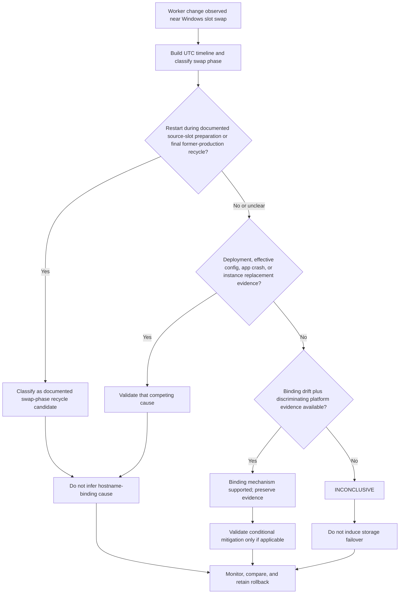

# Windows Slot-Swap Binding Drift and Worker Recycle

## 1. Summary

### Symptom

A Windows App Service slot swap completes, and a worker restart appears after cutover. Responders suspect hostname-binding drift, but available evidence may also fit normal swap preparation, the documented recycle of former production instances, platform replacement, a configuration/deployment change, or an application crash.

### Exact documented mechanism

Microsoft Learn currently says:

> “After slot swaps, the app might experience unexpected restarts. The restarts happen because after a swap, the host-name binding configuration goes out of sync. This situation by itself doesn't cause restarts. However, certain underlying storage events, such as storage volume failovers, might detect these discrepancies and force all worker processes to restart.”

It then says:

> “To minimize these types of restarts, set the `WEBSITE_ADD_SITENAME_BINDINGS_IN_APPHOST_CONFIG=1` app setting on all slots. However, this app setting doesn't work with Windows Communication Foundation (WCF) apps.”

This playbook does not extend that wording. In particular, it does not claim that drift always restarts workers, that the setting prevents every restart, or that an unseen storage event occurred.

### Decision flow

<!-- diagram-id: windows-slot-swap-binding-recycle-flow -->


### Conclusion rule

Temporal adjacency is not causation. Without evidence that distinguishes the binding mechanism from other restart paths, conclude **INCONCLUSIVE**. Reproduction never requires inducing storage failover or another platform failure.

## 2. Common Misreadings

- **“Every post-swap restart is hostname-binding drift.”** The documented mechanism is conditional, and swap itself contains restart/recycle phases.
- **“Binding drift alone causes the restart.”** Learn explicitly says the out-of-sync state by itself does not cause restarts.
- **“Setting the value on production is enough.”** Learn says to set it on **all slots**.
- **“The setting guarantees no restart.”** Learn says it minimizes “these types” of restarts; it is not a universal no-restart guarantee.
- **“The setting is safe for every Windows app.”** Learn says it does not work with WCF apps.
- **“A nearby storage event must have occurred.”** If the necessary platform telemetry is unavailable, that proposition remains not proven.

## 3. Competing Hypotheses

| ID | Hypothesis | Discriminating evidence |
|---|---|---|
| H1 | Documented swap-preparation restart or final former-production recycle. | Restart falls in a documented swap phase and affects the expected source/former-production slot instances. |
| H2 | Conditional hostname-binding drift mechanism. | Post-swap binding state and platform evidence distinguish it from H1 and H3-H5; chronology alone is insufficient. |
| H3 | Platform instance replacement or maintenance. | Instance identity changes with platform evidence independent of app process failure. |
| H4 | Configuration or deployment change. | Effective setting/artifact changed and is tied to a recycle trigger or regression. |
| H5 | Application crash or Auto-Heal. | Crash, exception, dump, Event Log, or Auto-Heal trigger aligns with PID change. |
| H6 | Apparent restart is only traffic moving to another instance. | Request instance changes but the original process evidence does not show a restart. |

## 4. What to Check First

### Build a phase-aware timeline

| Timeline event | Required evidence | Do not infer |
|---|---|---|
| Swap preparation | Activity Log start/suboperations; source and target; source PID/start time and instance | That every later restart has the same cause |
| Source-slot settings applied and warm-up | Effective slot settings; warm-up evidence; source process snapshots | That traffic has switched before the routing event |
| Routing switch / swap completion | Activity Log completion and correlation ID | That all post-swap app behavior is healthy |
| Final former-production recycle | Slot and process identity after the switch | That it is an unexpected production recycle |
| Later post-swap worker change | Before/after PID/start time and instance; platform/app diagnostics | Hostname-binding cause from proximity alone |
| Platform replacement | Instance identity and available platform event | App crash without crash evidence |
| Config/deployment change | Timestamped redacted diff and deployment ID | Causation merely because a change exists |
| Application crash/Auto-Heal | Exception, dump/Event Log, Auto-Heal action, process transition | Platform storage mechanism without platform evidence |

### Applicability matrix

| Hosting model | Applicability of documented setting | What can be claimed |
|---|---|---|
| Native Windows App Service, non-WCF | Candidate mitigation for the documented post-swap hostname-binding discrepancy; configure on all slots. | It can minimize this type of restart; validate in a nonproduction slot. |
| Native Windows App Service, WCF | Microsoft says the setting does not work with WCF apps. | Do not prescribe it as the mitigation; escalate with evidence. |
| Windows custom container | The cited Learn text does not provide a separate container-specific applicability guarantee. | Do not claim support or a no-restart outcome without product guidance or validation. |
| Linux code app | This Windows `applicationHost.config` binding mechanism is not documented as Linux guidance. | Use the Linux slot-swap playbook; do not extrapolate. |
| Linux custom container | Not documented by the cited Windows mechanism. | No Windows-setting recommendation and no universal no-restart claim. |

### Documented, observed, and not proven

| Evidence class | Treatment |
|---|---|
| Documented | Quote the conditional mechanism, all-slot requirement, and WCF exception exactly within context. |
| Observed | Record the environment's slot settings, bindings, Activity Log, PIDs/start times, instances, and diagnostics. |
| Not Proven | An underlying storage event or binding-triggered recycle when discriminating host telemetry is unavailable. |

### What is not documented

| Question | Microsoft Learn status | Safe treatment |
|---|---|---|
| Which exact storage event occurred in a specific incident? | Not knowable from the general guidance. | Require platform evidence or leave INCONCLUSIVE. |
| Exact delay from swap completion to discrepancy detection | Not stated. | Do not create a timing threshold. |
| A guarantee that setting `1` prevents all restarts | Not stated; wording is “minimize these types.” | Continue monitoring other recycle causes. |
| Separate support guarantee for Windows custom containers | Not stated in the cited text. | Validate/escalate rather than extrapolate. |
| Customer-visible telemetry that always identifies the storage trigger | Not promised. | State telemetry gaps explicitly. |
| An Azure Monitor table named `AppServiceIISLogs` | Not present in the current Microsoft.Web/sites table catalog. | Use documented tables and Windows/Kudu diagnostics without inventing columns. |

## 5. Evidence to Collect

### Required package

- Activity Log export for the swap window, including correlation ID, operation status, initiator, source, and target.
- Before/after PID, process start time, and approved instance marker for both slots where possible.
- Effective `WEBSITE_ADD_SITENAME_BINDINGS_IN_APPHOST_CONFIG` value and slot-setting status on **every slot**; redact unrelated values.
- Hostname inventory and effective slot configuration without certificate material, secrets, or real customer hostnames in shared artifacts.
- Deployment/package ID and configuration-change timeline.
- Kudu Process Explorer, Windows Event Log/application log, crash/Auto-Heal evidence, and dumps only when safely collected.
- HTTP request timeline around the swap and worker transition.

### Collection commands

```bash
az monitor activity-log list --resource-group <resource-group> --start-time <incident-start-utc> --end-time <incident-end-utc> --query "[?contains(operationName.value, 'Microsoft.Web/sites/slots/slotsswap/action')]" --output json
az webapp config appsettings list --resource-group <resource-group> --name <app-name> --slot <slot-name> --output json
az webapp config hostname list --resource-group <resource-group> --webapp-name <app-name> --slot <slot-name> --output json
az webapp deployment list-publishing-credentials --resource-group <resource-group> --name <app-name> --slot <slot-name> --query scmUri --output tsv
```

| Command or flag | Purpose |
|---|---|
| `az monitor activity-log list` | Exports control-plane events for the incident window. |
| `--resource-group <resource-group>` | Limits the query or app operation to the affected resource group. |
| `--start-time <incident-start-utc>` | Sets the beginning of the UTC evidence window. |
| `--end-time <incident-end-utc>` | Sets the end of the UTC evidence window. |
| `--query "[?contains(operationName.value, 'Microsoft.Web/sites/slots/slotsswap/action')]"` | Filters Activity Log output to slot-swap operations. |
| `--output json` | Preserves structured fields for evidence review. |
| `az webapp config appsettings list` | Captures each slot's effective app-setting entries. |
| `az webapp config hostname list` | Captures the selected slot's hostname-binding inventory. |
| `az webapp deployment list-publishing-credentials` | Retrieves the SCM endpoint field; treat the full response as sensitive. |
| `--name <app-name>` | Selects the parent web app. |
| `--webapp-name <app-name>` | Selects the parent web app for the hostname command. |
| `--slot <slot-name>` | Selects the slot being examined. |
| `--query scmUri` | Returns only the SCM URI field from the publishing response. |
| `--output tsv` | Emits the selected scalar field without JSON formatting. |

Publishing credentials and hostnames are sensitive operational data. Do not paste raw output into issues or public logs. Prefer portal/Kudu access with Microsoft Entra authentication and create a sanitized evidence summary.

### KQL: platform candidate events

The current table reference documents every projected `AppServicePlatformLogs` column below. Message searches locate candidates; they do not prove the binding mechanism or guarantee complete host telemetry.

```kusto
let incidentStart = datetime(<incident-start-utc>);
let incidentEnd = datetime(<incident-end-utc>);
AppServicePlatformLogs
| where TimeGenerated between (incidentStart .. incidentEnd)
| where Message has_any ("swap", "binding", "restart", "recycle", "worker", "storage")
    or OperationName has_any ("swap", "restart", "recycle")
| project TimeGenerated, Host, OperationName, Level, Message, ActivityId, DeploymentId, Exception
| order by TimeGenerated asc
```

### KQL: request/instance discontinuity

The current `AppServiceHTTPLogs` reference documents `ComputerName`, request fields, status, and elapsed milliseconds. It does not document PID or process start time.

```kusto
let incidentStart = datetime(<incident-start-utc>);
let incidentEnd = datetime(<incident-end-utc>);
AppServiceHTTPLogs
| where TimeGenerated between (incidentStart .. incidentEnd)
| summarize Requests=count(), Failures=countif(ScStatus >= 500), P95Milliseconds=percentile(TimeTaken, 95) by ComputerName, bin(TimeGenerated, 1m)
| order by TimeGenerated asc
```

### Settings-state comparison

For every slot, record a sanitized row:

| Slot | Hosting model | WCF? | Setting present? | Effective value | Slot-setting flag | Captured UTC |
|---|---|---|---|---|---|---|
| production | Record | Record | Record | Record | Record | Record |
| staging | Record | Record | Record | Record | Record | Record |
| other slots | Record each | Record | Record | Record | Record | Record |

Do not change the setting until you have this baseline and have confirmed the workload is not WCF.

### Reproduction/test record

| Field | Record |
|---|---|
| Environment | Documentation-only review; no Azure subscription or app was used |
| Repository source commit | `e466e157ee50dd0aded731ffc78ef2a7bfa1804e` |
| Learn verification date | 2026-10-14 |
| Azure reproduction date | `NOT_RUN` |
| Storage-failover test | `NOT_RUN` — must not be induced for this playbook |
| Result | `NOT_RUN` — setting validation and rollback were not executed against Azure |
| Evidence | Microsoft Learn pages listed in Sources; no runtime output is claimed |

## 6. Validation and Disproof by Hypothesis

| Hypothesis | Supporting evidence | Weakening or disproving evidence |
|---|---|---|
| H1 swap-phase recycle | Process transition maps to documented source preparation or former-production recycle, with matching slot identity. | Transition occurs later on the active production process and outside identified swap phases. |
| H2 binding mechanism | Applicable native Windows non-WCF app; post-swap discrepancy evidence plus platform evidence identifies the conditional trigger; controlled all-slot mitigation changes recurrence over multiple comparable swaps. | WCF/Linux scope, setting already effective on all slots with recurrence unchanged, or another cause has direct evidence. Absence of host telemetry does not disprove H2; it leaves it inconclusive. |
| H3 platform replacement | Instance identity changes and platform evidence supports replacement without an app crash/config trigger. | Same instance remains and only worker PID/start time changes. |
| H4 config/deployment change | A timestamped change aligns with process transition and controlled rollback removes the behavior. | No relevant diff, or rollback does not alter recurrence. |
| H5 app crash/Auto-Heal | Exception/dump/Event Log or Auto-Heal action directly precedes process replacement. | No crash/Auto-Heal evidence and platform evidence points elsewhere. |
| H6 traffic moved instances | HTTP/app marker changes while original worker remains stable. | Same instance shows a new PID/start time. |

[Observed] Record process, instance, settings, and operation evidence from the affected environment.

[Inferred] Binding drift is only a supported explanation when evidence discriminates it from the other hypotheses.

[Not Proven] A restart near a swap does not prove an underlying storage event or hostname-binding cause.

### Controlled validation of the setting

Only for an applicable native Windows **non-WCF** workload:

1. Preserve the baseline evidence package and export every slot's current setting state.
2. In a nonproduction environment, set `WEBSITE_ADD_SITENAME_BINDINGS_IN_APPHOST_CONFIG=1` on **all slots** through the normal configuration pipeline.
3. Expect the configuration change itself to be a possible restart boundary; timestamp it separately from any later swap.
4. Run approved swaps without inducing storage failover. Capture the same PID/start-time, instance, Activity Log, configuration, and diagnostics evidence over multiple comparable trials.
5. Treat reduced recurrence as supportive operational evidence, not proof of a universal guarantee or proof of an unseen historical storage event.

### Rollback

1. Stop further swaps if the app becomes unhealthy.
2. Restore the setting on every slot to its captured previous state (`0` or absent) through the same controlled configuration pipeline.
3. Verify all slots report the intended prior state and preserve the change event/restart timeline.
4. If the release itself is faulty, use the documented reverse swap only after preserving evidence.
5. For WCF or uncertain hosting applicability, do not trial the setting as a production experiment; escalate with the evidence package.

## 7. Likely Root Cause Patterns

- A normal swap-preparation restart is mistaken for a later production incident because slot identity was not recorded.
- Former production instances recycle after becoming staging, while responders attribute those staging events to the active production slot.
- A direct app-setting or deployment change creates a recycle boundary adjacent to the swap.
- An app crash or Auto-Heal action replaces the worker, with no discriminating evidence for hostname bindings.
- The conditional hostname-binding mechanism remains plausible, but customer-visible evidence cannot identify the underlying trigger; the correct outcome is **INCONCLUSIVE**.

## 8. Immediate Mitigations

- Preserve the evidence timeline before restarting, swapping again, or changing settings.
- If release health is unacceptable, perform the documented reverse swap to the last known-good site.
- For applicable native Windows non-WCF apps, plan the all-slot setting change in nonproduction first; do not patch only production.
- If crashes or Auto-Heal are evidenced, follow the Windows IIS/Kudu diagnostics path rather than attributing the event to bindings.
- Engage Azure support when host-level discrimination is required and customer-visible telemetry is insufficient.
- Never induce production storage failover, detach storage, or trigger a destructive platform event to reproduce this mechanism.

## 9. Prevention

- Capture slot name, deployment ID, PID, process start time, approved instance marker, and swap correlation ID in every release evidence bundle.
- Manage `WEBSITE_ADD_SITENAME_BINDINGS_IN_APPHOST_CONFIG` consistently across all slots when the documented mitigation is applicable.
- Add an explicit WCF/hosting-model applicability check to the deployment-slot runbook.
- Separate swap-operation events, configuration changes, deployments, platform replacements, and app crashes in dashboards and incident timelines.
- Preserve a rollback manifest showing the previous value and slot-setting state for every slot.
- Use **INCONCLUSIVE** rather than inventing a platform event when discriminating telemetry is absent.

## See Also

- [Windows Slot-Swap First-Request Latency](windows-slot-swap-first-request-latency.md)
- [Deployment Slots Operations](../../../operations/deployment-slots.md)
- [Windows IIS web.config Startup Failures](windows-iis-webconfig-startup.md)
- [Windows Kudu and Diagnostic Tools](windows-kudu-diagnostics.md)
- [Linux Slot Swap Restart / Config Drift / Warm-up Race](slot-swap-config-drift.md)
- [Slot Swap Failed During Warm-up](slot-swap-failed-during-warmup.md)

## Sources

- [Set up staging environments in Azure App Service](https://learn.microsoft.com/en-us/azure/app-service/deploy-staging-slots)
- [App Service environment variables and app settings](https://learn.microsoft.com/en-us/azure/app-service/reference-app-settings)
- [AppServiceHTTPLogs table reference](https://learn.microsoft.com/en-us/azure/azure-monitor/reference/tables/appservicehttplogs)
- [AppServicePlatformLogs table reference](https://learn.microsoft.com/en-us/azure/azure-monitor/reference/tables/appserviceplatformlogs)
- [Microsoft.Web/sites Azure Monitor table catalog](https://learn.microsoft.com/en-us/azure/azure-monitor/reference/tables/microsoft-web-sites)
