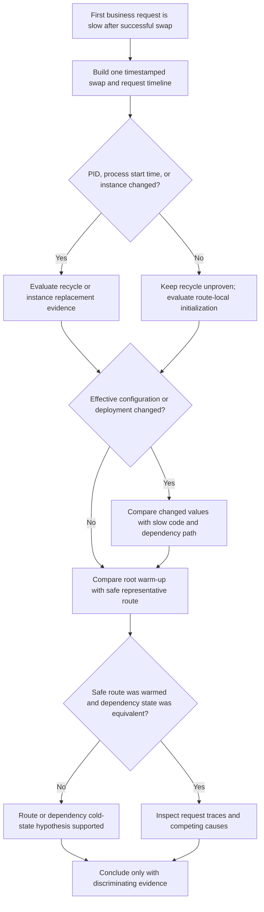

# Windows Slot-Swap First-Request Latency

## 1. Summary

### Symptom

A Windows App Service slot swap succeeds, yet the first request to a business route is slow. Later requests to the same route are fast. The worker PID might be unchanged.

Do not collapse this symptom into “the app recycled.” Investigate three independent questions:

1. Did the worker process or instance change?
2. Did the effective runtime configuration change?
3. Was this particular business route, including its dependencies, exercised during warm-up?

### Decision flow

<!-- diagram-id: windows-slot-swap-first-request-latency-flow -->


### Scope and conclusion rule

This playbook applies to native Windows App Service workloads behind IIS. It does not transfer Windows `web.config` or application-initialization assumptions to Linux. A successful swap proves that the documented swap gate completed; it does not prove that every application route or downstream dependency is warm.

If PID/start time, instance identity, effective configuration, route coverage, and dependency timings cannot distinguish the hypotheses, report **INCONCLUSIVE**.

## 2. Common Misreadings

- **“Slow first request means a recycle occurred.”** An unchanged PID and start time weaken that claim; lazy route initialization can occur in an existing process.
- **“Successful swap means every route is warm.”** Microsoft Learn documents root-path fallback and configurable initialization URLs, not automatic execution of every business route.
- **“Same PID proves nothing changed.”** Effective settings, route-local caches, credentials, connections, or external dependency state can still differ.
- **“A fast health endpoint represents checkout/reporting/search.”** A shallow endpoint may not execute the slow route's middleware, query compilation, cache fill, or connection setup.
- **“The nearest event caused the latency.”** Temporal adjacency prioritizes investigation but does not establish causation.

## 3. Competing Hypotheses

| ID | Hypothesis | Distinguishing question |
|---|---|---|
| H1 | The worker recycled during swap preparation or after cutover. | Did PID or process start time change on the same instance? |
| H2 | Traffic reached a different App Service instance. | Did instance identity or HTTP-log `ComputerName` change? |
| H3 | Effective configuration or deployed content changed. | Which value or artifact changed, and does it control the slow path? |
| H4 | Warm-up did not exercise the particular business route. | Was that exact safe route represented in effective warm-up configuration and logs? |
| H5 | The process stayed alive, but a route-local or dependency state was cold. | Does only the first safe route invocation pay cache, JIT, connection, DNS, token, or query setup? |
| H6 | A dependency was independently slow. | Do dependency traces show the elapsed time outside the app, without process/config change? |

H1 and H2 are different: a PID can repeat on a different instance, and an instance can host a newly started process. Record both dimensions.

## 4. What to Check First

1. Preserve the Activity Log event for **Swap Web App Slots**, including start/end time, status, correlation ID, source slot, and target slot.
2. Capture PID, process start time, and instance identity before the controlled swap and immediately before each probe after cutover. Use an authenticated diagnostic endpoint or Kudu Process Explorer; do not expose this data publicly.
3. Export effective app settings, connection-string names and slot-stickiness, runtime/bitness, deployed commit/package identity, and effective `web.config` warm-up entries for both slots. Redact values and secrets.
4. Identify the root/readiness path and one representative **read-only, synthetic, or isolated** business endpoint. Never replay a state-changing production `POST`, payment, order, message, or mutation merely to warm it.
5. Capture request and dependency timings for cold and repeated invocations. Use the same instance-routing conditions when your application safely supports that comparison.

### Documented, observed, and not proven

| Evidence class | What it means here |
|---|---|
| Documented | Learn describes swap preparation, source-slot restart/warm-up, routing switch, configurable warm-up paths, and the Azure Monitor columns used below. |
| Observed | Your timestamped PID/start-time snapshots, instance marker, Activity Log event, effective configuration, request rows, and application/dependency traces. |
| Not Proven | A recycle, route warm-up, or dependency cause inferred only from swap success or one slow request. |

### What is not documented

| Question | Microsoft Learn status | Investigation treatment |
|---|---|---|
| Does successful default root warm-up initialize every application route? | Not documented; the swap article describes `/` fallback, not universal route coverage. | Test a safe representative route separately. |
| Which application caches, JIT paths, ORM queries, tokens, or connections become warm? | Application-specific and not documented by App Service. | Instrument the app and dependencies. |
| Does every first-request delay imply a Windows worker recycle? | Not documented. | Require PID/start-time or equivalent process evidence. |
| What exact internal request fan-out occurs beyond configured application-initialization URLs? | Not documented in the cited App Service article. | Do not infer additional route coverage. |
| Is there an Azure Monitor table named `AppServiceIISLogs`? | No such table appears in the current Microsoft.Web/sites table catalog; Windows IIS request fields are documented under `AppServiceHTTPLogs`. | Query `AppServiceHTTPLogs`; use filesystem IIS logs separately if enabled. |

## 5. Evidence to Collect

### Before/after evidence worksheet

| Evidence | Before swap | After cutover, before first business probe | After first and second probes |
|---|---|---|---|
| UTC timestamp | Record | Record | Record each probe |
| Instance identity | App-provided `WEBSITE_INSTANCE_ID` hash/alias or approved marker | Same method | Same method |
| Worker PID and process start time | Kudu Process Explorer or authenticated app diagnostic | Same collector | Same collector |
| Deployed source commit/package ID | Record | Record | No change expected |
| Effective app-setting names and hashes | Record, secrets excluded | Record | No change expected |
| `web.config` applicationInitialization and warm-up app settings | Record | Record | No change expected |
| Request route/status/elapsed time | Baseline | Root/readiness only | Safe route attempt 1 and attempt 2 |
| Dependency spans | Warm baseline | If any | Safe route attempts 1 and 2 |

The instance marker must not expose the raw instance identifier to unauthenticated clients. Hash it, restrict the endpoint, or collect it through existing telemetry.

### Activity Log and configuration collection

```bash
az monitor activity-log list --resource-group <resource-group> --start-time <incident-start-utc> --end-time <incident-end-utc> --query "[?contains(operationName.value, 'Microsoft.Web/sites/slots/slotsswap/action')]" --output json
az webapp config appsettings list --resource-group <resource-group> --name <app-name> --slot <slot-name> --output json
az webapp config show --resource-group <resource-group> --name <app-name> --slot <slot-name> --output json
```

| Command or flag | Purpose |
|---|---|
| `az monitor activity-log list` | Exports control-plane events for the incident window. |
| `--resource-group <resource-group>` | Limits the query or app operation to the affected resource group. |
| `--start-time <incident-start-utc>` | Sets the beginning of the UTC evidence window. |
| `--end-time <incident-end-utc>` | Sets the end of the UTC evidence window. |
| `--query "[?contains(operationName.value, 'Microsoft.Web/sites/slots/slotsswap/action')]"` | Filters the Activity Log response to slot-swap operations. |
| `--output json` | Preserves structured fields for the incident record. |
| `az webapp config appsettings list` | Captures effective app-setting entries for comparison. |
| `az webapp config show` | Captures the slot's site configuration. |
| `--name <app-name>` | Selects the parent web app. |
| `--slot <slot-name>` | Selects the slot being compared. |

Store exports in an access-controlled incident location. App-setting output can contain secrets; produce a redacted name/slot-setting/hash comparison before sharing.

### Request comparison

Use a preproduction slot or approved isolated test identity:

1. Record PID/start time and instance marker.
2. Request `/` or the configured readiness route once.
3. Request a representative safe `GET` such as `/diagnostics/read-model-warmup` twice with unique correlation IDs.
4. Compare route elapsed time and dependency spans across attempt 1 and attempt 2.
5. Repeat only if the workload, endpoint, and rate are approved. Never convert a state-changing business operation into an ad hoc warm-up call.

### KQL: request timing by instance and route

The query uses only columns in the current `AppServiceHTTPLogs` Learn reference. `ComputerName` is the server that generated the entry; it is useful instance evidence but is not a PID.

```kusto
let incidentStart = datetime(<incident-start-utc>);
let incidentEnd = datetime(<incident-end-utc>);
AppServiceHTTPLogs
| where TimeGenerated between (incidentStart .. incidentEnd)
| where CsMethod == "GET"
| where CsUriStem in ("/", "/health", "/diagnostics/read-model-warmup")
| project TimeGenerated, ComputerName, CsMethod, CsUriStem, ScStatus, TimeTaken
| order by TimeGenerated asc
```

**Sanitized synthetic example output (not observed):**

| TimeGenerated | ComputerName | CsMethod | CsUriStem | ScStatus | TimeTaken |
|---|---|---|---|---|---|
| 2026-10-14 12:34:57 | `instance-a` | GET | `/` | 200 | 18 |
| 2026-10-14 12:35:03 | `instance-a` | GET | `/diagnostics/read-model-warmup` | 200 | 1240 |
| 2026-10-14 12:35:08 | `instance-a` | GET | `/diagnostics/read-model-warmup` | 200 | 42 |

This synthetic pattern shows stable server identity, fast root warm-up, and a slower first safe business-route probe. It supports investigating route-local or dependency cold state; it does not prove that no process recycle occurred because `AppServiceHTTPLogs` has no PID or process-start column.

### KQL: platform-message timeline

`AppServicePlatformLogs` documents `TimeGenerated`, `Host`, `OperationName`, `Level`, `Message`, `DeploymentId`, and `ActivityId`. Message text varies, so use this as a candidate-event search, not proof that every recycle is represented.

```kusto
let incidentStart = datetime(<incident-start-utc>);
let incidentEnd = datetime(<incident-end-utc>);
AppServicePlatformLogs
| where TimeGenerated between (incidentStart .. incidentEnd)
| where Message has_any ("swap", "restart", "recycle", "worker")
    or OperationName has_any ("swap", "restart", "recycle")
| project TimeGenerated, Host, OperationName, Level, Message, DeploymentId, ActivityId
| order by TimeGenerated asc
```

### Windows IIS and dependency evidence

- Treat `AppServiceHTTPLogs` as the documented Azure Monitor request-log table for IIS-style request fields.
- If filesystem IIS logs are enabled, preserve the raw files and document their schema separately; do not relabel them as an `AppServiceIISLogs` table.
- Capture application traces with correlation ID, route phase, and dependency duration. Azure Monitor request logs do not contain downstream dependency spans.
- Capture PID/start time from Kudu Process Explorer, an authenticated diagnostic endpoint, or existing APM process metadata; neither KQL table above documents a PID column.

### Reproduction/test record

| Field | Record |
|---|---|
| Environment | Documentation-only review; no Azure subscription or app was used |
| Application source commit | `NOT_RUN` — no application artifact was deployed |
| Documented procedure revision | This page revision in the merged history |
| Learn verification date | 2026-10-14 |
| Azure reproduction date | `NOT_RUN` |
| Result | `NOT_RUN` — queries and comparison procedure were not executed against Azure |
| Evidence | Microsoft Learn pages listed in Sources; no runtime output is claimed |

## 6. Validation and Disproof by Hypothesis

| Hypothesis | Supporting evidence | Weakening or disproving evidence |
|---|---|---|
| H1 worker recycle | Same instance, changed PID/start time aligned with the delay; startup telemetry follows. | Same instance and unchanged PID/start time across cutover and probes. This weakens H1 but does not identify H4-H6. |
| H2 instance change | `ComputerName` or approved instance marker changes at the slow request. | Stable instance evidence across comparable requests. |
| H3 effective config/deployment change | Redacted before/after diff identifies a changed value/artifact used by the slow route; controlled rollback removes the delay. | Values, slot markers, package identity, and relevant files match; reverting the suspected value does not change behavior. |
| H4 route not warmed | Effective warm-up includes `/` or health only; first safe business-route call is slow while its second call is fast. | The exact safe route is configured and evidenced during warm-up, with equivalent host and dependency context. |
| H5 route/dependency cold state | Same process and instance; attempt 1 shows one-time cache/JIT/connection/token/query cost that disappears on attempt 2. | Repeated requests remain slow or dependency spans show no first-use difference. |
| H6 independent dependency slowdown | Dependency span accounts for the delay and external telemetry shows matching latency. | In-process work accounts for elapsed time, or dependency timing remains normal. |

[Observed] Record only evidence captured from the investigated environment.

[Inferred] A changed PID plus startup traces supports recycling, but still does not prove why the recycle occurred.

[Not Proven] Swap success, temporal proximity, and one slow request alone prove none of H1-H6.

## 7. Likely Root Cause Patterns

- Default `/` warm-up succeeds, but the first business route initializes a separate code path or cache.
- Process and instance remain stable while the first dependency connection, token, DNS lookup, or query compilation dominates latency.
- Slot-specific configuration differs and selects a cold dependency or feature path after cutover.
- Swap preparation or another event starts a new process, and application startup does not fully initialize the business route.
- Traffic reaches another instance whose application-local state is cold.

Do not label a pattern as the root cause until its discriminating evidence is present.

## 8. Immediate Mitigations

- If impact is severe and the previous slot is known good, follow the documented immediate reverse-swap procedure after preserving evidence.
- Add or repair only an approved, idempotent, read-only initialization route that exercises the required dependencies without changing business state.
- Use swap with preview to validate effective target-slot settings and safe endpoints before cutover.
- Temporarily reduce optional first-use work or move it to controlled startup/background initialization with explicit readiness criteria.
- Roll back a configuration change only when you have captured the before state and have a tested restoration path.

## 9. Prevention

- Publish a warm-up contract listing every configured path, expected status, dependency coverage, side-effect policy, and timeout budget.
- Include PID/start time, deployment ID, safe instance marker, route timing, and dependency spans in incident telemetry.
- Test root-only versus safe representative-route warm-up in a nonproduction slot.
- Keep all warm-up endpoints idempotent, authenticated or network-restricted where appropriate, and incapable of creating orders, payments, messages, or other business mutations.
- Alert separately on worker changes, instance changes, configuration drift, and first-route latency instead of using one “cold start” label.

## See Also

- [Windows Slot-Swap Binding Drift and Worker Recycle](windows-slot-swap-binding-recycle.md)
- [Deployment Slots Operations](../../../operations/deployment-slots.md)
- [Windows IIS web.config Startup Failures](windows-iis-webconfig-startup.md)
- [Windows Kudu and Diagnostic Tools](windows-kudu-diagnostics.md)
- [Linux Slot Swap Restart / Config Drift / Warm-up Race](slot-swap-config-drift.md)
- [Slot Swap Failed During Warm-up](slot-swap-failed-during-warmup.md)

## Sources

- [Set up staging environments in Azure App Service](https://learn.microsoft.com/en-us/azure/app-service/deploy-staging-slots)
- [IIS application initialization add element](https://learn.microsoft.com/en-us/iis/configuration/system.webserver/applicationinitialization/add)
- [AppServiceHTTPLogs table reference](https://learn.microsoft.com/en-us/azure/azure-monitor/reference/tables/appservicehttplogs)
- [AppServicePlatformLogs table reference](https://learn.microsoft.com/en-us/azure/azure-monitor/reference/tables/appserviceplatformlogs)
- [Microsoft.Web/sites Azure Monitor table catalog](https://learn.microsoft.com/en-us/azure/azure-monitor/reference/tables/microsoft-web-sites)
