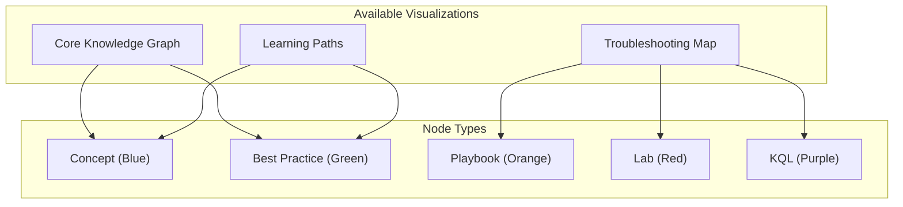

# Visualization

Explore the Azure App Service Practical Guide through interactive knowledge graphs and visual maps.

<!-- diagram-id: visualization-index-diagram-1 -->


## Why Visual Navigation?

Traditional documentation navigation relies on hierarchical menus and search. Visual graphs offer:

- **Relationship Discovery**: See how concepts connect to playbooks, labs, and KQL queries
- **Learning Path Clarity**: Understand prerequisites and progression at a glance
- **Troubleshooting Context**: Navigate from symptoms to solutions through evidence chains

## Available Visualizations

<div class="grid cards" markdown>

-   :material-graph-outline:{ .lg .middle } __Core Knowledge Graph__

    ---

    A fixed snapshot of the documents in the core graph data file, not the whole guide. See the graph page for its destination list and data-file change date.

    [:octicons-arrow-right-24: Explore the Knowledge Graph](core-knowledge-graph.md)

-   :material-sitemap:{ .lg .middle } __Troubleshooting Map__

    ---

    A fixed snapshot of troubleshooting and navigation documents. See the map page for its destination list and data-file change date.

    [:octicons-arrow-right-24: Open Troubleshooting Map](troubleshooting-map.md)

-   :material-road-variant:{ .lg .middle } __Learning Paths__

    ---

    Visual learning progressions for Python, Node.js, Java, and .NET development on App Service.

    [:octicons-arrow-right-24: View Learning Paths](learning-paths.md)

</div>

## Graph Legend

Understanding the node types and edge relationships used across all visualizations:

### Node Types

| Type | Color | Description |
|------|-------|-------------|
| `concept` | Blue | Platform concepts and architecture (How App Service Works, Request Lifecycle) |
| `best_practice` | Green | Operational guidance (Production Baseline, Security Best Practices) |
| `playbook` | Orange | Troubleshooting procedures (Intermittent 5xx, Memory Pressure) |
| `lab` | Red | Hands-on reproducible experiments |
| `kql` | Purple | KQL query patterns for diagnostics |
| `map` | Teal | Decision trees, evidence maps, mental models |
| `reference` | Gray | CLI cheatsheets, platform limits |

### Edge Types

| Relationship | Meaning |
|-------------|---------|
| `prerequisite` | Must understand A before B |
| `related` | Conceptually connected |
| `used_in` | A is used within B |
| `deep_dive_for` | A provides detailed coverage of B |
| `troubleshooting_for` | Playbook addresses issues in concept |
| `validated_by_lab` | Playbook hypothesis tested by lab |
| `investigated_with_kql` | Playbook uses this KQL query |

## How Graphs Are Built

The two knowledge graphs use fixed snapshots in `docs/assets/graph/core-knowledge.json` and `docs/assets/graph/troubleshooting-map.json`, not the whole guide. Each graph page lists the documents in its data file and the date of the file's last change. The destination lists are built from the same JSON and need JavaScript.

The generator reads document frontmatter such as this example:

```yaml
---
title: Memory Pressure and Worker Degradation
slug: memory-pressure-and-worker-degradation
doc_type: playbook
section: troubleshooting
topics:
  - performance
  - memory
  - worker
products:
  - azure-app-service
related:
  - intermittent-5xx-under-load
  - slow-response-but-low-cpu
prerequisites:
  - how-app-service-works
  - request-lifecycle
used_in:
  - first-10-minutes-performance
evidence:
  - kql
  - detector
  - lab
---
```

On the current documentation tree, `tools/build_doc_graph.py` stops with an error because documents share a slug and writes no graph files. No repository workflow runs it or compares its output with the committed files. The snapshots are retained without a generated-data freshness check.

## Technical Implementation

The visualizations use [Cytoscape.js](https://js.cytoscape.org/) for interactive 2D graph rendering:

- **Click to Navigate**: Click any node to open the corresponding documentation page
- **Search/Filter**: Use the search box to highlight matching nodes
- **Zoom/Pan**: Off by default so the page scrolls normally; turn on **Graph gestures** in the controls above each graph to zoom with the mouse wheel or a pinch and to pan by dragging the background
- **Layout**: Automatic force-directed layout with manual adjustment support

## Contributing to Visualizations

Adding a document or changing its frontmatter does not update either snapshot. Graph coverage changes need an explicit change to the corresponding data file; they are not part of the site build.

Keep document metadata consistent with the [Taxonomy](../meta/taxonomy.md). Frontmatter relationships are inputs the generator reads, not a promise that a document appears in these snapshots.

## See Also

- [Guide home](../index.md)
- [Start here](../start-here/overview.md)

## Sources

- [Microsoft Learn source 1](https://learn.microsoft.com/en-us/azure/app-service/overview)
- [Microsoft Learn source 2](https://learn.microsoft.com/en-us/azure/app-service/environment/overview)
